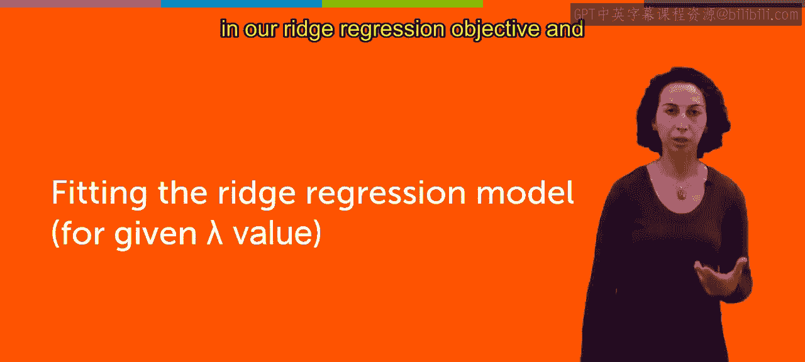
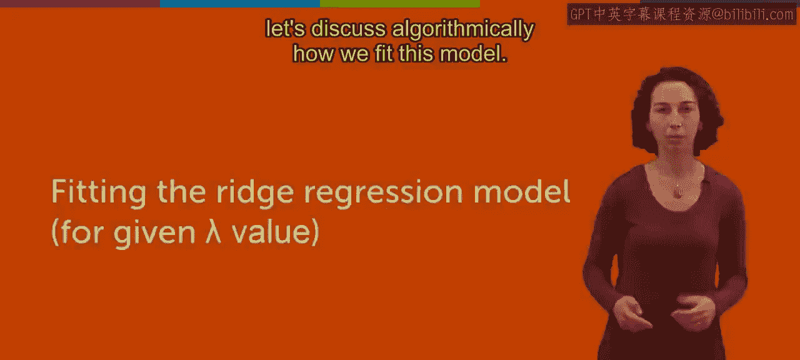
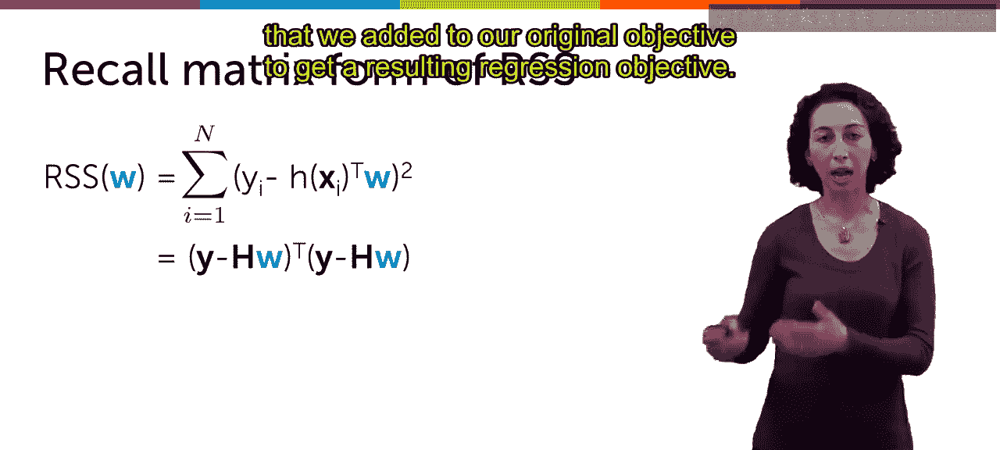
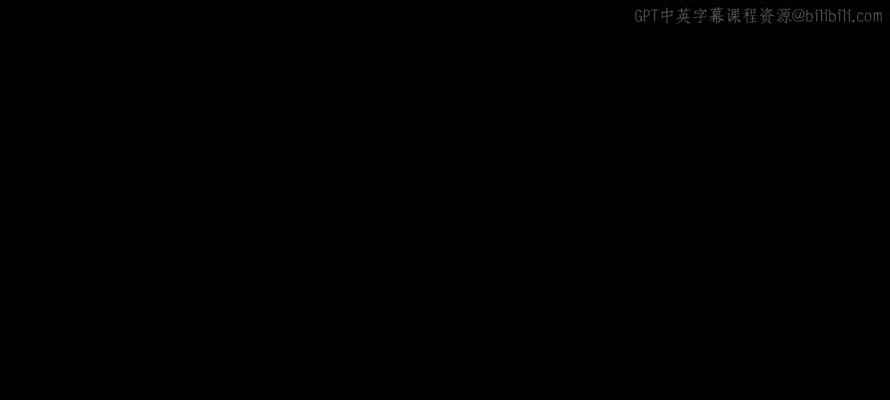
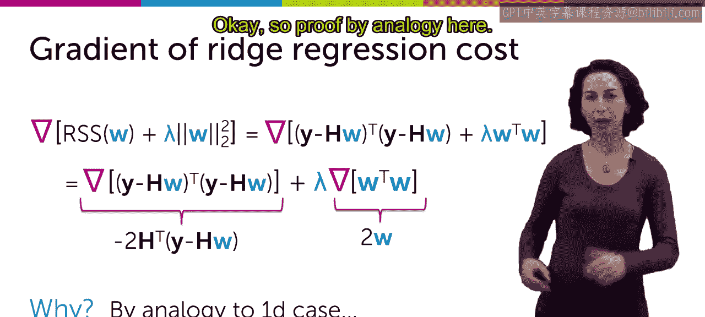

# 华盛顿大学《机器学习（回归，第2课⧸共4课）｜Machine Learning》中英字幕 p71 71_计算岭回归目标的梯度.zh_en -BV11b421H7XL_p71-

。

For now， let's assume that somebody gives you the lambda value that we want to use in our Rige regression objective。

 and let's discuss algorithmically how we fit this model。

So in particular， in this part， we're describing this gray box， our machine learning algorithm。

And to start with， just like we've done many times before。

 we're first going to rewrite our objective in matrix notation where we assume we have some n observations and we want to write jointly what the objective is for all N of these observations。

So let's just recall what we did for our residual sum of squares term。Where for our model。

 we thought about stacking up all N observations。And all the features associated with those n observations in this big green matrix。

 and that matrix got multiplied by a vector of our regression coefficients。

 and then we had this additive noise per observation。

 so we wrote this matrix notation as y equals HW plus epsilon。

Then when we went to form our residual sum of squares。

 we showed that it was equivalent to the following where we have y minus HW transpose times y minus HW。

Okay， so this is our matrix notation for our residual summa squares term。

 but now we want to do a similar term for our model complexity penalty that we added to our original objective to get our resulting Ri regression objective。

So in particular， we want to write this two norm of W squared in vector notation。

 so this two norm of our W vector squared， we said was equal to W0 squared plus w1 squared plus w2 squared plus all the way up to our depth feature squared。

And this is equivalent to you。Takeaking our W vector。Transpose， meaning putting it as a row。

And multiplying by the W vector itself。Because if we think about doing this multiplication。

 we're going to get w0 times w0 plus w1 times w1 plus w2 times w2， etc cetera。

 and that's exactly equivalent and so we can write this as W。So I'm trying to write a thick vector。

 W vector， W transpose W。Okay， so this is our vector notation for this model complexity term。

So putting it all together， our Rige regression total cost for some n observations can be written in as follows where we have y minus hw transpose times y minus Hw plus lambda times W transpose W。

Okay， now that we have this， we can start doing what we've done in the past。

 which is take the gradient and we can think about either setting the gradient to zero to get a closed form solution or doing our gradient descent algorithm。

 and we're going to walk through both of these approaches now。

So the first step is computing the gradient of this objective。

So here I'm just writing exactly what we had on the previous slide。

 but now with these gradient signs in front， and as we've seen before。

 the gradient distributes across a sum， so we have the gradient of this first term plus the gradient of our model complexity term where the first term is our measure of fit that residual summa squares term。

And we know that the gradient of the residual sum of squares has the following form minus 2。

 h transpose y minus Hw。But a question is， what's the gradient of this model complexity term？

And what we see is that the gradient of this is two times W and why is it two times W Well instead of deriving it。

 I'll leave that for a little mini challenge for you guys it's fairly straightforward to derive just taking partials with respect to each W component just write W transpose w as w0 squared plus w1 squared plus blah。

 blah， blah， all the way up to wd squared and then take a derivative just with respect to one of the Ws but for now what I'm going to do is I'm just going to draw analogy to the 1D case where w transpose w is analogous to just w squared if w weren't a vector and we're instead just a scalar and what's the derivative of w squared it's2 w okay so proof by analogy here。

