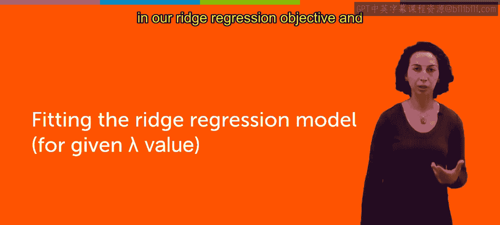
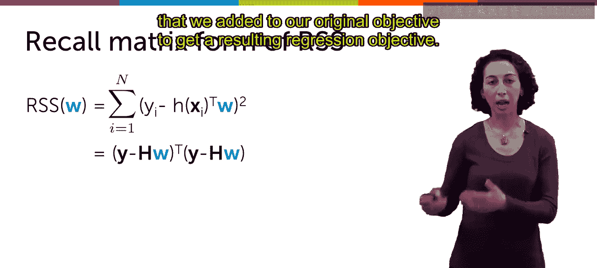
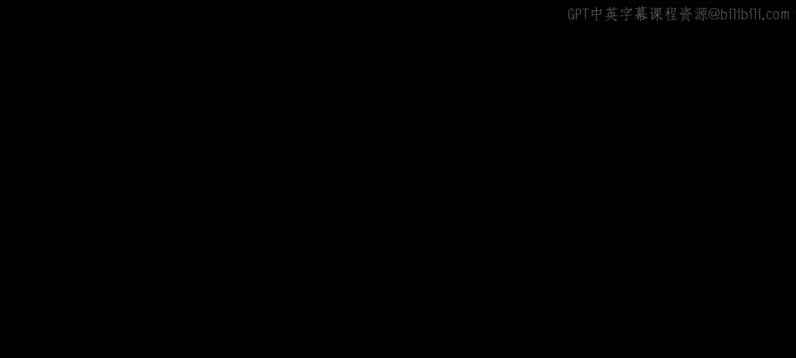
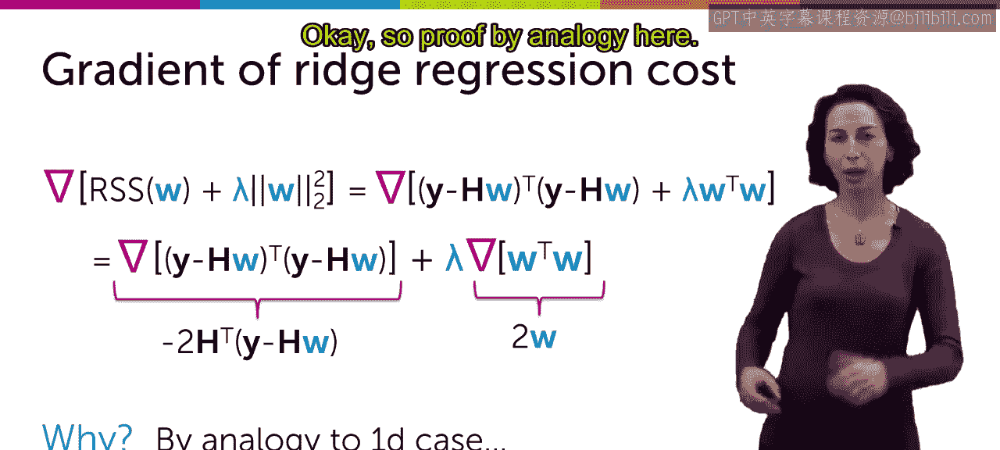

# 机器学习：第2课：计算岭回归目标的梯度 🧮

在本节课中，我们将学习如何计算岭回归目标的梯度。岭回归通过在普通最小二乘法的目标函数中添加一个模型复杂度惩罚项（L2正则化）来防止过拟合。我们将首先回顾如何用矩阵形式表示岭回归的目标函数，然后详细推导其梯度，为后续寻找最优解（无论是通过闭式解还是梯度下降法）奠定基础。

上一节我们介绍了岭回归的目标函数，它由残差平方和与模型复杂度惩罚项两部分组成。本节中，我们来看看如何将这个目标函数用矩阵形式表示，并计算其梯度。

## 用矩阵形式表示目标函数

首先，我们假设已经给定了一个用于岭回归的正则化参数 λ 值。我们的目标是讨论如何从算法上拟合这个模型。

与之前多次操作类似，我们首先将目标函数用矩阵符号重写。假设我们有 N 个观测值，我们希望为所有 N 个观测值联合写出目标函数。

以下是残差平方和项的矩阵表示回顾。对于我们的模型，我们将所有 N 个观测值及其特征堆叠在一个大的绿色矩阵 **H** 中。该矩阵乘以我们的回归系数向量 **w**，然后加上每个观测值的加性噪声 **ε**。因此，我们将其矩阵形式写为：
**y = Hw + ε**

当我们构建残差平方和时，我们证明了它等价于以下形式：
**(y - Hw)^T (y - Hw)**

这就是我们残差平方和项的矩阵表示。

现在，我们需要为添加到原始目标函数中以得到岭回归目标的模型复杂度惩罚项，构建一个类似的矩阵表示。

## 模型复杂度惩罚项的矩阵表示

具体来说，我们希望用向量符号表示 **||w||₂²**（即 w 的 L2 范数的平方）。我们说过，向量 **w** 的 L2 范数平方等于 w₀² + w₁² + w₂² + ... + w_d²。

这等价于取我们的 **w** 向量，将其转置（即写成行向量），然后乘以 **w** 向量本身。因为如果我们考虑进行这个乘法运算，我们将得到 w₀ × w₀ + w₁ × w₁ + w₂ × w₂，等等，这完全等价。因此，我们可以将其写为：
**w^T w**

这就是我们模型复杂度项的向量表示。

## 完整的岭回归目标函数

将两部分结合起来，对于 N 个观测值，岭回归的总成本可以写成如下形式：
**J(w) = (y - Hw)^T (y - Hw) + λ w^T w**

现在，我们有了这个目标函数，就可以像过去一样开始操作：计算梯度。我们可以考虑将梯度设为零以获得闭式解，或者执行梯度下降算法。接下来我们将逐步讲解这两种方法。

第一步是计算这个目标函数的梯度。

## 计算梯度

这里，我直接写出了上一张幻灯片的内容，但现在前面加上了梯度符号。正如我们之前所见，梯度在求和上是可分配的。因此，我们有第一项的梯度加上模型复杂度项的梯度。第一项是我们的拟合度量，即残差平方和项。

我们知道残差平方和的梯度具有以下形式：
**∇[ (y - Hw)^T (y - Hw) ] = -2 H^T (y - Hw)**

但问题是，这个模型复杂度项的梯度是什么？

我们看到，这个模型复杂度项的梯度是 **2w**。为什么是 **2w** 呢？与其在这里推导，我将其留作一个小的挑战。通过分别对每个 w 分量求偏导来推导是相当简单的：只需将 **w^T w** 写成 w₀² + w₁² + ... + w_d²，然后对其中一个 w 求导。

现在，我要做的是类比一维情况。如果 **w** 不是向量而是一个标量，那么 **w^T w** 就类似于 **w²**。而 **w²** 的导数是什么？是 **2w**。所以，这里是通过类比来证明。

因此，模型复杂度惩罚项 **λ w^T w** 的梯度是 **2λw**。

## 完整的梯度表达式

将两部分结合起来，岭回归目标函数 **J(w)** 的完整梯度为：
**∇J(w) = -2 H^T (y - Hw) + 2λw**

我们可以将其重写为：
**∇J(w) = -2 H^T (y - Hw) + 2λw**

这个表达式为我们提供了目标函数在任意点 **w** 的下降方向。在下一部分，我们可以将其设为零来求解最优的 **w**（闭式解），或者将其代入梯度下降的迭代更新公式中。

本节课中我们一起学习了如何用矩阵形式表示岭回归的目标函数，并详细推导了其梯度。我们回顾了残差平方和的矩阵表示，引入了模型复杂度惩罚项 **λ w^T w** 的向量表示，并通过类比一维情况，得出了其梯度为 **2λw**。最终，我们得到了完整的岭回归梯度表达式 **∇J(w) = -2 H^T (y - Hw) + 2λw**，这是后续进行模型优化的关键一步。