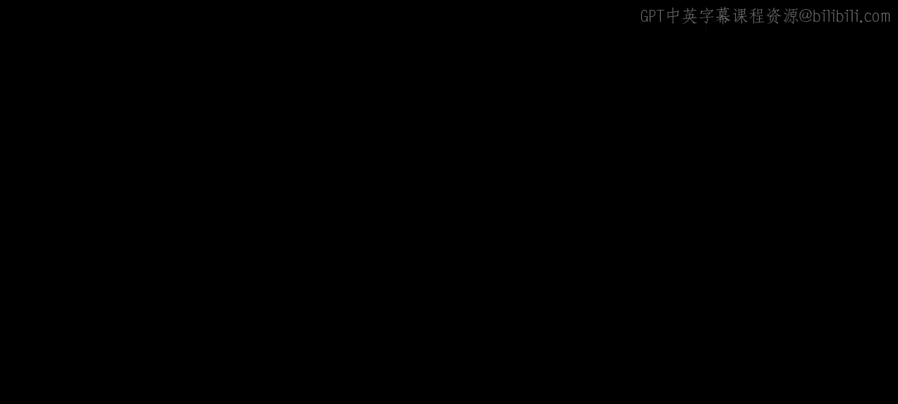
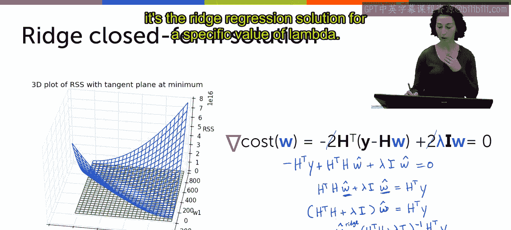

# 华盛顿大学《机器学习（回归，第2课⧸共4课）｜Machine Learning》中英字幕 p72 72_方法1：闭式解.zh_en -BV11b421H7XL_p72-

。

Okay， so our first approach is just going to be to set our gradient equal to zero and solve for W。

But before we get there， let's just do a little linear algebra review of what identity matrices are。

 so the identity matrix is just the matrix analog of the number one and it can be defined in any dimension so here we show just a scalar here we show a two by two matrix and what we see the identity matrixes it just places ones along the diagonal and zeros on the off diagonal and that's true in any dimension up to having an n by n matrix we have n ones on the diagonal in every other term and the matrix is zero。

So let's discuss a few fun facts about the identity matrix。

 well if you take the identity matrix and you multiply by a vector V。

And let's say that this identity matrix is some n by n matrix and this vector is an n by one matrix。

 you're just going to get the vector V back。On the other hand。

 if you multiply this identity matrix by another matrix a。

 you're just going to get and so the a matrix is some n by M matrix。

 you're just going to get that a matrix back。Then we can talk about a matrix inverse。 In this case。

 we're talking about square matrix， so。A inverse and A are both n by N matrices。

 and so by definition。So let me just write that this was a matrix that we were multiplying by and here by definition。

Of the matrix inverse。If we take a inverse times a。

 then the result is the identity matrix that's just like when we think about dividing scalar so this this inverse is like the matrix equivalent of division。

 so if you think of dividing a scalar a by a you get the number one and so this is the matrix analog of that。

And then likewise， again， for some end by N matrices。If you multiply a by a inverse。

 you also get the identity and you can actually use the last few facts to prove this。

 you can simply think about post multiplying both sides by a and we have a inverse a。

 which we know to be the identity matrix， and then we have a times the identity matrix。

 and actually I should say both of these results， whether you have V times。Sorry， sorry。

 I should just say it in the matrix case。A times the identity。You likewise get out a。

 so here we end up with a equals， you have identity times a， a equals a。

 which is a proof that this holds here， okay。These are just some fun facts about the identity matrix as well as inverses that are going to be useful in this module and probably in other modules we have later on as well。

And what we're going to do now now that we understand this identity matrix is simply rewrite the total cost that we had or sorry the gradient of the total cost。

With this identity matrix， so this is exactly the same all we've done。Ass we've replaced。W。

 this w vector by the identity times W。So， these are。Equivalent。

But this is going to be helpful in our next derivation。Okay。

 so now we can take this equivalent form of the gradient of our total cost and set it equal to zero。

So the first thing we can do is just divide both sides by two to get rid of those twos。

 and then when we multiply out we get minus h transpose y minus H transpose HW。Plus。

 lambmbda identity W equals0 and when we're setting this equal to0。

 I'm going to put the hat on the W because that's what we're solving for。So then I can bring- sorry。

 there should be a plus sign here， didn't do that right？So then I can bring this to the other side。

 I get H transpose HW hat plus lambda identity W hat equals H transpose Y。

 and then what I see is I have W hat appearing in both of these terms so I can factor it out。

And I get H transpose H。Plus， lambda times the identity times W hat。

So this is the step where having that identity matrix was useful。

 so I hope it was worth everything on the last slide to get that one little punchline okay。

 so this equals h transpose y and the end result if we use our little inverse lemmas from the previous slide if I premply both sides by h transpose h plus lambda I inverse。

Then I get W hat is equal to。H transpose H plus lambda I。Inverse H transpose y。Okay。

 and in particular， I'm going to call this W hat Rige。

To indicate that it's the Rige regression solution for a specific value of lambmbda。

