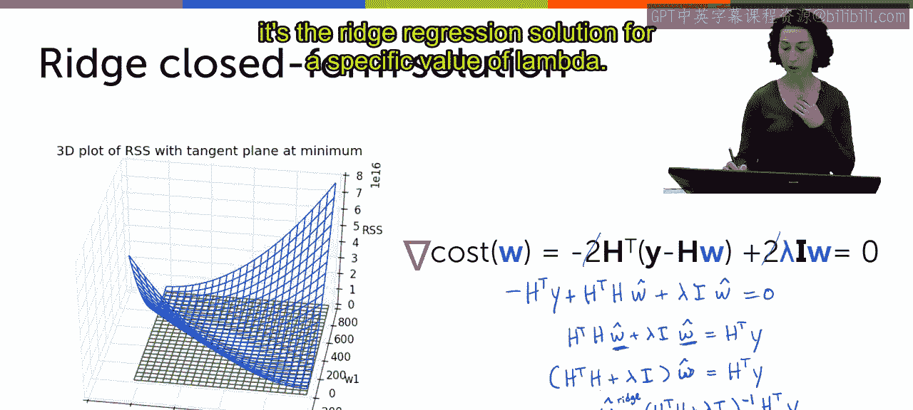

# 机器学习：第2课：方法1：闭式解 🧮

在本节课中，我们将学习求解岭回归问题的第一种方法：闭式解。我们将通过设置梯度为零并求解权重向量 **W** 来得到解析解。首先，我们需要回顾一些线性代数的基础知识，特别是单位矩阵和矩阵逆的概念。

## 线性代数回顾：单位矩阵与矩阵逆

上一节我们介绍了岭回归的目标函数。在推导其闭式解之前，让我们先回顾一些关键的线性代数概念。

单位矩阵是数字“1”的矩阵类比。它可以定义在任何维度上。对于一个标量，单位就是1。对于一个矩阵，单位矩阵是一个方阵，其主对角线上的元素均为1，其余元素均为0。

以下是一些关于单位矩阵和矩阵逆的重要性质：

*   **性质1**：任何向量 **V** 乘以与其维度匹配的单位矩阵 **I**，结果仍是该向量本身。
    *   公式： **I * V = V**
*   **性质2**：任何矩阵 **A** 乘以与其行数匹配的单位矩阵 **I**，结果仍是该矩阵本身。
    *   公式： **I * A = A**
*   **性质3**：矩阵 **A** 的逆矩阵 **A⁻¹** 满足以下关系（前提是 **A** 是可逆的方阵）。
    *   公式： **A⁻¹ * A = I** 且 **A * A⁻¹ = I**
    *   这类似于标量除法：a * (1/a) = 1。

理解这些性质将帮助我们简化后续的推导过程。

## 推导岭回归的闭式解

现在，我们回到岭回归的目标。我们的目标是找到使总成本函数 **J(W)** 最小的权重 **W**。为此，我们计算其梯度并令其等于零。

首先，我们利用单位矩阵的性质，将梯度表达式中的 **W** 改写为 **I * W**。这种写法是等价的，但能为后续的因式分解提供便利。

梯度表达式为：
∇J(W) = -2Hᵀy + 2HᵀH W + 2λ W

将其中的 **W** 替换为 **I W** 后，我们得到：
∇J(W) = -2Hᵀy + 2HᵀH W + 2λ I W

接下来，我们设置梯度等于零以求解最优的 **Ŵ**：

1.  将等式两边同时除以2以简化：
    -Hᵀy + HᵀH Ŵ + λ I Ŵ = 0
2.  将包含 **Hᵀy** 的项移到等式右边：
    HᵀH Ŵ + λ I Ŵ = Hᵀy
3.  注意到 **Ŵ** 在两个项中都出现，我们可以将其因式分解出来。这正是之前引入单位矩阵 **I** 的关键步骤：
    (HᵀH + λ I) Ŵ = Hᵀy
4.  最后，为了解出 **Ŵ**，我们在等式两边同时左乘矩阵 **(HᵀH + λ I)** 的逆矩阵：
    Ŵ = (HᵀH + λ I)⁻¹ Hᵀy

至此，我们得到了岭回归问题的闭式解。我们将其记为 **Ŵ_Ridge**，以强调它是针对特定正则化参数 **λ** 的岭回归解。

## 总结

本节课中，我们一起学习了求解岭回归问题的第一种方法——闭式解法。我们首先回顾了单位矩阵和矩阵逆的核心线性代数知识。然后，通过设置成本函数梯度为零，并巧妙地利用矩阵运算进行推导，最终得到了权重向量的解析解公式：**Ŵ_Ridge = (HᵀH + λ I)⁻¹ Hᵀy**。这个公式为我们提供了一种直接计算最优参数的方法。