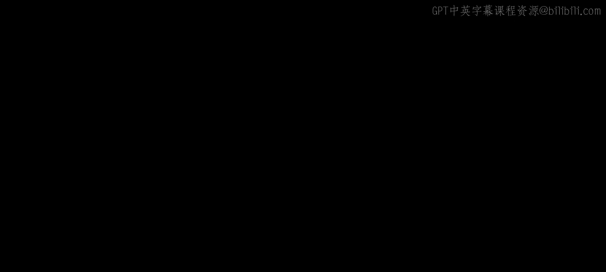
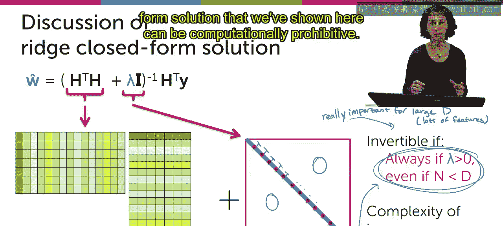

# 华盛顿大学《机器学习（回归，第2课⧸共4课）｜Machine Learning》中英字幕 p73 73_讨论闭式解.zh_en -BV11b421H7XL_p73-

。

Okay， so now let's think a little bit about this solution， so this is our W hat Ridge。

And what happens if I set lambda equal to zero will I get W hat Rige？Is equal to H transpose H。

Inverse。H transpose Y。And that might look very familiar to you。

 that was exactly equal to our W hat least squares， our old solution。

Before we introduce this notion of Ri regression。And what if I set lambda all the way to infinity？

Well， then I get W hat Ridge。Equals zero。Because。It's like dividing by infinity。

When we have this infinity appearing in this inverse。

 remember the inverse was like our matrix analog of division。

 so that's the intuition for why W hat Rige is exactly equal to zero。Okay。

 so this is a little sanity check that when lambda is equal to zero， this solution。

 this closeform solution we have is exactly equal to our least square solution。

 that's what we had discussed at the very beginning of this module and likewise when we crank Lambda all the way up to infinity。

 our solution is equal to zero。But now what we have is we have a closed form for what the solution is for some lambda in between zero and infinity。

Let's also recall the discussion we had about our previous solution， W Ha Lee squares。

 where we said this H transpose H。Looks something or looks exactly like the following where this is our little cartoon of our H matrix。

 where the number for H transpose that let me actually write it here， it'll be clear the number。

Of rows is equivalent to the number of observations。That's n and the number of columns。

Is equal to the number of features。Which we denote as D。And what we said， not last module。

 but the module before that， we said H transpose H。

 the multiplication of these two matrices is invertible。In general。

 if the number of observations is greater than the number of features。

 but really it's the number of linearly independent observations being greater than the number of features。

 and we said the complexity of this inverse is cubic in the number of features D。

Well now let's think about similar properties， but of our Rige regression solution。

Where this h transpose H is exactly like we had it before， but now before we take our inverse。

 we're adding lambda times the identity matrix， and when you take a scalar and multiply by the identity matrix。

 you just get that value along the diagonal。So we get a whole bunch of lambdas along the diagonal and zero everywhere else in this matrix。

嗯。So what ends up happening now is the result h transpose h plus lambda times identity is invertible always when lambda is greater than zero。

 even if the number of observations or number of linearly independent observations is less than the number of features。

 so this is really important。When you have lots of features。So for large D。I choose lots。

I have features。And remember that's how we motivated using Ri regression we're in these really complicated models where you have lots and lots of features。

 a lot of flexibility and the potential to overfit now we see something very explicit about how it helps us and。

Just to return to the discussion on the naming。A Rige regression being called a regularization technique。

 if you remember， I said that we're regularizing our standardly square solution。Well。

 we can see that here because lambda times the identity。Is making。

H transpose H plus lambda identity more。Regular。That's what's allowing us to do this inverse。

 even in this other situation， this harder situation， and because this result is more regular。

 we call itreized。Okay， but the complexity of the inverse is still cubic in the number of features we have。

 and often when we're thinking about Ri regression， like I said。

 we're thinking about cases where you have lots and lots of features。

 so doing this closed form solution。That we've shown here can be computationally prohibitive。

