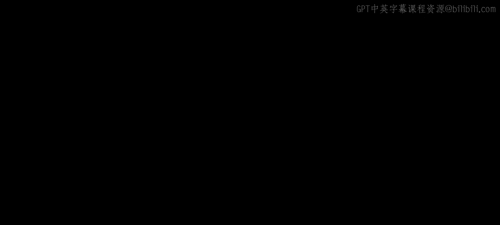
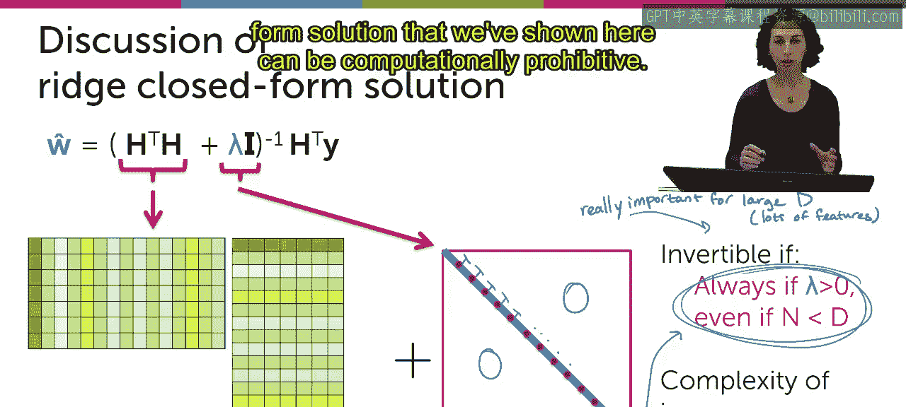

# 机器学习：回归：第2课：岭回归的闭式解讨论 🧮



在本节课中，我们将深入探讨岭回归的闭式解。我们将分析其数学形式，理解正则化参数 `λ` 如何影响解，并将其与普通最小二乘法的解进行比较。我们还将讨论该解的计算特性及其在特征数量众多时的意义。

---

上一节我们介绍了岭回归的目标函数。本节中，我们来看看其闭式解 `W_hat_Ridge` 的具体形式及其性质。

`W_hat_Ridge` 的闭式解由以下公式给出：
```
W_hat_Ridge = (H^T * H + λ * I)^(-1) * H^T * Y
```
其中，`H` 是设计矩阵，`Y` 是目标值向量，`λ` 是正则化参数，`I` 是单位矩阵。

---

### 正则化参数 `λ` 的影响

现在，我们来探讨正则化参数 `λ` 取不同值时解的变化。

以下是两种极端情况的分析：

*   **当 `λ = 0` 时**：公式简化为 `(H^T * H)^(-1) * H^T * Y`。这正是我们熟悉的**普通最小二乘法（OLS）** 的解 `W_hat_least_squares`。这验证了岭回归是普通最小二乘法的一个推广。
*   **当 `λ → ∞` 时**：公式中的 `(H^T * H + λ * I)^(-1)` 项趋近于零矩阵，因为相当于除以无穷大（矩阵求逆是除法概念的类比）。因此，解 `W_hat_Ridge` 趋近于**零向量**。这意味着极强的正则化会迫使所有权重收缩至零。

通过这个闭式解，我们现在可以精确地计算 `λ` 在 `0` 到 `∞` 之间任意值时的解。

---

### 与最小二乘解的比较

让我们回顾一下之前关于最小二乘解 `W_hat_least_squares` 的讨论。

`H^T * H` 矩阵的可逆性通常要求**观测数量 `n`** 大于**特征数量 `d`**（更准确地说，是线性无关的观测数量大于特征数量）。其求逆的计算复杂度是 `O(d^3)`，即与特征数量的立方成正比。

现在，考虑岭回归的解 `W_hat_Ridge`。其核心矩阵变为 `H^T * H + λ * I`。

当 `λ > 0` 时，即使观测数量少于特征数量（`n < d`），这个新矩阵也**总是可逆的**。这一点至关重要。

---

### 正则化的作用与计算考量

这引出了岭回归被称为**正则化技术**的原因。添加 `λ * I` 项使得 `H^T * H` 矩阵变得更“规则”（更稳定），从而保证了在各种情况下（包括特征很多的情况）都能求逆。正是这种“规则化”效应，使其得名“岭”回归。

然而，尽管保证了可逆性，求逆的**计算复杂度仍然是 `O(d^3)`**。在岭回归的典型应用场景中，我们往往处理具有大量特征（`d` 很大）的复杂模型。因此，直接计算这个闭式解在计算上可能非常昂贵，甚至不可行。

---



本节课中，我们一起学习了岭回归的闭式解。我们看到了正则化参数 `λ` 如何平滑地在最小二乘解和零解之间进行插值，并理解了 `λ > 0` 如何确保解始终存在，即使特征多于样本。最后，我们指出了直接计算闭式解在高维情况下的计算挑战，这为后续介绍更高效的优化方法（如梯度下降）做了铺垫。