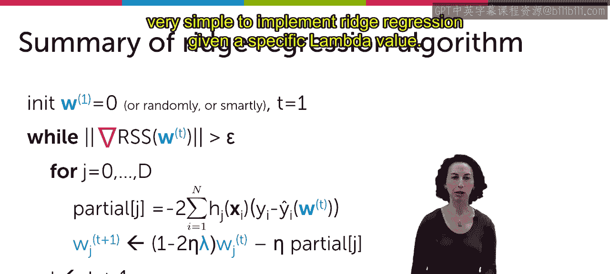

# 华盛顿大学《机器学习（回归，第2课⧸共4课）｜Machine Learning》中英字幕 p74 74_方法2：梯度下降.zh_en -BV11b421H7XL_p74-

。

So instead of this closed form solution that can be computationally prohibitive。

 we can think about using our gradient descent algorithm to solve rich regression。

And let's just talk about the element wise update that we have so it's the update to the J feature weight and remember here I'm showing the gradient of our total cost just as a reminder。

And。What we do is we take our previous weight for the Jth feature and we subtract Eta， our step size。

 times whatever this gradient update dictates to form our new weight and what does this gradient tell us well this first term here on this line？

Is exactly what we had before from our residual sum squares term so this is。Same as before。

This comes from。Our residuals on the squares term。But now， in addition to this。

 we have another term appearing。 we have this term， so this is our new term。That comes from。The ja。

Component。Of2 lambda W， this W vector。Okay。So one thing we see is we see we have a WJT appearing in two places。

 so we can combine these and simplify the form of this expression to get a little bit more interpretability。

So what we see is that。Our update first takes WJT and multiplies by 1 minus2 times our step size times our tuning parameter。

So times Eta and lambda， and here we know that Eta is greater than zero。

And we know that lambda is greater than or equal to zero。

And so the result is two times8ta times lambda is going to be greater than zero。

 so when we have one minus。A positive number， we know that this is going to be。

This thing here is going to be less than or equal to one。

But the other thing we want is we want the result of。Of this to be positive。 So to enforce that。

 we're going to say that。Two Ada lambmbda。Has to be less than one。Okay。

 so it's a positive quantity that is less than one。Okay。

 so what we're doing is we're taking our previous coefficient and we're multiplying by some number that's less than one。

 a positive number less than one， so what that's doing is it's just shrinking the value by some amount。

 it's some fraction。And then we have this update here， which is the same。

Update that we had just from our residual summit squares as before。

 so I'll just call this our update term。From。Residual sum of squares。

And so let's draw a picture of what's happening here。

And what I'm going to do is I'm going to draw a picture that's a function of。Iterations。

Going this way。And。Magnitude of the coefficients。Along the Y axis。But this is just a little cartoon。

We're going to say that at some iteration T。We have a coefficient WJT。

And what we're doing in Rige regression is we're introducing this intermediate step。Where。

Here we first shrink the value of the coefficient。According to 1 minus2 eta lambda。

 so this is1 minus2 eta lambda times Wjt。And so just to be very clear， this isn't。Intermediate。Step。

Introduced。And。The Ri regression。So this is some iteration T， this is some in between iteration。

 and when we get to iteration。T plus1。What we do is we take whatever this update term is。

 it could be positive， it could be negative and we modify this shrun and coefficient So let's just assume for this illustration that it's positive。

 some positive value。嗯。So I'm going to take the last value of my shrunken coefficient。

 I'm going to draw it here， and then I'm going to add。Some amount。

 but let's see I want to add an amount that makes it。

 let's say a little bit less than what my coefficient was before。So。Sorry。

 my pen is acting crazy here。So I'm going to add this is my little update term。From RSS。

And this will give me。WJ at iteration T+1。And let's contrast with what our old standard least squares algorithm did so previously。

In red。Um。Just RSS， which was our least square solution， we had WJT， so we started at the same point。

But instead of shrinking the coefficient with this intermediate step。

 we just took this little update term from residual sum squares and modified this coefficient。

 So I'm going to try and map over to time。To iteration T plus one and then add this same amount。

 the same update term。 So again， this is the。Same。Update term。That I'm adding to WJT。

 that this is going to give me。My W JT plus1。According to the Lee squares algorithm。Okay。

 so just to be clear， what's going on here in case this picture was not helpful to you is in the Rige regression case。

 we're taking our previous value of our coefficient。

 our Jth regression coefficient and the first thing we're doing before we decide whether what our fit term is saying we should do to it is we first shrink it at every iteration we first take the last value and we make it smaller and that's where the model complexity term is coming in where we're saying we want smaller coefficients to avoid overfitting。

But then after that， we're going to say， well okay now let's listen to how well my model is fitting the data。

 that's where this update term is coming in and we're going to modify our shrun and coefficient and in contrast。

 our old solution never did that shrinking first， it just said okay let's just listen to the fit and listen to the fit and listen to the fit at every iteration and that's where we could get into issues of overfitting。

Okay， so here's a summary of our standard least squares gradient descent algorithm。

 This is what we had again two modules ago where we just initialize our our weights factor and while not converge for every feature dimension we're going to go through compute this partial derivative of the residual sum of squares that's that update term I was talking about on the last slide and then I'm going to。

Use that to modify my previous coefficient according to the step size Eda。

 and I'm going to keep iterating until convergence。Okay， so this is what you've coded up before。

 now let's look at what we have to do to modify this code to get our ridge regression variant。

And notice that the only change is in this line for updating WJ where instead of taking WJT and doing this update with this what I'm calling partial here。

We're taking 1 minus28 to lambda at times WJ and doing the update。

 so it's a trivial trivial trivial modification to your code and that's really cool， it's very， very。

 very simple to implement Rige regression given a specific lambmbda value。

