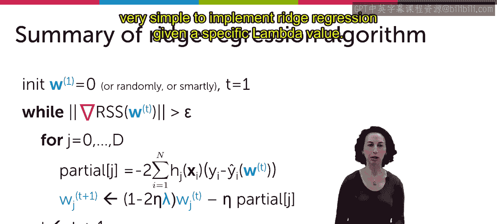

# 机器学习：第2课：方法2：梯度下降


在本节课中，我们将学习如何使用梯度下降算法来求解岭回归问题。我们将看到，相比于可能计算量巨大的闭式解，梯度下降提供了一种更灵活、更易于实现的迭代求解方法，并且只需对标准最小二乘的梯度下降代码进行微小的修改。

---

## 岭回归的梯度下降更新规则

上一节我们介绍了岭回归的目标函数，它由残差平方和与模型复杂度惩罚项组成。本节中，我们来看看如何通过梯度下降来优化这个目标函数。

我们关注对第 `j` 个特征权重 `W_j` 的逐元素更新。总成本函数的梯度（作为提醒）如下所示。

更新规则是：我们取第 `j` 个特征的上一个权重 `W_j^T`，减去学习率 `η`（步长）乘以梯度指示的更新量，从而得到新的权重。

这个梯度由两部分组成：
*   第一部分来自残差平方和项，这与我们之前的标准最小二乘梯度相同。
*   第二部分是新增的项，它来自惩罚项 `λ * ||w||^2` 对 `W_j` 的偏导数，即 `2λW_j`。

我们发现 `W_j^T` 在两个地方出现，因此可以合并并简化这个表达式，使其更具可解释性。

简化后的更新规则表明，更新首先将 `W_j^T` 乘以 `(1 - 2ηλ)`。我们知道 `η > 0` 且 `λ ≥ 0`，因此 `2ηλ` 是一个正数。为了保证 `(1 - 2ηλ)` 是正数（从而起到收缩作用而非反向放大），我们要求 `2ηλ < 1`。

所以，`(1 - 2ηλ)` 是一个介于 0 和 1 之间的正数。这意味着在每次迭代中，我们首先将上一个系数值按这个比例进行**收缩**。

然后，我们再加上来自残差平方和项的更新量（与标准最小二乘相同）。我们可以将此称为 **RSS更新项**。

因此，岭回归的权重更新公式可以清晰地写为：
`W_j^{new} = (1 - 2ηλ) * W_j^{old} + η * [RSS对W_j的梯度]`

---

## 可视化更新过程：收缩与拟合

为了理解这个过程，让我们画一个简图。假设横轴是迭代次数，纵轴是系数 `W_j` 的大小。

在某个迭代 `T`，我们有一个系数值 `W_j^T`。岭回归引入了一个中间步骤：
1.  **收缩步骤**：首先，我们将 `W_j^T` 乘以 `(1 - 2ηλ)`，得到一个收缩后的系数值。这体现了模型复杂度惩罚项的作用：我们希望系数更小以避免过拟合。
2.  **拟合步骤**：然后，我们考虑模型对数据的拟合情况，即加上 RSS 梯度项（可能是正或负）来调整这个收缩后的系数，最终得到 `W_j^{T+1}`。

相比之下，标准最小二乘的梯度下降（红色路径）没有这个收缩步骤。它直接从 `W_j^T` 出发，加上相同的 RSS 更新项，得到 `W_j^{T+1}`。

关键区别在于：岭回归在每次迭代中都“先收缩，再根据数据拟合调整”；而标准最小二乘“只根据数据拟合调整”。正是这个持续的收缩倾向，帮助岭回归控制了系数大小，从而缓解过拟合。

---

## 算法对比与代码实现

以下是标准最小二乘梯度下降算法的伪代码总结：

```python
初始化权重向量 w
while 未收敛：
    for j in 所有特征维度：
        计算残差平方和对 w_j 的偏导数 (grad_rss)
        w_j = w_j - η * grad_rss  # 更新权重
```

现在，我们看看如何修改这段代码来实现岭回归。唯一的改变就在权重更新的那一行。

以下是岭回归梯度下降的伪代码：

```python
初始化权重向量 w
while 未收敛：
    for j in 所有特征维度：
        计算残差平方和对 w_j 的偏导数 (grad_rss)
        w_j = (1 - 2*η*λ) * w_j - η * grad_rss  # 更新权重（注意符号合并）
```

注意，修改非常简单：在应用 RSS 梯度更新之前，先将旧的 `w_j` 乘以收缩因子 `(1 - 2ηλ)`。这是一个微不足道但至关重要的修改，使得给定一个 `λ` 值后，实现岭回归变得非常容易。

---

## 总结

本节课中，我们一起学习了：
1.  **岭回归的梯度下降更新规则**：其核心是在标准最小二乘更新前，增加了一个系数收缩步骤 `(1 - 2ηλ)`。
2.  **更新的直观理解**：收缩步骤对应于模型复杂度惩罚，它持续地将系数向零方向压缩；而 RSS 梯度项则致力于提高数据拟合度。两者在每次迭代中平衡。
3.  **算法实现**：实现岭回归的梯度下降只需对标准最小二乘梯度下降代码进行一行修改，即在更新权重时乘以收缩因子，非常简单。



通过这种方法，我们可以高效地求解岭回归模型，即使在特征维度很高、闭式解计算困难的情况下也是如此。