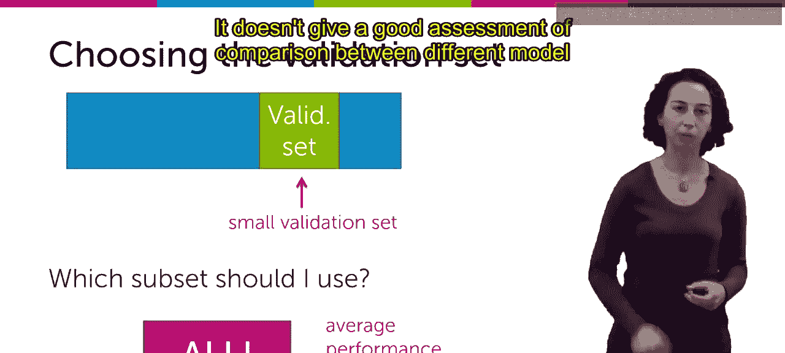

# 华盛顿大学《机器学习（回归，第2课⧸共4课）｜Machine Learning》中英字幕 p75 75_通过交叉验证选择调优参数.zh_en -BV11b421H7XL_p75-

。

Now let's turn to this important question of how to choose the Lambda tuning parameter。

And what we mentioned last module was that if we have some tuning parameter that controls model complexity。

 then we can think of for every value of that tuning parameter。

 we can fit our model on our training data， then we can assess the performance of that fitted model on a validation set and we can tabulate this for all values of Lada that we might consider。

 and choose the specific model complexity according to the error on this validation set and then assess the performance of this selected model on our test set。

嗯。Well， now what we've seen is Rige regression is a special case of an objective where there's a tuning parameter。

 lambda that's controlling model complexity， and we'd like to see how we can select this tuning parameter。

 so of course we can use exactly this procedure that we described last module and that's assuming that we have sufficient data to do this training validation test split。

But now let's ask the question of what if we don't have enough data to reasonably do a divide into these three different sets。

 what can you do and we're going to talk about this in the context of rich regression。

 but again this holds for any tuning parameter lambda that you might have in selecting between different model complexities or any other tuning parameter controlling your model okay。

 so we're assuming that we're starting with a smallish data set。And as always。

 we need to break off some test data set that we're going to hide okay。

 we always need to have some test set that's never touched during training or validation of our model so now we took this smaller data and we have even a smaller data set to do our training and model validation。

So how are we going to do this Well， we want to do this in some way that's a bit smarter than the naive approach of just forming our validation set。

So let's just remember this naive approach where we took whatever data was remaining after we split off our test set and we defined some validation set。

And a question is， in this case。When we have just a small amount of data so necessarily this validation set will just be a small number of observations。

 is this sufficient for comparing between different model complexities and assessing which one is best Well。

 no， clearly the answer is no we're saying that it's just a small set it's not going to be representative of things that we might see or the space of things that we might see out there。

Okay， so what can we do better we're stuck with just this data set。Well。

 did we have to use the last set of tabulated observations as the observations to define this validation set。

 no， I couldn't use the first few observations or next set of observations or any random subset of observations in this data set and a question is which subset of observations should I use as my validation set？

And the answer， and this is the key insight is use。All of the data subsets。

 because if you're doing that， then you can think about averaging your performance across these validation sets and avoid any sensitivity you might have to one specific choice of validation set that might give some strange numbers because it just has a few observations。

 doesn't give a good assessment of comparison between different model complexities。

