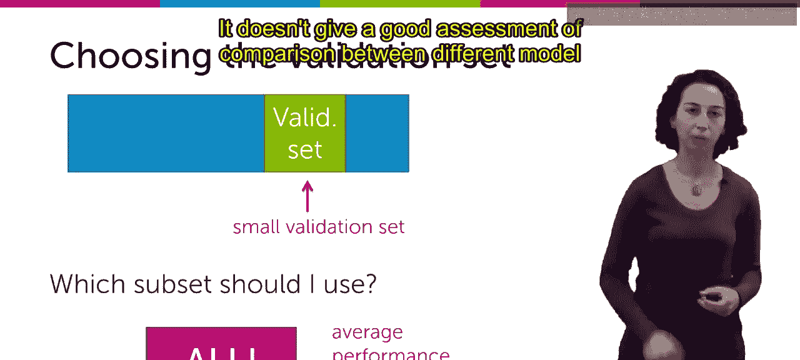

# 机器学习：第2课：通过交叉验证选择调优参数 🎯

在本节课中，我们将学习一个关键问题：当数据量有限时，如何选择岭回归中的调优参数 λ。我们将重点介绍一种比简单的训练-验证-测试集划分更智能的方法——交叉验证。

上一节我们介绍了使用验证集来选择控制模型复杂度的调优参数。本节中，我们来看看当数据量不足以进行有效的三部分划分时，应该怎么办。

## 问题背景：数据量不足的挑战

我们假设从一个较小的数据集开始。与往常一样，我们需要预留一部分数据作为测试集，这部分数据在模型训练和验证过程中绝对不能使用。这样一来，可用于训练和模型验证的数据集就更小了。

那么，我们该如何进行呢？我们需要一种比简单地划分出一个验证集更聪明的方法。

## 简单验证集方法的局限性

让我们回顾一下简单的方法：在划分出测试集后，用剩余的数据定义一个验证集。问题是，当数据总量很小时，这个验证集必然只包含少量观测样本。这足以比较不同模型复杂度并评估哪个最佳吗？答案显然是否定的。一个小的验证集不能很好地代表我们可能遇到的数据分布。

## 更好的解决方案：交叉验证

既然我们只有这些数据，有什么更好的办法吗？我们是否必须用最后一部分观测数据来定义验证集？不，我可以用前几个观测值、下一组观测值或数据集中的任何随机子集。那么，应该使用哪个子集作为我的验证集呢？

关键的见解是：**使用所有数据子集**。因为这样做，你可以考虑在这些验证集上平均你的性能表现，从而避免对某个特定验证集选择的敏感性。一个只包含少量观测值的特定验证集可能会因为偶然性给出奇怪的结果，无法很好地评估不同模型复杂度之间的比较。

以下是交叉验证的核心思想：

1.  **将数据划分为K份**：将训练数据（测试集已预留）随机、均匀地划分为K个部分（或“折”）。
2.  **迭代训练与验证**：进行K次迭代。在每次迭代 `i` 中：
    *   将第 `i` 份数据作为验证集。
    *   使用剩余的 K-1 份数据来训练模型。
    *   在验证集上评估训练好的模型的性能（例如，计算误差）。
3.  **汇总结果**：计算K次验证误差的平均值，作为对特定 λ 值下模型性能的估计。
4.  **选择最佳参数**：对多个候选的 λ 值重复上述过程，选择那个在交叉验证中平均验证误差最小的 λ。
5.  **最终评估**：使用选定的最佳 λ，在整个训练集上重新训练最终模型，并在预留的测试集上进行最终性能评估。

这种方法的核心优势在于，它最大限度地利用了有限的数据进行模型选择和评估，减少了因单次数据划分带来的随机性影响。

## 总结

本节课中，我们一起学习了在数据量有限的情况下，如何通过交叉验证技术来选择岭回归（或其他模型）的调优参数 λ。我们认识到简单划分验证集的局限性，并掌握了交叉验证通过多次划分、训练和验证来更稳健地评估模型性能的基本流程。这是机器学习实践中一项非常重要且实用的技术。