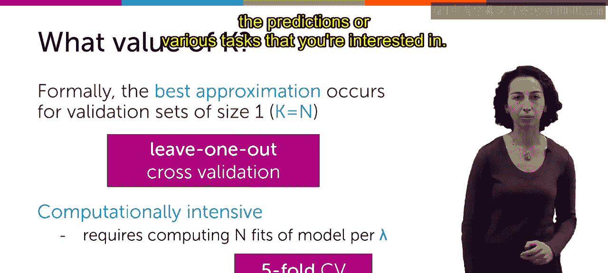

# 华盛顿大学《机器学习（回归，第2课⧸共4课）｜Machine Learning》中英字幕 p76 76_K折交叉验证.zh_en -BV11b421H7XL_p76-

。

So how are we going to do this， how are we going to use all of our data as our validation set We're going to use something called K full cross validation where the first step it's just a preprocessing step where we're going to take our data and divide it into K different blocks and we have n total observations so every block of data is going to have n over K observations and these observations are randomly assigned to each block。

Okay， so this is really key that we're taking our tabulated data and。In this image。

 even though it looks like it might just be parsing out a table of data。

 the data in each one of these blocks is randomly assigned。

 and for all steps of the algorithm that I'm going to describe now。

 we're going to use exactly the same data split， so exactly the same assignments of observations to each one of these different blocks。

Okay， then for each one of these K different blocks。

 we're going to cycle through treating each block as the validation set and using all the remaining observations to fit the model for every value of Lambda so in particular。

We're going to start by saying for a specific value of lambmbda。

And we're going to do a procedure for each of K blocks。

 and then at the end we're going to cycle through all values of lambda， so for right now。

 assume that we're looking at a specific lambda value out of a set of possible values we might look at。

And now we're going to cycle through each one of our blocks where at the first iteration。

 we're going to fit our model using all the remaining data that's going to produce something that I'm calling W hat Lambda。

 So indexed by this lambmbda that we're looking at one so where we're considering the first block as our validation set then we're going to take that fitted model。

 and we're going to assess its performance on this validation set and that's going to。

Result in some error which I'm calling error sub1， meaning the error on the first block of data for this value of lambmbda okay。

 so I'm going to keep track of the error for the value of lambda for each block and then I'm going to do this for every value of lambda okay so I'm going to move on to the next block treat that as my validation set。

Fit the model on all the remaining data， compute the error of that fitted model on the second block of data。

 do this on the third block， fit data on all the remaining data。

 assess the performance on the third block， and cycle through each of my blocks like this。

And at the end， I've tabulated my error across each of these K different blocks for this value of lambda。

And what I'm going to do is I'm going to compute what's called the cross validationation error of lambda。

 which is simply an average of the error that I had on each of the k different blocks。

 so now I explicitly see how my measure of error， my summary of error for the specific value lambmbda。

Uses all of the data， it's an average across the validation sets in each of the different blocks。

Then I'm going to repeat this procedure for every value that I'm considering of lambmbda。

 and I'm going to choose the lambmbda that minimizes this cross validation error。

So I had to divide my data into K different blocks in order to run this K fold cross validation algorithm。

 so a natural question is what value of k should I use？Well。

 you can show that the best approximation to the generalization error of a model is given when you take K to be equal to n and what that means is that every block。

Has just one observation， so this is called leave one out cross validation。

 so although it has the best approximation of what you're trying to estimate。

 it tends to be very computationally intensive because what do we have to do for every value of lambda。

 we have to do n fits of our model， and if n is even reasonably large and if it's complicated to fit our model each time that can be quite intensive。

So instead， what people tend to do is use k equals5 or 10。

 so this is called fivefold or tenfold cross validation。Okay。

 so this summarizes our cross validation algorithm， which is a really。

 really important algorithm for choosing tuning parameters。

And even though we discuss this option of forming a training validation and test set。

 typically you're in a situation where you don't have enough data to form each one of those。

 or at least you don't know if you have enough data to have an accurate approximation of generalization error as well as assessing the difference between different models。

 so typically what people do is crossvalidation， they hold out some test set and then they do either leave one out fivefold tenfold crossvalidation to choose their tuning parameter Lambda。

 and this is a really critical step in the machine learning workflow is choosing these tuning parameters in order to select a model and use that for the predictions or various tasks that you're interested in。

