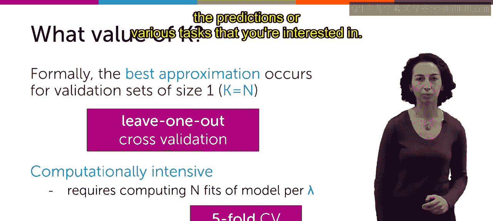

# 机器学习：第2课：K折交叉验证 📊

在本节课中，我们将学习一种非常重要的机器学习技术——K折交叉验证。这种方法能帮助我们更有效地利用有限的数据来评估模型性能，并选择最佳的超参数（例如正则化强度λ）。我们将详细介绍其原理、步骤以及如何选择K值。

---

上一节我们讨论了将数据简单划分为训练集和验证集的方法。然而，这种方法可能无法充分利用所有数据，并且验证集的评估结果可能不稳定。本节中，我们来看看如何通过K折交叉验证来解决这些问题。

K折交叉验证的核心思想是：**将全部数据集循环用作验证集**，从而让每一份数据都参与到模型评估中。以下是其具体步骤。

## 数据预处理：划分K个块

首先，这是一个预处理步骤。我们将总数为 `n` 的观测数据，随机划分为 `K` 个不同的数据块。

*   每个数据块包含 `n/K` 个观测值。
*   关键点在于，**每个数据块中的观测值是随机分配的**。
*   在整个算法过程中，我们将使用完全相同的划分方式，即每个观测值所属的块是固定的。

## 核心算法：循环验证与评估

接下来，对于每一个我们考虑的超参数值（例如λ），我们将执行以下循环过程。为简化说明，我们假设当前正在评估一个特定的λ值。

我们将循环遍历这K个数据块。在每一次循环中，我们将其中一个块视为**验证集**，并使用**所有剩余的数据**来拟合模型。

以下是针对一个特定λ值的详细步骤：

1.  **第一次迭代**：将第一个数据块作为验证集。使用剩余的所有数据拟合模型，得到模型参数 **`W_hat_λ`**。然后，用该模型在第一个验证集上评估性能，计算出一个误差值，记为 **`error_1`**（即针对此λ值，在第一个数据块上的误差）。
2.  **后续迭代**：移动到下一个数据块，将其作为新的验证集。再次使用所有剩余数据拟合模型，并在第二个验证集上计算误差 **`error_2`**。
3.  **循环完成**：重复此过程，直到每个数据块都轮流充当过一次验证集。最终，我们得到了此λ值在K个不同数据块上的K个误差值。

完成对所有K个块的循环后，我们计算此λ值的**交叉验证误差**。它非常简单，就是所有K个块上误差的平均值：

**CV_Error(λ) = (error_1 + error_2 + ... + error_K) / K**

现在可以清楚地看到，我们对特定λ值的误差度量，是通过对所有不同数据块上的验证集误差取平均得到的，从而**利用了全部数据**的信息。

## 选择最佳超参数

上述过程是针对一个λ值进行的。我们需要对考虑的所有λ值重复这一整个流程。

最终，我们选择那个能够**最小化交叉验证误差**的λ值作为最佳超参数。

## 如何选择K值？🤔

在运行K折交叉验证算法时，一个自然的问题是：K应该取多少？

理论上，当取 **K = n**（即数据总量）时，对模型泛化误差的近似是最好的。这意味着每个数据块只包含一个观测值，这种方法称为**留一法交叉验证**。

*   **优点**：能提供对泛化误差的最佳估计。
*   **缺点**：计算量非常大。因为对于每个λ值，我们都需要进行n次模型拟合。当n较大或模型本身拟合较复杂时，这会非常耗时。

因此，实践中人们通常使用 **K = 5** 或 **K = 10**，即**五折**或**十折交叉验证**。这在计算效率和估计准确性之间取得了良好的平衡。

---

本节课中我们一起学习了K折交叉验证算法。这是一个用于选择模型超参数（如正则化参数λ）的极其重要的算法。

尽管我们之前讨论了划分训练集、验证集和测试集的方法，但通常我们面临的情况是数据不足以进行如此清晰的划分，或者不确定划分后是否能准确估计泛化误差。因此，标准的做法是：保留一部分数据作为最终的测试集，然后使用留一法、五折或十折交叉验证等方法在剩余数据上选择超参数λ。

**选择这些超参数以筛选出最佳模型，是机器学习工作流程中至关重要的一步**，它直接关系到模型最终用于预测或完成各项任务的性能。