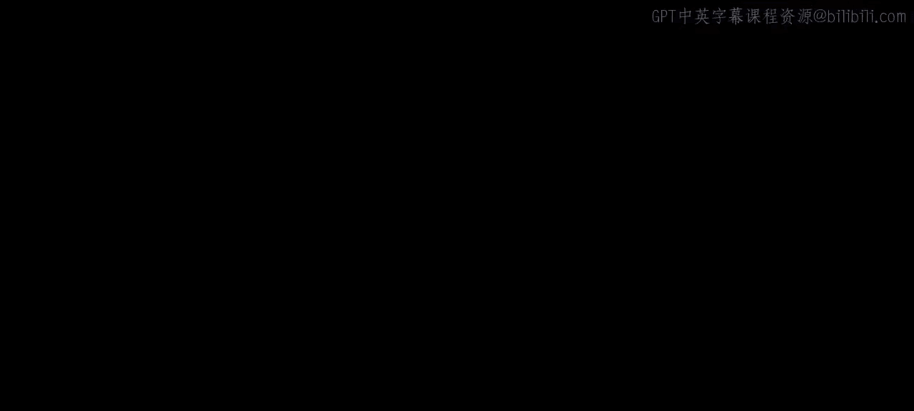
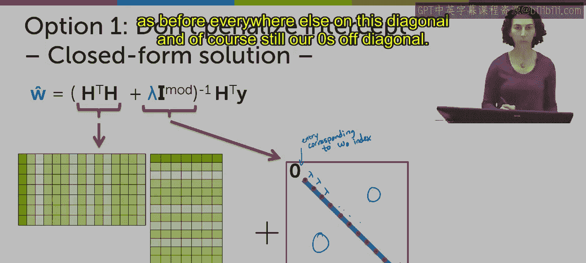
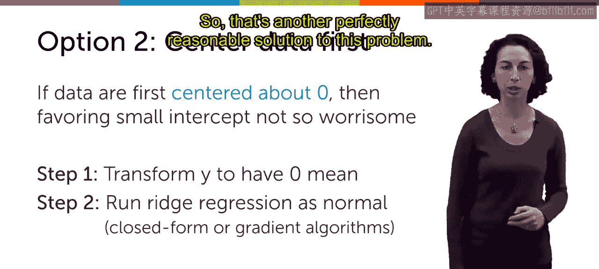

# 华盛顿大学《机器学习（回归，第2课⧸共4课）｜Machine Learning》中英字幕 p77 77_如何处理截距.zh_en -BV11b421H7XL_p77-

。

Well we discussed Rige regression and cross validation。

 but we kind of brushed onto the rug what can be a fairly important issue when we discussed our Rige regression objective。

 which is how to deal with the intercept term that's commonly included in most models。

So in particular， let's recall our multiple regression model。

 which is shown here and so far we've just treated generically that there's some H0 of x。

 that's our first feature with coefficient W0， but as we mentioned two modules ago。

 typically that first feature is treated to be what's called the constant feature so that W0 just represents the intercept of the model so if you're thinking of some hyperplan issueses。

 wheres it's sitting along that y axis。And then all the other features are some arbitrary set of other terms that you might be interested in。

Okay， well。If we have this constant feature in our model。

 then the model that I wrote on the previous slide simplifies to the following where in this case。

 when we think of our matrix notation for having n different observations。

 when we're forming our H matrix，The first column of that matrix。

 that's the coefficient for the W0 term， the W0 coefficient。

 so in this special case that entire first column is filled entirely with ones so that we get W0 all along as the first feature for every observation。

Okay， so this is the specific form that our H matrix is going to take in this case where we have an intercept term in the model。

Now let's return to our standard Rige regression objective that we had where we said we have the residual sum of squares plus lambda times the two norm of our w vector squared。

 where that two norm of that W vector included w0 for the intercept term in the models where that's what it represents。

So a question is。Does this really make sense to do because what this is doing is it's encouraging that intercept term to be small。

 that's what that Rige regression penalty is doing and do we want a small intercept so you know it's useful to think about doing Rige regression when you're adding lots and lots of features but regardless of how many features you add to your model。

Does that really matter in how we're thinking about the magnitude of the intercept？Not really。

 so it probably doesn't make a lot of sense intuitively to think about shrinking the intercept just because we have this very flexible model with lots of other features so let's think about how to address this。

Okay， the first option we have is not to penalize the intercept term and the way we can do that is to separate out that W0 coefficient from all the other Ws。

 W1， W2， all the way up to WD， when we're thinking about that penalty term。

 so we have residual sum of squares of W0 and what I'll call WR， all those other Ws。

 and when we add our Rige regression penalty。The two norm is only taken of that W rest factor。

 all those w's not including our intercept。So a question is how do we implement this in practice。

 how is this going to modify the closed form solution or the gradient descent algorithm that we showed previously when we weren't handling this specific case？

So the very simple modification we can make is simply defining something that I'm calling i mod。

 it's a modified identity matrix that has a0 in the first entry and so in the11 entry and all the other elements are exactly the same as an identity matrix before so to be explicit our h transpose h term is going to look just as it did before。

 but now this lambda I mod has a0 in the so this is。The entry。Corresponding。To the W0 index。

And then we have lambdas as before， everywhere else on this diagonal， and of course。

 still our zeros off diagonal。

Okay， now let's look at our gradient descent algorithm。And。Here it's going to be very simple。

 we just add in a special case that if we're updating。Our intercept term。

 So if we're looking at that zeroth feature， we're just going to use our old。Lee Squares updatedate。

No shrinkage。To W0。but otherwise。For all other features。We're going to do the Rige update。Okay。

 so we see algorithmically， it's very straightforward to make this modification where we don't want to penalize that intercept term。

But there's another option we have， which is to transform the data， so in particular。

 if we center the data about zero as a pre processing step。

Then it doesn't matter so much that we're shrinking the intercept towards zero and not correcting for that because when we have data centered about zero。

 in general， we tend to believe that the intercept will be pretty small so here what I'm saying is step one first we transform all our y observations to have mean zero and then as a second step we just run exactly the Rige regression we described at the beginning of this module where we don't account for the fact that there's this intercept term at all。

So that's another perfectly reasonable solution to this problem。

🎼。