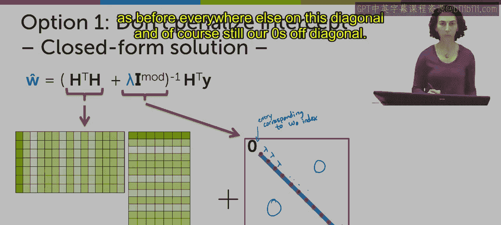
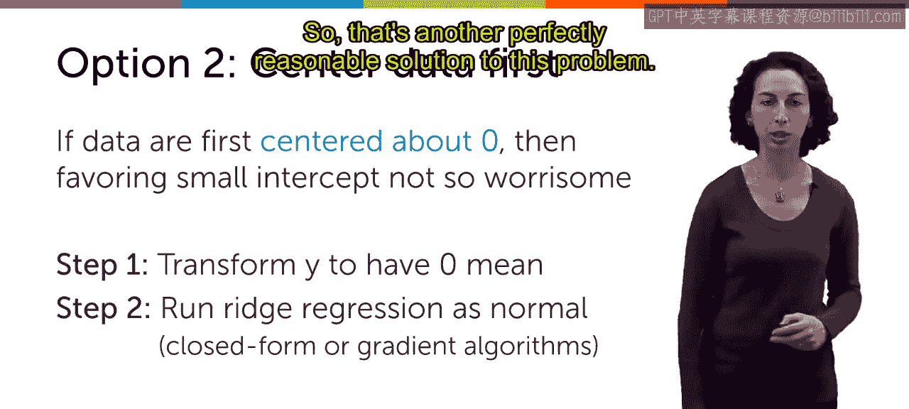

# 机器学习：第2课：如何处理截距


在本节课中，我们将要学习一个在岭回归中容易被忽略但相当重要的问题：如何处理模型中的截距项。我们将探讨为什么在惩罚项中包含截距可能不合理，并介绍两种处理此问题的实用方法。


上一节我们介绍了岭回归和交叉验证，但在讨论岭回归目标函数时，我们暂时搁置了一个重要议题。


## 回顾带截距的模型

首先，让我们回顾一下多元线性回归模型。模型通常表示为：

**公式：** `y = w0 + w1*x1 + w2*x2 + ... + wd*xd`

其中，`w0` 代表模型的**截距**。在特征矩阵 **H** 的表示中，与 `w0` 相乘的第一列特征通常被设置为常数 **1**，以便 `w0` 对每个观测值都起作用。

**代码表示（构造设计矩阵 H）：**
```python
# 假设已有特征矩阵 X (n x d)
import numpy as np
n = X.shape[0]
# 在 X 前添加一列全为1的向量，对应截距 w0
H = np.column_stack([np.ones(n), X])
```

因此，当模型中包含截距项时，我们的设计矩阵 **H** 具有一个特殊的结构。

## 岭回归目标函数中的截距问题

现在，让我们回到标准的岭回归目标函数：

**公式：** `RSS(w) + λ * ||w||₂²`

这里，`||w||₂²` 是权重向量 **w** 的 L2 范数平方，它**包含了截距 `w0`**。这意味着惩罚项也在鼓励 `w0` 变小。

但这里存在一个疑问：无论我们向模型中添加多少特征，我们真的希望截距项也变小吗？直觉上，惩罚截距项可能并不合理，因为截距的大小通常与模型的灵活性无关。

因此，我们需要思考如何解决这个问题。

## 方法一：不惩罚截距项

第一种解决方案是**将截距 `w0` 从惩罚项中排除**。我们可以修改目标函数，使其只惩罚 `w0` 之外的其他权重。

**修改后的目标函数公式：**
`RSS(w0, w_rest) + λ * ||w_rest||₂²`

其中，`w_rest = [w1, w2, ..., wd]`。

那么，在实践中如何实现呢？这会影响我们之前推导的闭式解和梯度下降算法。

**对于闭式解**，我们需要修改正则化矩阵。我们定义一个修改的单位矩阵 **I_mod**，其左上角（对应 `w0` 的位置）为 0，其余对角元素为 1。

**代码表示（修改正则化矩阵）：**
```python
d = X.shape[1] # 特征数量（不包括截距）
I_mod = np.eye(d+1) # 创建单位矩阵，尺寸为 (d+1) x (d+1)
I_mod[0, 0] = 0 # 将第一个对角元素（对应w0）设为0
# 岭回归闭式解变为：w = np.linalg.inv(H.T @ H + lambda * I_mod) @ H.T @ y
```

**对于梯度下降算法**，修改非常简单：在更新 `w0` 时，不使用收缩（即不使用正则化项），而更新其他权重时则应用岭回归的更新规则。

**梯度下降更新规则伪代码：**
```
对于每一次迭代：
    # 更新截距 w0（使用普通最小二乘的梯度，无惩罚）
    w0_new = w0_old - learning_rate * gradient_of_RSS_wrt_w0
    # 更新其他权重 w_j（使用岭回归的梯度，包含惩罚）
    对于 j 在 [1, d] 中：
        w_j_new = w_j_old - learning_rate * (gradient_of_RSS_wrt_wj + 2*λ*w_j_old)
```
这样，我们就能在算法上轻松实现不惩罚截距项。

## 方法二：数据中心化

另一种完全合理的解决方案是**对数据进行预处理**，具体来说，是进行**中心化**。



其核心思想是：如果我们将目标变量 **y** 和特征 **x** 都中心化（即减去各自的均值），使得数据围绕零点分布，那么拟合出的截距 `w0` 自然会接近于零。在这种情况下，即使惩罚项包含了 `w0`，其影响也会大大减弱。

操作步骤如下：
1.  **第一步**：计算 `y` 的均值 `y_mean`，并将所有 `y` 观测值转换为 `y_centered = y - y_mean`。同样地，对每个特征 `xj` 计算均值并中心化。
2.  **第二步**：对中心化后的数据 `(y_centered, X_centered)` 运行**标准的岭回归**，无需再对截距做特殊处理。因为此时模型拟合的截距预期很小，惩罚它不再是一个大问题。

**代码表示（数据预处理）：**
```python
# 1. 中心化目标变量 y
y_mean = np.mean(y)
y_centered = y - y_mean

# 2. 中心化特征 X（对每一列）
X_mean = np.mean(X, axis=0)
X_centered = X - X_mean

# 3. 在中心化后的数据上运行标准岭回归（无需修改惩罚项）
# 注意：此时模型拟合的 w0 将代表中心化后的“截距”
```

这种方法通过数据变换巧妙地解决了问题，无需修改算法本身。

## 总结

本节课中，我们一起学习了如何处理岭回归中的截距项问题。我们认识到，不加区分地惩罚截距可能缺乏直观意义。为此，我们介绍了两种主要策略：
1.  **算法修改**：明确地将截距 `w0` 排除在岭回归的 L2 惩罚项之外，无论是通过修改闭式解中的正则化矩阵，还是在梯度下降中为 `w0` 设置特殊的更新规则。
2.  **数据预处理**：通过对目标变量和特征进行中心化，使数据围绕零点分布，从而让截距自然趋近于零，这样即使惩罚截距，其影响也微乎其微。



这两种方法都是有效且常用的，你可以根据具体场景和编程便利性选择适合的一种。理解这一点有助于你更正确地应用岭回归，并解释其结果。