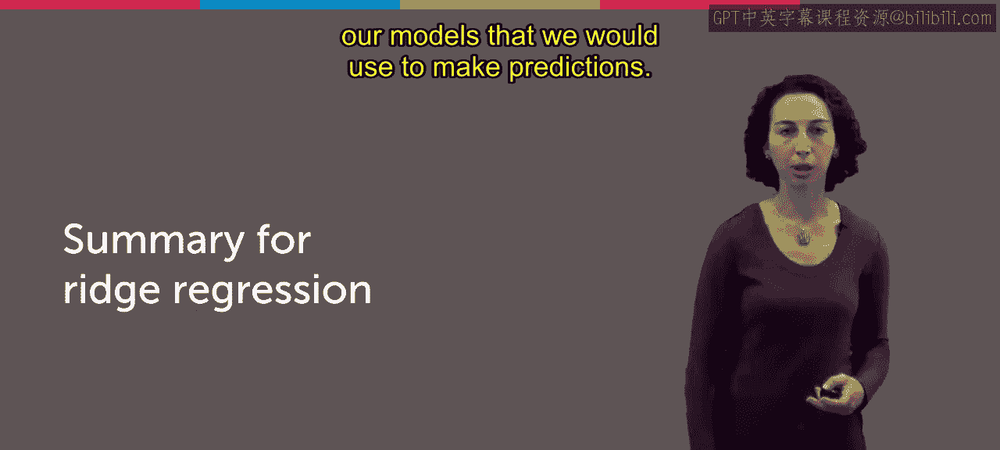
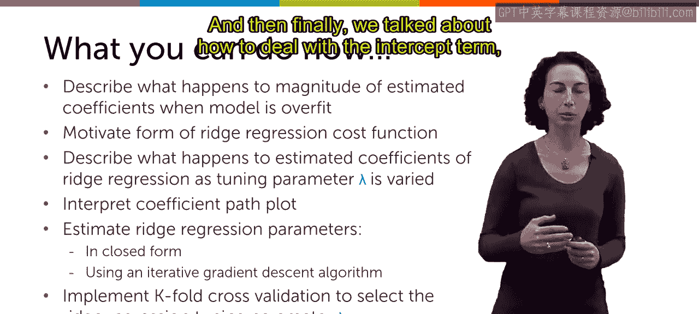

# 华盛顿大学《机器学习（回归，第2课⧸共4课）｜Machine Learning》中英字幕 p78 78_简要回顾.zh_en -BV11b421H7XL_p78-

。

So in summary， we've presented this concept of Rige regression。

 which is a regularized form of standard linear regression。

 it allows us to account for having lots and lots of features in a very straightforward way both intuitively and algorithmically as we've explored in this module and what Ri regression is allowing us to do is automatically perform this bias variance tradeoff so we thought about how to perform Ri regression for a specific value of lambmbda and then we talked about this method of cross validationation in order to select the actual lambda we're going to use for our models that we would use to make predictions。

So in summary， we've described why Rige regression might be a reasonable thing to do motivating that the magnitude term that Rige regression introduces the magnitude of the coefficients。

 penalizing that make sense from the standpoint of overfitted models tend to have very large magnitude coefficients。

 then we talked about the actual ridge regression objective and thinking about how it's balancing fit with the magnitude of these coefficients and we talked about how to fit the model。

 both as a closeform solution as well as gradient descent and then how to choose our value of lambda using crossvalation and that method generalizes well beyond regression。

 let alone just ridge regression and then finally we talked about how to deal with the intercept term if you want to handle that specifically。

