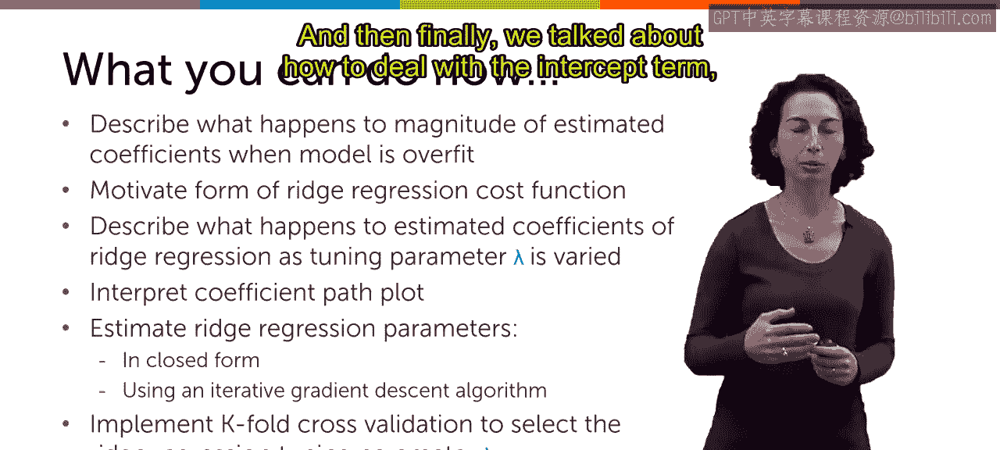

# 机器学习：第2课：岭回归核心概念回顾 🧠

在本节课中，我们将系统性地回顾岭回归的核心概念。岭回归是标准线性回归的一种正则化形式，它提供了一种直观且算法上直接的方法来处理大量特征。我们将探讨其动机、目标函数、拟合方法以及如何选择关键参数。

---

## 岭回归的动机与目标 🎯

上一节我们介绍了标准线性回归可能面临的过拟合问题。本节中，我们来看看岭回归如何通过惩罚系数的大小来解决这个问题。

过拟合模型往往具有**非常大**的系数。岭回归通过在其目标函数中引入一个惩罚项来限制系数的大小，从而在模型拟合与系数幅度之间进行权衡。其目标函数如下：

**公式：**
`目标 = 最小化 [ RSS(w) + λ * Σ(wi²) ]`

其中：
*   `RSS(w)` 是残差平方和，衡量模型对数据的拟合程度。
*   `λ * Σ(wi²)` 是惩罚项（L2正则化），`λ` 是控制惩罚力度的超参数。
*   `wi` 是模型系数（不包括截距项）。

这个公式清晰地表明，岭回归的目标是找到一个平衡点：既要让预测误差（RSS）小，又要让所有系数的平方和不过大。

---

## 模型拟合方法 ⚙️

理解了目标函数后，我们来看看如何实际求解岭回归模型。主要有两种方法。

以下是两种核心的拟合方法：

1.  **闭式解**：对于岭回归，我们可以直接通过矩阵运算得到最优系数的解析解。公式为：
    **公式：** `w* = (XᵀX + λI)⁻¹ Xᵀy`
    其中 `I` 是单位矩阵。当特征数量非常多或 `XᵀX` 不可逆时，这个公式依然有效。

2.  **梯度下降**：这是一种迭代优化算法。我们通过计算目标函数的梯度（导数），并沿梯度反方向逐步更新系数 `w`，直至收敛到最小值。这种方法适用于大规模数据集或在线学习场景。

---

## 选择正则化参数 λ 🔍

模型拟合依赖于参数 `λ` 的选择。`λ` 控制着正则化的强度：`λ=0` 时退化为普通线性回归；`λ` 很大时，所有系数会被严重压缩趋近于零。

为了选择最优的 `λ`，我们使用**交叉验证**方法。这个方法不仅适用于岭回归，也广泛适用于其他机器学习模型。

以下是交叉验证的基本步骤：

*   将训练数据分成若干份（例如5份）。
*   依次将其中一份作为验证集，其余作为训练集。
*   对于每个待选的 `λ` 值，用训练集拟合模型，并在验证集上评估性能（如计算误差）。
*   对所有分割的结果取平均，得到每个 `λ` 对应的平均性能。
*   选择平均性能最好（如验证误差最小）的那个 `λ` 值作为最终参数。

---

## 处理截距项 📐

最后，我们讨论一个重要的细节：如何处理截距项（偏置项）。

在岭回归中，我们通常**只对特征对应的系数 `w` 进行惩罚，而不惩罚截距项 `w0`**。这是因为截距项代表目标变量的全局均值偏移，惩罚它可能使模型产生不必要的偏差。实际操作中，通常在计算惩罚项 `Σ(wi²)` 前，先将数据**中心化**（使每个特征均值为0），这样拟合出的模型自然就包含了正确的截距信息。

---

## 总结 📝

本节课中我们一起学习了岭回归的完整框架。我们从其**动机**开始——通过惩罚大系数来防止过拟合。然后，我们定义了岭回归的**目标函数**，它平衡了拟合优度与模型复杂度。接着，我们探讨了两种**拟合方法**：闭式解和梯度下降。为了找到最佳的正则化强度，我们介绍了**交叉验证**这一通用且强大的模型选择工具。最后，我们明确了**截距项**通常不被纳入正则化惩罚范围的处理方式。岭回归为我们提供了一种系统性的方法，来自动进行偏差-方差权衡，是处理高维数据的有力工具。