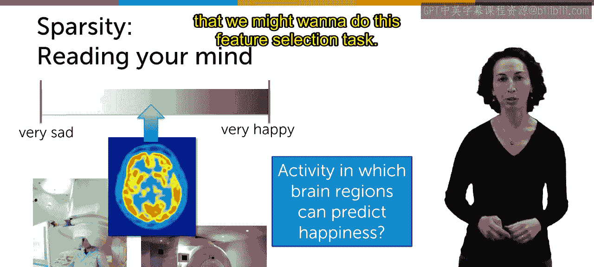

# 华盛顿大学《机器学习（回归，第2课⧸共4课）｜Machine Learning》中英字幕 p79 79_特征选择任务.zh_en -BV11b421H7XL_p79-

。

In this module， we're going to discuss how to select amongst a set of features to include in our model and to do this。

 we're first going to start by describing a way to explicitly search over all possible models and then what we're going to do is describe a way to implicitly do a feature selection using regular regression akin to the types of ideas we're talking about when we discuss ridge regression。

 So let's start by motivating this feature selection task。

 So question is why might you want to select amongst your set of features One is for efficiency So let's say you have a problem with has 100 billion features。

 that might sound like a lot。 it is actually a lot。

 but there are many applications out there these days where we're faced with this many features Well every time we go to do prediction with 100 billion features that multiplication we have to do between our feature vector and the weights on all these features is really computationally intensive。

In contrast， if we assume that the weights on our features are sparse and what I mean by that is that there are many zeroes。

 then things can be done much more efficiently because when we're going to form our prediction。

 all we need to do，Is some over all of the features whose weights are not zero。

But another reason for wanting to do this feature selection and one that perhaps might be more common at least classically。

 is for the reason of interpretability， where we want to understand what are the features relevant for。

 for example， a prediction task。So for example in our housing application we might have a really long list of possible features associated with every house this is actually an example of a set of features that were listed for a house that was listed on Zillow and there are lots and lots of detailed things including what roof type the house has and whether it includes a microwave or not when it's getting sold and the question is are all these features really relevant to assessing the value of the house or at least how much somebody will go and pay for the house？

They probably wouldn't mind if they're spending a couple hundred thousand dollars to go by a microwave that's probably not factoring in very significantly and making their decision about the value of the house。

 So when we're faced with all these features， we might want to select a subset that are really representative or relevant to our task of predicting the value of a house So here I've shown perhaps a reasonable subset of features that we might use for assessing the value and one question we're going to go through in this module is。

 how do we think about choosing this subset。And another application we talked about a couple modules ago was this。

Reading your mind task where we get a scan of your brain and for our sake we can just think of this as an image and then we like to predict whether you are happy or sad in response to whatever you were shown so when we went to take the scan of your brain。

 you're shown either a word or an image or something like this and we want to be able to predict how you felt about that just from your brain scan。

So we talked about the fact that we treat our inputs， our features as just the voxels。

 we can think of them as just pixels in this image and wanted it to relate those pixel intensities to this output。

 this response happiness and in many cases maybe what we'd like to do is find a small subset of regions in the brain that are relevant to this prediction task。

 and so here again is a reason for interpretability that we might want to do this feature selection task。

