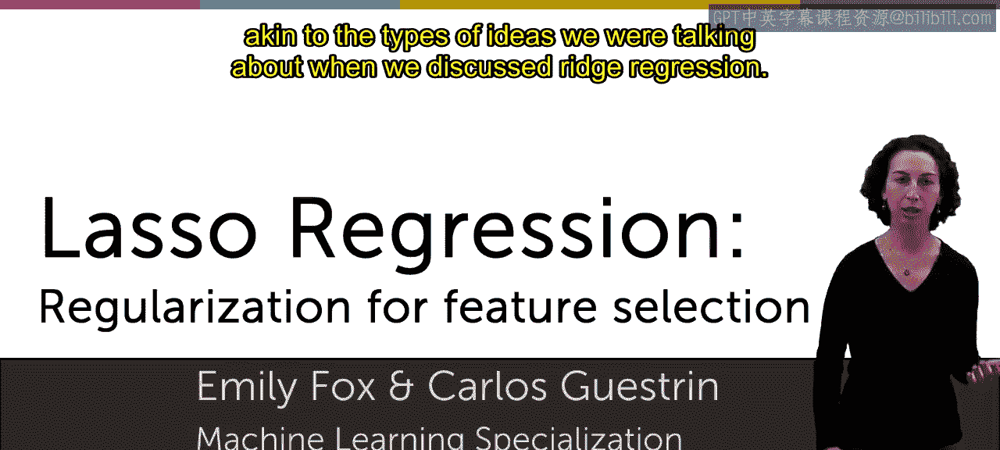

# 机器学习：第2课：特征选择任务 🎯

在本节课中，我们将要学习如何从一组特征中选择一部分来构建我们的模型。我们将首先介绍一种显式搜索所有可能模型的方法，然后描述一种类似于岭回归思想的、使用正则化回归进行隐式特征选择的方法。

## 为什么需要特征选择？ 🤔

上一节我们介绍了特征选择的概念，本节中我们来看看为什么我们需要进行特征选择。主要有两个原因：效率和可解释性。

### 效率原因
假设一个问题有1000亿个特征。每次进行预测时，都需要计算特征向量与所有权重的乘积，这在计算上非常密集。相比之下，如果我们的权重是稀疏的（即许多权重为零），那么预测过程会高效得多，因为我们只需要对非零权重的特征进行求和。

### 可解释性原因
更常见的原因是为了可解释性。我们希望通过理解哪些特征与预测任务相关，来更好地解释模型。例如，在房价预测应用中，我们可能有许多特征，但并非所有特征都与房价评估真正相关。我们可能希望选择一个真正有代表性的特征子集。

另一个例子是“读心术”任务，我们希望通过大脑扫描图像预测情绪。我们可能希望找到与预测任务相关的大脑区域的小子集，这同样是为了可解释性。

## 显式特征选择方法 🔍

在了解了特征选择的重要性之后，本节中我们来看看如何进行特征选择。一种直接的方法是显式地搜索所有可能的特征组合。

### 搜索所有子集
最直接的方法是尝试所有可能的特征子集。对于一个有 `D` 个特征的问题，总共有 `2^D` 个子集。以下是评估每个子集的基本步骤：

1.  对于每个特征子集 `S`（`S` 是 `{1, 2, ..., D}` 的一个子集）。
2.  仅使用子集 `S` 中的特征来训练一个模型（例如线性回归模型）。
3.  在验证集上评估该模型的性能（例如计算误差）。
4.  选择在验证集上性能最好的那个特征子集。

这种方法可以保证找到最优的特征子集，但计算成本极高。当 `D` 很大时（例如 `D=100`，则有 `2^100` 个子集），这在计算上是不可行的。

## 隐式特征选择方法：正则化 🛡️

由于显式搜索所有子集的方法计算量过大，本节中我们介绍一种更实用的隐式特征选择方法：正则化。这种方法通过修改损失函数，鼓励模型使用更少的特征。

### L2正则化（岭回归）
我们之前讨论的岭回归使用了L2正则化。它在损失函数中增加了所有权重平方和的惩罚项。其公式如下：

**损失函数 = 误差平方和 + λ * Σ(权重_j²)**

L2正则化会使权重变小，但通常不会将任何权重精确地设为零。因此，它实现了“收缩”效果，而非严格的特征选择。

### L1正则化（Lasso回归）
为了实现特征选择，我们可以使用L1正则化，也称为Lasso回归。它在损失函数中增加的是权重的绝对值之和作为惩罚项。其公式如下：

**损失函数 = 误差平方和 + λ * Σ|权重_j|**

L1正则化的关键特性是，它倾向于产生稀疏解，即许多权重会被精确地设为零。那些权重为零的特征就被模型“选择”排除在外了。参数 `λ` 控制着正则化的强度：`λ` 越大，被置零的权重就越多，模型使用的特征就越少。

通过调整 `λ`，我们可以在模型的复杂度和稀疏性之间进行权衡，从而隐式地完成特征选择。

## 总结 📝

本节课中我们一起学习了特征选择的任务和方法。
*   我们首先讨论了进行特征选择的两个主要原因：**提升计算效率**和**增强模型可解释性**。
*   接着，我们介绍了一种**显式方法**，即搜索所有可能的特征子集，虽然它能找到最优解，但计算成本过高，不适用于特征数量多的情况。
*   最后，我们重点介绍了一种**隐式方法**，即通过**正则化**进行特征选择。特别是**L1正则化（Lasso回归）**，它通过在损失函数中添加权重绝对值之和的惩罚项，能够自动将不重要的特征权重设为零，从而实现高效的特征选择。这种方法通过在模型训练中融入选择过程，避免了组合爆炸问题，是一种更实用的解决方案。