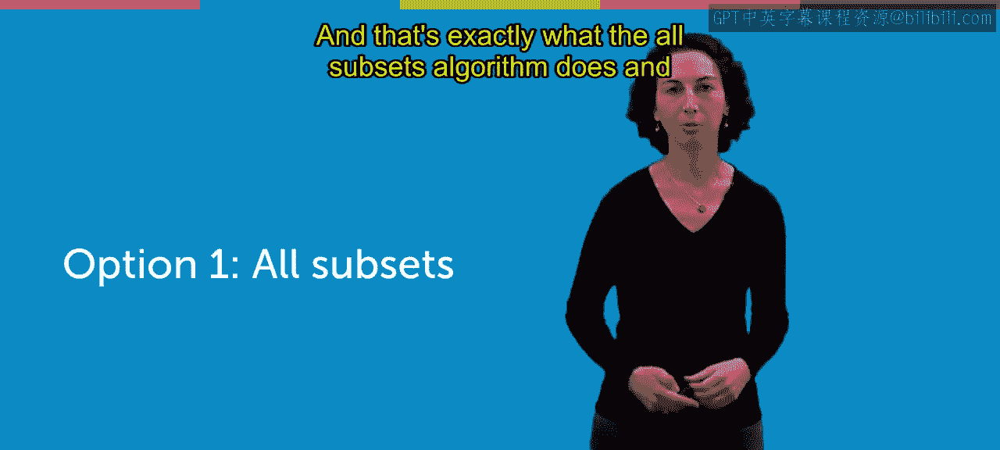
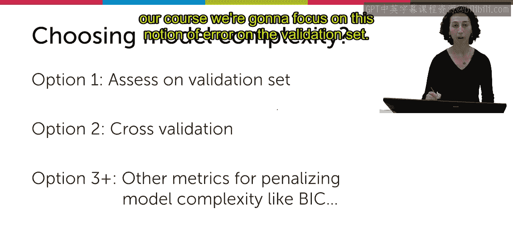

# 华盛顿大学《机器学习（回归，第2课⧸共4课）｜Machine Learning》中英字幕 p80 80_所有子集.zh_en -BV11b421H7XL_p80-

。

Okay， so how are we going to go about this feature selection task Well one option we have is the obvious choice which is to search over every possible combination of features we might want to include in our model and look at the performance of each of those models and that's exactly what the all subsets algorithm does and we're going to describe this now。

Okay， well the all subsets algorithm starts by considering a model with absolutely no features in it。

 okay， removing all these features we might have for our house and saying what's the performance of that model。

 so just to be clear。Start with。No features。And there's still a model for no features。

 so the model for no features remember is just that our observation is simply noise。Okay。

 so we can assess the performance of this model on our training data。

And there's some training error associated with a model with no features。

So we're going to plot that point。 Then the next thing we're going to do is we're going to search over every possible model of just one feature。

 So let's say to start with we consider a model with just number of bedrooms and here we're going to plot。

The training error。Of model。Fed。Just。With。Number of bedrooms as the feature。Then we're going to say。

 well， what's the training error of a model fit just with number of bathrooms， square feet。

 square feet of the lot， and cycle through each one of our possible features？

And then at the end of this， we can say out of all models with just one feature。

 which one fit the training data the best， and in this case it happened to be the model that included square feet living。

 so we've seen that before that that's a very relevant feature。Okay。

 so we're going to highlight this is the。Best。Fitting model。看。With only one feature。

And we're going to keep track of this model and we can discard all the other ones。

Then we're going to go and search over all models with two features。Search over。All combinations。

Of two features。And we're going to figure out which one of these has the lowest training error。

 keep track of that model， and that happens to be a model that has number of bedrooms and number of bathrooms。

 and that might make sense because when we're going to search for a property often someone will sayI want a three bedroom house with two bathrooms。

 so that might be a reasonable choice for the best model which is two features。

And I want to emphasize that the best model with just two features doesn't have to contain any of the features that were contained in the best model of one feature。

 so here our best model with two features， has number bedrooms， number of bathrooms。

 whereas in contrast， our best model with just one feature has square feet living。Okay。

 so these aren't necessarily nested， so maybe I'll write this explicitly。Best。冇。Of size。Kay。

Need not contain。Features。I model。Of best model of size k minus1。Okay。

So hopefully that's clear and we're going to continue our procedure searching over all models then with three features。

 all models with four features， five features， and at some point what we're going to get to is we're going to get to a model that has capital D features that's all of the features that we include and there's only one such model so it's just one point here。

Then what we can do is we can draw this line， which represents the set is connecting the points which represent the set of all best possible models each with a given number of features。

Then a question is， well， which of these models of these best models with K features do we want to use for our predictions？

Well， hopefully it's clear from this course as well as from this slide that we don't just want to choose the model with the lowest training error because as we know at this point as we increase model complexity。

 our training error is going to go down and that's what we're seeing in this plot So instead it's the same type of choices that we've had previously in this course for choosing between models of various complexity one choice is if you have enough data you can assess performance on the validation set that's separate from your training and test set we also talked about doing crossval and in this case there many other。

Metrics we can look at for how to think about penalizing model complexity。

 there are things called BIC and a long list of other methods that people have for choosing amongst these different models。

 but we're not going to go through the details of that for our course。

 we're going to focus on this notion of error on the validation set。

