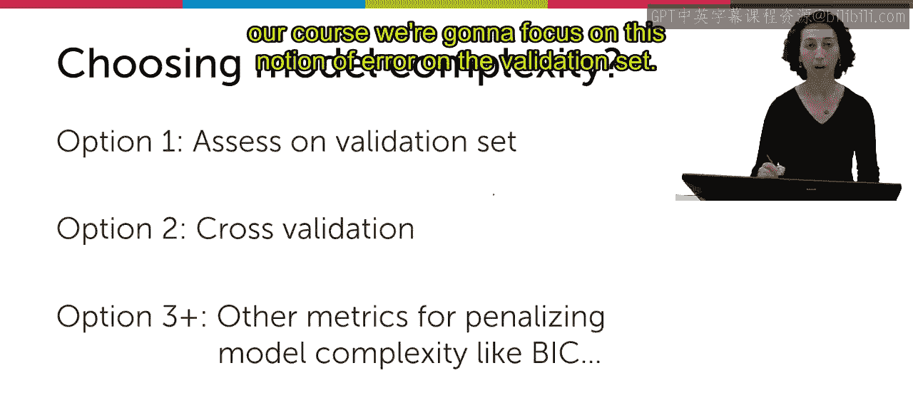

# 机器学习：第2课：特征选择之所有子集法


在本节课中，我们将学习一种特征选择方法——所有子集法。该方法通过评估包含不同特征组合的模型性能，来帮助我们为预测任务选择最合适的特征集。


---

## 特征选择任务

上一节我们讨论了特征选择的重要性。本节中，我们来看看如何具体执行特征选择任务。一个直观的方法是：搜索所有可能的特征组合，并评估每个组合对应模型的性能。这正是“所有子集”算法所做的事情。

## 所有子集算法详解

所有子集算法从一个不包含任何特征的模型开始。

**初始模型：无特征**
首先，考虑一个没有任何特征的模型。这意味着模型假设观测值仅仅是噪声。我们可以在训练数据上评估这个模型的性能，并得到一个训练误差值。

**搜索单特征模型**
接下来，算法会搜索所有仅包含一个特征的模型。例如，我们首先评估仅以“卧室数量”为特征的模型，并计算其训练误差。然后，我们依次评估仅以“浴室数量”、“居住面积”、“地块面积”等单个特征为输入的模型。完成对所有单特征模型的评估后，我们找出其中训练误差最小的模型。在这个例子中，表现最好的单特征模型是包含“居住面积”的模型。

以下是评估单特征模型的伪代码表示：
```python
for feature in all_features:
    model = train_model(training_data, [feature])
    error = compute_training_error(model, training_data)
    record_error(feature, error)
best_single_feature = feature_with_minimum_error
```

**搜索双特征及更多特征的模型**
然后，算法会继续搜索所有包含两个特征的模型组合。我们评估所有可能的双特征组合，并找出训练误差最小的那个。例如，最佳的双特征模型可能包含“卧室数量”和“浴室数量”。

需要强调的是，最佳的双特征模型不一定包含最佳单特征模型中的特征。例如，最佳单特征模型使用“居住面积”，而最佳双特征模型可能使用“卧室数量”和“浴室数量”。因此，大小为 `k` 的最佳模型不一定包含大小为 `k-1` 的最佳模型中的特征。

算法会以此类推，继续搜索所有包含三个、四个、五个……直至包含所有 `D` 个特征的模型。

**选择最终模型**
完成所有搜索后，我们会得到一条曲线，它连接了每个特征数量 `k` 下对应的最佳模型（即训练误差最小的模型）的性能点。

那么，我们应该选择哪个特征数量的最佳模型用于最终预测呢？根据课程知识，我们不能简单地选择训练误差最低的模型，因为随着模型复杂度（特征数量）增加，训练误差通常会持续下降，这从我们绘制的曲线中也可以看出。

因此，我们需要使用其他方法来在复杂度不同的模型间做出选择，这与本课程之前讨论过的模型选择原则一致。

以下是几种常见的选择方法：
*   **验证集评估**：如果有足够的数据，可以在独立的验证集上评估各个模型的性能，选择验证误差最小的模型。
*   **交叉验证**：使用交叉验证来更稳健地估计模型的泛化误差。
*   **信息准则**：使用如BIC（贝叶斯信息准则）等包含模型复杂度惩罚项的指标进行选择。

在本课程中，我们将重点关注基于验证集误差进行模型选择的方法。

---

## 总结




本节课中，我们一起学习了“所有子集”特征选择算法。该算法系统地评估了从零特征到全部特征的所有可能组合，并找出了每个特征数量下的最佳模型。最后，我们讨论了如何通过验证集误差、交叉验证或信息准则等方法，从这些最佳模型中选择出泛化能力最强的最终模型，避免因过度追求低训练误差而导致过拟合。