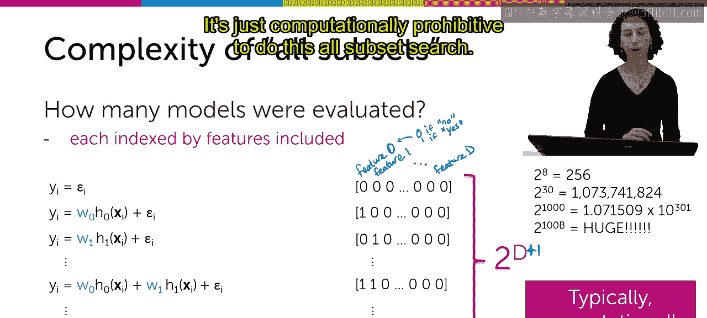

# 华盛顿大学《机器学习（回归，第2课⧸共4课）｜Machine Learning》中英字幕 p81 81_所有子集的复杂度.zh_en -BV11b421H7XL_p81-

。

Well， this all subsets algorithm might seem great or at least pretty straightforward to implement。

 but a question is what's the complexity of running all subsets。

 how many models did we have to evaluate Well clearly we evaluated all models but let's quantify what that is。

So we looked at the model that was just noise， we looked at the model with just the first feature。

 second feature all the way up to。The model which is the first two features。

 the second two features and every possible model up to the full model of all capital D features and what we can do is we can index each one of these models that we searched over by a feature vector and this feature vector is going to say。

So for feature one。Feature2 all the way up to feature D。What we're going to enter is。Zero。

 if no that feature is not in the model and one， if yes， that feature is in the model。

 So it's just going to be a binary vector indicating which features are present so in the case of just noise or no features。

 we have zeros along this whole vector in the case of just the first model， I mean。

 the first feature being included in the model we're just going to have a one in that first feature location and zero is everywhere else。

 I guess for consistency。Let me index this as feature zero， feature1， all the way up to feature D。

 okay。And we're going to go through。This entire set of possible feature vectors。

And how many choices are there for the first entry？Two， how many for the second， two， two。

 two choices for every entry and how many entries are there？With my new indexing， instead of D。

 there's really D plus one。 that's just a little notational choice。

And I did a little back of the envelope calculation for a couple choices of D， so for example。

 if we had a total of eight different features we were looking over。

 then we would have to search over 256 models。That actually might be okay， but if we had 30 features。

 all of a sudden we have to search over 1 billion some number other feature of different models and if we have 1000 features which really is not that many in applications we look at these days all of a sudden we have to search over 1。

07 times 10 to the 301 and for the example I gave with 100 billion features I don't even know what that number is。

 well， I'm sure I could go and compute it， but I didn't bother and it's clearly just huge so what we can see is that。

Typically， in most situations we're faced with these days。

 it's just computationally prohibitive to do this all subset search。

