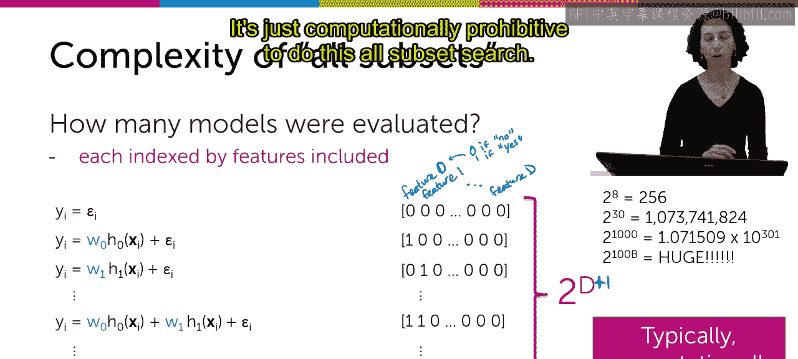

# 机器学习：第2课：所有子集算法的复杂度分析

在本节课中，我们将探讨“所有子集”算法在特征选择中的应用，并重点分析其计算复杂度。我们将了解为何随着特征数量的增加，该算法会变得不可行。

## 算法回顾与复杂度问题

上一节我们介绍了“所有子集”算法，它通过评估所有可能的特征组合来寻找最佳模型。本节中，我们来看看运行该算法需要评估多少个模型，即其计算复杂度。

该算法评估了从“仅噪声”模型（无任何特征）到包含所有特征的完整模型之间的每一个可能模型。为了量化模型总数，我们可以为每个被评估的模型分配一个特征向量。

## 特征向量的表示方法

以下是特征向量的定义方式：
*   我们为每个特征（从特征0到特征D）分配一个位置。
*   如果某个特征被包含在模型中，其对应位置的值设为 **1**。
*   如果某个特征未被包含在模型中，其对应位置的值设为 **0**。

因此，每个模型都对应一个长度为 `D+1` 的二进制向量。例如：
*   “仅噪声”模型对应的向量为：`[0, 0, ..., 0]`
*   仅包含第一个特征的模型对应的向量为：`[1, 0, ..., 0]`

## 计算模型总数

我们需要遍历所有可能的二进制特征向量。每个特征位置有两种选择（0或1）。由于有 `D+1` 个特征位置，因此需要评估的模型总数为：

**公式：** `2^(D+1)`

这意味着模型数量随特征数量 `D` 呈指数级增长。

## 复杂度实例分析

以下是针对不同特征数量 `D` 的计算结果：

*   **D = 8**：需评估 `2^9 = 512` 个模型。这个数量或许可以接受。
*   **D = 30**：需评估 `2^31 ≈ 21.4亿` 个模型。数量变得非常庞大。
*   **D = 1000**：需评估 `2^1001 ≈ 1.07 * 10^301` 个模型。这个数字已经大到无法实际计算。
*   **D = 1000亿**：需评估的模型数量是一个无法想象的天文数字。

## 结论

本节课中我们一起学习了“所有子集”算法的复杂度分析。我们可以看到，模型总数是特征数量的指数函数 `2^(D+1)`。对于现代应用中常见的成百上千甚至更多的特征，评估所有可能的子集在计算上是完全不可行的。因此，我们需要寻找更高效的特征选择方法。