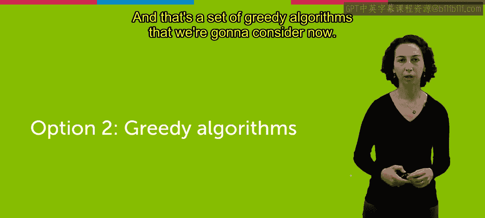
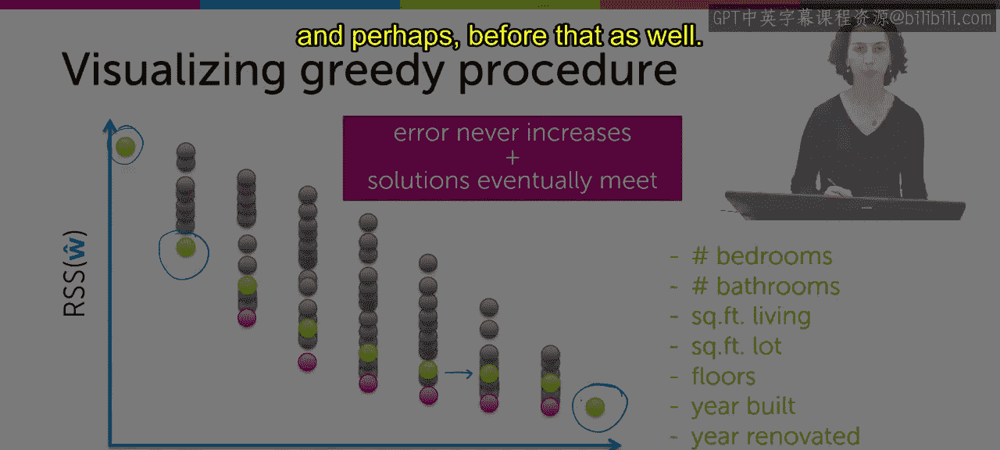
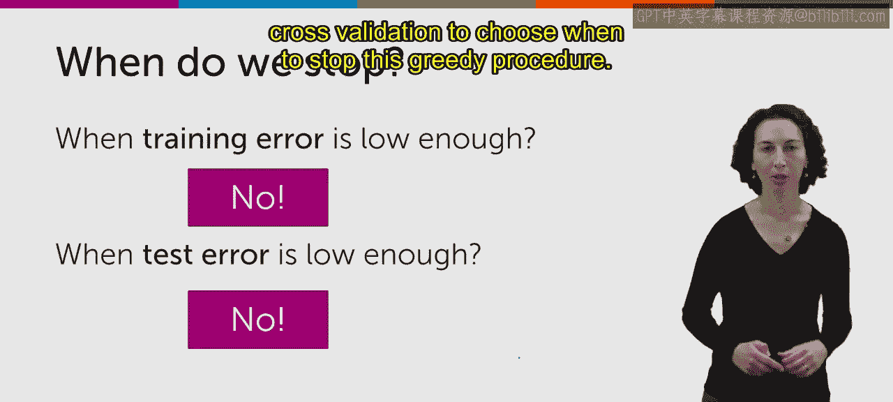

# 华盛顿大学《机器学习（回归，第2课⧸共4课）｜Machine Learning》中英字幕 p82 82_贪心算法.zh_en -BV11b421H7XL_p82-

。

Okay， so in cases where you can't do all subsets， what can we do？Well， one thing we can do。

 which is going to be option number two in our series of feature selection algorithms is to do a suboptimal but tractable。

Approach to selecting amongst features， and that's a set of greedy algorithms that we're going to consider now。

So one simple algorithm is what's called the forward stepwise algorithm where you start with some set of possible features and then what you're going to do is you're going to just greedily walk through each select the next best feature and keep iterating so let's be a little bit more explicit about this So first we're going to start with the empty set no features or you could start with a list of features that you know you want to be included in the model so for example the constant feature which might be your feature H0 but then what you're going to do is you're going to fit your model with whatever your current set of features are to get an estimate of the weights on those features。

 your estimate of your regression coefficients and then what you're going do is you're going to search over。

All the possible features that you might add and choose the one that best improves your fit and so one measure of this might be training error。

 so you choose the feature that most reduces your training error and then you just include that in your model and you recurse this procedure where now you have a model with some number of features and you're going to search over every other possible feature you might want to add and choose the next one that drops your training error the most and keep going so let's visualize this procedure。

For this visualization， we're going to start with the picture that we had in our all subset search。

 and we're going to look at how the greedy search differs from the search we would have done in all subsets。

So at the first step。We start with no features in our model。

 so we're actually going to be at exactly the same point as we were in all subsets。Start at same。

Training error。As all subsets。Which is equivalent to no features in the model。

And then what we're going to do is we're going to search over all our features and choose the one that reduces training error the most。

And which one is that going to be Well， it's actually going to be the same one we got for all subsets because at that point when we're doing all subsets and looking over all models of one feature。

 again， we have the same choice of choosing the best single feature even though we're doing this greedy procedure when we start with empty set our first best feature is going to be the same as the best feature that you would get doing all subsets so。

Again。Stay at。All subset solution。For best model。我也是。One feature。And in that case， remember。

 just like in all subsets， we choose square feet as the best feature when we have just one feature。

But then things can start to diverge because when we go to our second step。In the G algorithm。

 we're forced to keep square feet in our model。And we're just greedily going to search over the next feature that's why it's called greedy。

 I should' have mentioned this previously because we're just doing the quote unquote greedrey thing of just saying what's the next best thing。

 the next best thing， the next best thing and not thinking globally about what might be best okay so in this case maybe the next best thing that we could add the model forcing ourselves to keep square feet in our model is year renovated so when we think about what greedy finds at two features we have square feet living and year renovated。

But if we compare to what our all subsets had， it was number of bedrooms and number of bathrooms。

So this is where we see that things can be different because once we're forced to keep square feet。

 maybe。The next thing that's most relevant to value， you can have these like very large old houses。

 but those might not be worth as much， it might be the year that the house was renovated that's really relevant to the value。

 but as we described before， it might be reasonable to think that the best model with just two features was number bedrooms and number bathrooms because those are really key attributes that people used to value whether a house is a good fit for them。

Okay， well then we continue with this procedure， we already had square feet living。

 we had year renovated and now in this case our next feature we're going to add is waterfront and we're going to keep going in this process and when's the next time that our。

Greedy procedure is going to meet the same solution as the all subset。

 so we started at the same point we said after the first。um。

Iteration we were at the same point Well again we'll be at the same point once we get all the way obviously to including all features because there's only one such model with all features so there are a couple points that I want to make about this greedy procedure one is the fact that from iteration to iteration error can never decrease and the reason for that is even if there's nothing else that you want to add to your model。

 even if everything else is junk or perhaps only making things a lot worse in terms of predictions you can always just set the weight equal to zero on that additional feature and then you'd have exactly the same model you had with just one fewer feature and so the training error would be exactly the same so we know that training error will never increase and the other thing that we mentioned is that eventually the training error will be equivalent to that of all subsets when you're using all of your features and perhaps before that as well。

Okay， well， when do we stop this greeny procedure？Just to really， really hammer this home。

I'll just ask the question again， do we stop when the training error is low enough？No， okay。

 remember that training error will decrease as we increase model complexity so as we keep adding more and more features our training error will go down。

 what about when test error is low enough？Again， no。

 remember that we never touch our test data when we're searching over model complexity or choosing any kind of tuning parameter。

Again， what we're going to do is use our validation set or cross validation to choose when to stop this greedy procedure。

