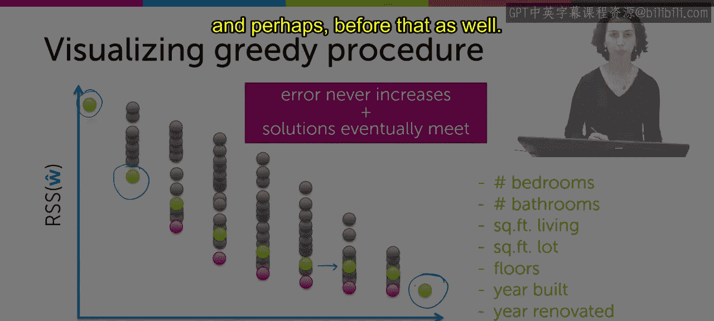
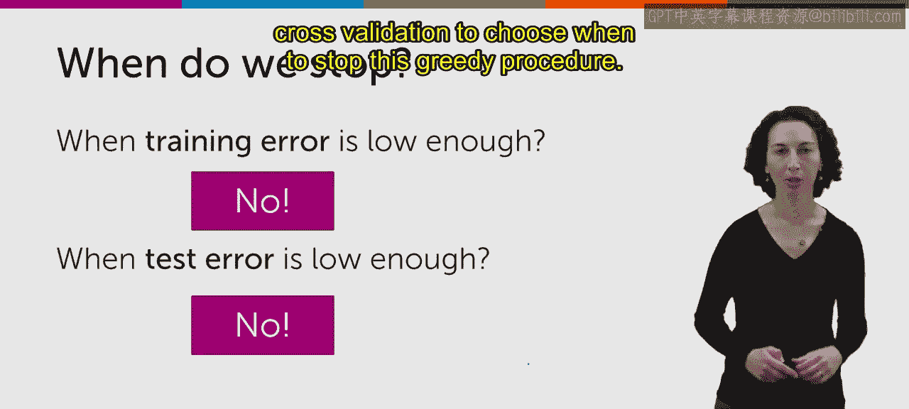

# 机器学习：第2课：贪心算法

在本节课中，我们将学习一种在特征数量过多、无法穷举所有子集时，用于特征选择的次优但可行的算法——贪心算法。我们将详细介绍其工作原理、步骤、优缺点，并讨论如何确定停止添加特征的时机。

上一节我们介绍了穷举所有特征子集的方法，本节中我们来看看当特征数量庞大时，一种更实用的替代方案。

## 算法概述

贪心算法是一种迭代式的方法。它从一个初始特征集（通常是空集）开始，在每一步中，它都“贪婪地”选择当前能最大程度提升模型性能的单个特征加入模型，并重复此过程。

## 前向逐步选择算法

一种简单的贪心算法称为**前向逐步选择算法**。以下是其具体步骤：

首先，从一个初始特征集开始。通常从空集开始，也可以从已知必须包含的特征（例如常数项特征 `h0`）开始。

然后，执行以下迭代过程：
1.  用当前的特征集拟合模型，得到回归系数的估计值。
2.  搜索所有**可能被加入**的特征，选择一个能最大程度**改善模型拟合效果**的特征。衡量标准可以是训练误差，即选择那个能最大程度降低训练误差的特征。
3.  将该特征纳入模型。
4.  重复此过程：在已包含若干特征的模型基础上，继续搜索剩余特征，选择下一个能最大程度降低训练误差的特征。

## 算法流程可视化

为了理解贪心搜索与全子集搜索的差异，我们可以进行可视化对比。

在第一步，我们从空模型开始，这与全子集搜索的起点相同，对应的训练误差也相同。

接着，我们搜索所有特征，选择那个最能降低训练误差的特征。在只有一个特征的情况下，贪心算法找到的最佳特征与全子集搜索找到的最佳单特征模型结果**相同**。例如，在房价预测中，两者可能都会选择“房屋面积”作为第一个最佳特征。

但从第二步开始，情况可能开始分化。在贪心算法中，我们被强制保留已选的“房屋面积”特征，然后贪婪地搜索下一个最佳特征。此时，第二个被加入的特征可能是“翻新年份”。

然而，全子集搜索找到的最佳双特征模型可能是“卧室数量”和“卫生间数量”。这就是差异所在：一旦贪心算法固定了第一个特征，其后续选择可能无法达到全局最优的组合。

我们继续这个流程。在已有“房屋面积”和“翻新年份”后，下一个加入的特征可能是“是否临水”。这个过程会持续进行。

贪心算法与全子集搜索的解在何时会再次重合？显然，当模型包含**所有特征**时，两者必然相同，因为此时只有一个可能的模型。

关于这个贪心过程，有几点需要说明：
*   **训练误差单调不增**：从一次迭代到下一次迭代，训练误差永远不会增加。原因是，即使新加入的特征是无效的，我们总可以将其权重设为零，从而得到与之前完全相同的模型，训练误差保持不变。
*   **最终收敛**：最终，当使用所有特征时，训练误差会与全子集搜索的结果相同（也可能在此之前某个点相同）。

## 何时停止算法？

一个关键问题是：我们何时停止这个贪心过程？

*   **当训练误差足够低时停止？** 不。因为随着模型复杂度（特征数）增加，训练误差总会下降，这会导致我们选择过于复杂的模型。
*   **当测试误差足够低时停止？** 不。记住，在搜索模型复杂度或选择任何调优参数时，我们**绝不能**触碰测试数据。

正确的做法是使用**验证集**或**交叉验证**来选择停止贪心程序的时机。我们在验证集上评估每一步得到的模型性能，选择在验证集上表现最好的那个模型复杂度（即特征数量）。

## 总结

本节课中我们一起学习了贪心算法，特别是前向逐步选择法，作为一种高效的特征选择手段。我们了解了它通过迭代地添加当前最优特征来工作，虽然无法保证找到全局最优特征子集，但计算上可行。最重要的是，我们明确了必须依赖验证集或交叉验证，而不是训练误差或测试误差，来决定何时停止添加特征，以防止过拟合并选择泛化能力最佳的模型。