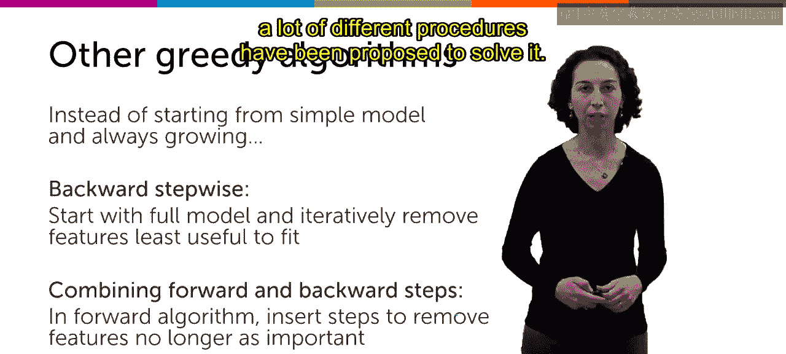

# 华盛顿大学《机器学习（回归，第2课⧸共4课）｜Machine Learning》中英字幕 p83 83_贪心前向逐步算法的复杂度.zh_en -BV11b421H7XL_p83-

。

So now let's talk about the complexity of this forward stepwise algorithm and contrast it with the all subsets procedure。

 so how many models did we evaluate here？Well in the first step assuming that we have a total of D features。

 we searched over D models then in the second step we had d minus1 models to search over so all remaining features we might think about adding and in the third step we had D minus2 features and so on and a question is how many steps did we take how many of these and so on did we have well。

It depends， it depends on when we chose to stop， but at most we're going to have D steps。

 which gets us to the full model， so the complexity of this is order d squared so at most D steps each on the order of looking over D models。

And that's going to be much， much less than2 to the D。

 which is what we had for our all subsets when D is reasonably large。Okay。

 so this procedure is going to be significantly more computationally efficient or feasible than doing all subsets。

Well this was just one of many possible choices you have for greedy algorithms for doing feature selection as an example。

 instead of always starting from an empty model and growing and growing and growing。

 adding more features， you could do the opposite could start from a full model and then choose at each iteration which feature to eliminate。

But you could also think about combining these steps so you could do a forward procedure where you search over which feature to add。

 but then every so often you could go back and think about deleting features because like we said you might in the forward process add a feature that later once you've added another feature no longer is relevant so as an example of this maybe and it's not completely probably true in this application。

 but maybe once you've added。Number of bedrooms and number of baths。

 maybe square feet is no longer so relevant since these other things can act as a proxy of four square feet or something like that。

 and there are lots and lots of other variants of algorithms people have proposed with different metrics for when you add or remove features and different ways to search over the features because this problem of feature selection is really important it' not a new problem and so a lot of different procedures have been proposed to solve it。

