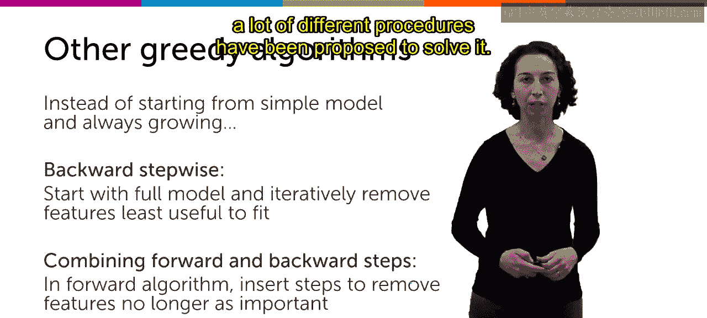

# 机器学习：第2课：贪心前向逐步算法复杂度分析

在本节课中，我们将要学习贪心前向逐步算法的计算复杂度，并将其与全子集选择法进行对比。我们还将探讨该算法的变体及其在特征选择中的应用。

## 算法复杂度分析

上一节我们介绍了贪心前向逐步算法的基本流程，本节中我们来看看它的计算复杂度。

假设我们总共有 **D** 个特征。在算法的第一步，我们需要评估 **D** 个模型（即考虑添加每一个特征）。在第二步，我们评估 **D-1** 个模型（考虑添加剩余的特征）。第三步评估 **D-2** 个模型，依此类推。

算法需要执行多少步？这取决于我们何时选择停止。但最多的情况下，我们会执行 **D** 步，直到构建出包含所有特征的完整模型。

因此，该算法的复杂度是 **O(D²)**。这是因为最多有 **D** 步，每一步大约需要评估 **D** 个模型。

当 **D** 较大时，**O(D²)** 的计算量远小于全子集选择法的 **O(2ᴰ)**。这使得贪心前向逐步算法在计算上显著更高效、更可行。

## 贪心算法的其他变体

上述算法只是众多可能的贪心特征选择策略之一。以下是其他一些常见的变体：

*   **后向逐步选择**：与“前向”过程相反，该算法从包含所有特征的**完整模型**开始，在每次迭代中，选择删除一个对模型性能影响最小的特征。
*   **前向后向混合选择**：这是一种结合了添加和删除操作的策略。在“前向”过程中添加特征后，算法可能会周期性地“回看”，评估并删除那些因添加了新特征而变得不再重要的旧特征。例如，在预测房价时，一旦模型添加了“卧室数量”和“浴室数量”这两个特征，“房屋面积”这个特征可能就不再那么重要，因为前两者可以作为面积的一个近似代理。

除了上述策略，研究人员还提出了许多其他算法变体。这些变体在何时添加或删除特征的标准（度量指标）以及如何搜索特征组合的方式上有所不同。特征选择是一个非常重要且历史悠久的问题，因此诞生了多种多样的解决方案。

## 总结

本节课中我们一起学习了贪心前向逐步算法的计算复杂度。我们了解到其复杂度为 **O(D²)**，远低于全子集选择法的 **O(2ᴰ)**，从而在特征数量较多时具有显著的计算优势。我们还简要介绍了该算法的其他变体，如后向选择和混合选择，说明了特征选择方法的多样性。