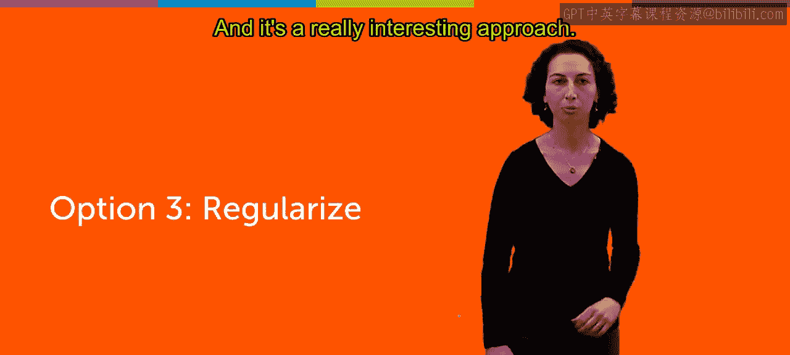
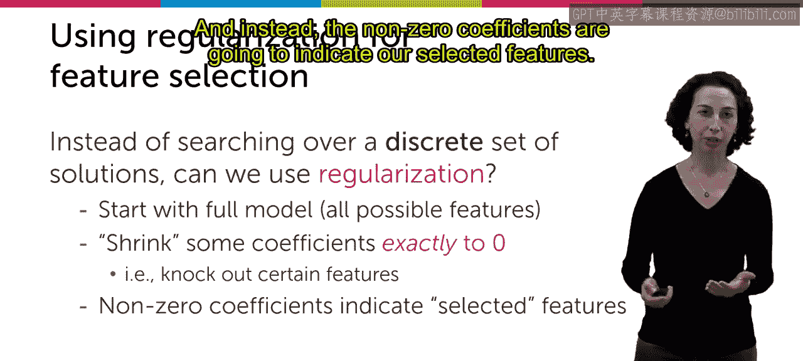

# 华盛顿大学《机器学习（回归，第2课⧸共4课）｜Machine Learning》中英字幕 p84 84_我们能否使用正则化进行特征选择.zh_en -BV11b421H7XL_p84-

。

Well， for our third option for feature selection， we're going to explore a completely different approach which is using regular regression to implicitly perform feature selection for us。

 and the algorithm we're going to explore is called LaSso。

 and it's really fundamentally changed the field of machine learning， statistics and engineering。

 it's had a lot， a lot of impact and just a number of applications and it's a really interesting approach。

Let's recall regularized regression in the context of Rige regression first。

 where remember we were balancing between the fit of our model on our training data and a measure of the magnitude of our coefficients。

 where we said that smaller magnitudes of coefficients indicated that things were not as overfit as if you had crazy large magnitudes。

 and we introduced this tuning parameter lambda， which balanced between these two competing objectives。

So for our measure fit， we looked at residual summa squares and in the case of Rige regression。

 when we looked at our measure of the magnitude of the coefficients。

 we use what's called the L2 norm， so this is just the two norm squared in this case。

 which is the sum of each of our feature weights squared。Okay， this Rige regression penalty。

 we said encouraged our weights to be small。But one thing I want to emphasize is that encourage them to be small。

 but not exactly zero。And we can see this if we look at the coefficient path that we describe for Ri regression。

 where we see the magnitude of our coefficients shrinking and shrinking towards zero as we increase our lambda value。

 and we said in the limit as lambda goes to infinity in that limit the coefficients become exactly zero。

 but for any finite value of lambda， even a really really， really large value of lambda。

 we're still just going to have very， very， very small coefficients， but they won't be exactly zero。

So why does it matter that they're not exactly zero。

 why am I emphasizing so much this concept of the coefficients being zero Well this is this concept of sparsity that we talked about before。

 where if we have coefficients that are exactly zero， well then for efficiency of our predictions。

 that's really important because we can just completely remove all the features where their coefficients are zero from our prediction operation and just use the other coefficients and the other features。

And likewise， for interpretability， if we say that one of the coefficients is exactly zero。

 what we're saying is that that feature is not in our model， so that is doing our feature selection。

So a question though， is， can we use regularization to get at this idea of doing future selection？

Instead of what we talked about before， where before。

 when we're talking about all subsets or our greedy algorithms。

 what we were doing is we were searching over a discrete set of possible solutions。

 we're searching over the solution that included the first and the fifth feature or the second and the seventh or this entire collection of these discrete solutions。

 but what we'd like to ask here is whether we can start with， for example， our full model and then。

Just shrink some coefficients not towards zero， but exactly to zero。

 because if we shrink them exactly to zero， then we're knocking out those coefficients。

 we're knocking those features out from our model， and instead the non-zero coefficients are going to indicate our selected features。

