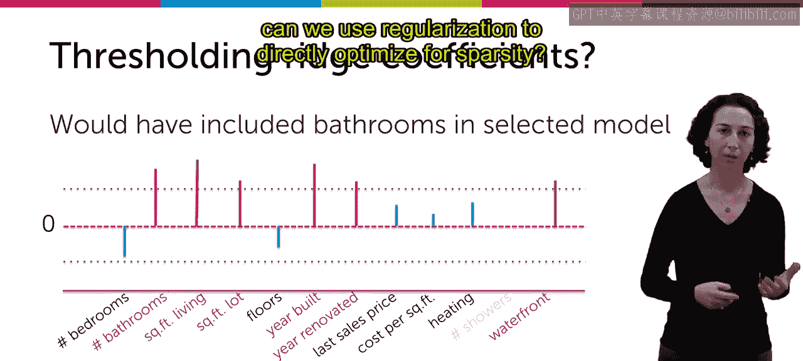
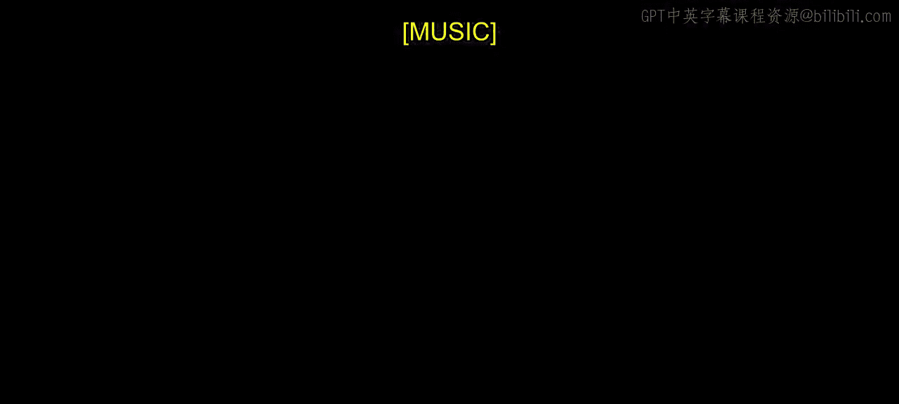

# 华盛顿大学《机器学习（回归，第2课⧸共4课）｜Machine Learning》中英字幕 p85 85_对岭回归系数进行阈值处理.zh_en -BV11b421H7XL_p85-

。

Okay， well， maybe we can just take our Rige regression solution and just take all the little coefficients and just say they're zero。

 just get rid of those。We're going to call those thresholdholding those away。

 we're going to choose some value where below that value of the magnitude of the coefficient is below the threshold that we choose just going to say it's not in the model。

 so let's explore this idea a little bit。So here I'm just showing an illustration of a little cartoon of what the weights might look like on a set of features in our housing application and I'm choosing some threshold which is this dashed black line and if the magnitude exceeds that threshold。

Then I'm going to say that features in my model， so here in pink or fusia， Carls， what color is this？

sia this is Carlos's color scheme， he's very attached to it fusia， so in fusia。

 I'm showing the features that have been selected to be in my model after doing this thresholdholding of my ridge regression coefficients。

😊，Might seem like a reasonable approach， but let's dig into this a little bit more and in particular let's look at two very related features。

 so if you look at this list of features you see in green I've highlighted number of bathrooms and number of showers。

So these numbers tend to be very， very close to one another because lots of bathrooms have showers and as the number of showers grow。

 clearly the number of bathrooms grow because you're very unlikely to have a shower not in a bathroom。

But what's happened here？Well， our model has included nothing having to do with bathrooms or showers or anything of this concept。

嗯。So that doesn't really make a lot of sense， to me。

 it seems like something having to do with how many bathrooms are in the house should be a valuable feature to include when I'm assessing the value of the house。

So what's going wrong？Well， if I hadn't included number of showers， let's just。

 for simplicity's sake， treat the number of showers as exactly equivalent to the number of bathrooms。

It might not be exactly equivalent， but they're very strongly related， but like I said。

 for simplicity， let's say they're exactly the same。

 So if I hadn't included number of showers in my model to begin with。In the full model。

 then when I did my ridge search， it would have placed that weight that had been on number of showers on the number of bathrooms。

Because remember it's a linear model we're summing over weight times number of bathrooms plus wait times number of showers。

 so if number of bathrooms equals number of showers。

 it's equivalent to the sum of those two weights just times number of bathrooms。

 excluding number of showers from the model so the point here is that if I hadn't included this redundant feature number of showers。

 what I see now visually is that number of bathrooms would have been included in my selected model doing the thresholding。

So the issue that I'm getting at here it's not specific to number of bathrooms and number of showers。

 it's an issue that if you have a whole collection， maybe not to。

 maybe a whole set of strongly related features， more formally statistically I'll call these strongly correlated features。

Then Rige regression is going to prefer a solution that places a bunch of smaller weights on all the features rather than one large weight on one of the features because remember the cost under the ridge regression model is the size of that feature squared and so if you have one really big one that's really going to blow up that cost that L2 penalty term whereas the fit of the model is going to be basically about the same。

 whether I distribute the weights over redundant features or if I put a big one on just one of them in zeros elsewhere。

 so what's going happen is I'm going to get a bunch of these small weights over the redundant features and if I think about simply thresholding。

 I'm going to discard all of these redundant features whereas one of them or potentially the whole set really were relevant to my prediction task so hopefully is clear from this illustration that just taking ridge regression and thresholdholding out these small weights is not a solution to our feature selection problem。

So instead， we're left with this question of can we use regularization to directly optimize for sparsity？

