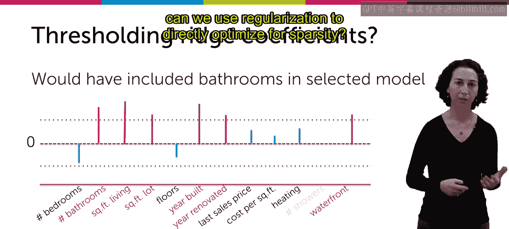

# 机器学习：第2课：对岭回归系数进行阈值处理

在本节课中，我们将探讨一种看似直观的特征选择方法：对岭回归模型的系数进行阈值处理。我们将分析其背后的逻辑，并通过一个具体的例子来揭示这种方法存在的根本问题。

上一节我们介绍了岭回归及其在防止过拟合方面的作用。本节中我们来看看，能否通过简单地“舍弃”小系数来实现特征选择。

## 概述：阈值处理的想法

岭回归的解决方案可能会产生许多系数值很小的特征。一个自然的想法是：我们可以设定一个阈值，将所有系数绝对值低于该阈值的特征权重直接设为零，从而将它们从模型中移除。我们称这种方法为“阈值处理”。

以下是阈值处理的基本步骤：
1.  训练一个岭回归模型。
2.  检查所有特征的权重系数。
3.  设定一个阈值（例如 0.01）。
4.  将所有系数绝对值小于该阈值的特征权重设为零。
5.  仅保留系数绝对值大于阈值的特征。

## 一个具体的例子

为了更清楚地说明，让我们看一个图示。假设在房价预测应用中，我们有一系列特征及其对应的岭回归权重系数。

图中，每个条形代表一个特征的权重系数大小。我们选择了一个阈值（图中的黑色虚线）。任何系数绝对值超过此阈值的特征（图中品红色部分）将被保留在模型中；而低于此阈值的特征（图中其他颜色部分）则被剔除。

这看起来似乎是一种合理的方法。但让我们深入分析，特别是观察两个高度相关的特征。

## 问题所在：相关特征的影响

如果我们查看特征列表，会发现“卫生间数量”和“淋浴间数量”这两个特征（图中绿色高亮部分）通常高度相关。因为大多数卫生间都配有淋浴设施，随着淋浴间数量增加，卫生间数量也往往会增加。

然而，在我们的阈值处理结果中，模型完全没有包含任何与卫生间或淋浴间相关的特征。这似乎不合逻辑，因为房屋的卫生间数量理应是评估其价值时的一个重要特征。

那么，问题出在哪里？

为了简化分析，我们假设“淋浴间数量”与“卫生间数量”完全相等。如果最初在构建完整模型时没有包含“淋浴间数量”这个特征，那么岭回归算法就会将原本分配给“淋浴间数量”的权重全部加到“卫生间数量”上。

因为这是一个线性模型，其预测是各特征权重与取值的乘积之和。如果“卫生间数量”等于“淋浴间数量”，那么“权重1 * 卫生间数量 + 权重2 * 淋浴间数量”就等价于“（权重1 + 权重2）* 卫生间数量”。

因此，如果没有这个冗余的“淋浴间数量”特征，仅对“卫生间数量”进行阈值处理时，其系数很可能超过阈值并被保留在模型中。

## 根本原因：岭回归的惩罚项

这里揭示的问题并非特例，而是一个普遍现象：当存在一组高度相关（统计上称为强相关性）的特征时，岭回归倾向于给所有这些特征分配一系列较小的权重，而不是给其中一个特征分配一个较大的权重。

原因在于岭回归的**成本函数**。岭回归的目标是最小化以下公式：

`总成本 = 预测误差 + λ * Σ(权重_i²)`

其中，`Σ(权重_i²)` 是 L2 惩罚项。如果将一个很大的权重集中在一个特征上，会显著增大这个惩罚项。然而，将权重分散到多个冗余特征上，模型的拟合效果（预测误差部分）几乎相同，但惩罚项的总和却可能更小。

因此，对于一组冗余特征，岭回归给出的解决方案是一系列小权重。此时如果进行简单的阈值处理，我们就会错误地丢弃所有这些实际上与预测任务相关的特征。

希望通过这个图示和解释，能够清楚地表明：**简单地采用岭回归并对小系数进行阈值处理，并不能解决我们的特征选择问题。**

## 总结与过渡

本节课中我们一起学习了为何对岭回归系数进行阈值处理是一种有缺陷的特征选择方法。其核心问题在于，岭回归的 L2 惩罚项会促使模型将权重分散到相关特征上，导致每个特征的系数都变小，从而在阈值处理时被误删。

于是，我们面临一个新的问题：**能否使用正则化方法直接优化模型的稀疏性（即让大部分系数直接为零）？** 这将引导我们探索下一节的主题：Lasso回归及其背后的L1正则化。