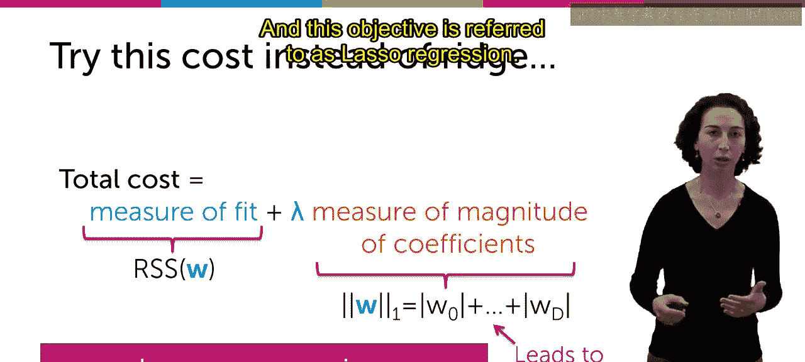
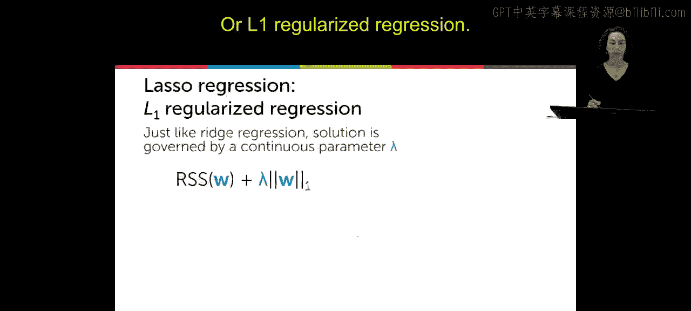
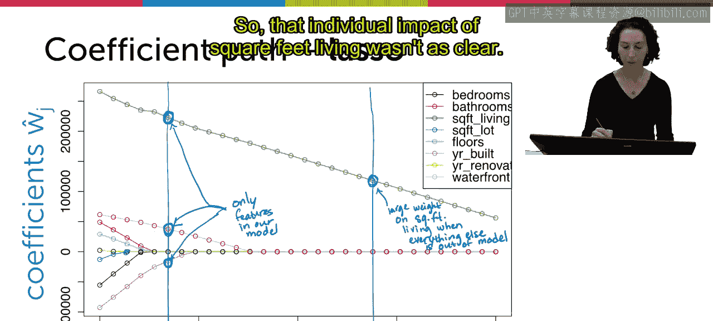

# 华盛顿大学《机器学习（回归，第2课⧸共4课）｜Machine Learning》中英字幕 p86 86_Lasso目标及其系数路径.zh_en -BV11b421H7XL_p86-

。

Okay， well in place of our Rige regression objective。

 what if we took our measure of our magnitude of our coefficients to be what's called the L1 norm where we're going to simply sum over the absolute value of each one of our coefficients。

 so we actually describe this as a reasonable measure of the magnitude of coefficients when we were discussing ridge regression last module。

Well， the result of this is something that leads to sparse solutions for reasons that we're going to go through in the remainder of this module。

 and this objective is referred to as Lasso regression or L1 regular regression。

So just like in Rige regression， LASO is governed by a tuning parameter Lambda that controls how much we're favoring sparsity of our solutions relative to the fit on our training data。

And so just to be clear here， we see that when we're doing our feature selection task。

 we're searching over a continuous space， the space of lambmbda values。

 Lambda is governing the sparsity of the solution and that's in contrast to， for example。

 the all subsets or greedy approaches where we talked about those searching over a discrete set of possible solution so it's really a fundamentally different approach to doing feature selection。

Okay， but let's talk about what happens to our solution as we vary lambmbda。And again。

 just to emphasize this lambda is a tuning parameter that in this case is balancing fit and sparsity。

Okay， so if lambda is equal to0， what's going to happen Well this penalty term is completely going to disappear and our objective is simply going to be to minimize residual sum of squares。

 that was our old least squares objective。 So we're going to get W hat what I'll call Lassso。

 the solution to our lasso problem is going to be exactly equal to W hat least squares。

 So this is equal to our unregularized。Solution。And in contrast， if we set lambda equal to infinity。

 this is where we're completely favoring this magnitude penalty and completely ignoring the residual squares fit in this case。

 what's the thing that minimizes the L1 norm？So what value of our regression coefficients is going to have the sum of their absolute values being the smallest。

 Well， again， we're just like in Rige， when lambda does equal to infinity， we're going to get。

W hat Lasso equal to the zero vector。And if lambda is in between。

We're going to get that in this case， the one norm。Of our。Lasso solution。

Is going to be less than or equal to the one norm。Of our least square solution。

And it's going to be greater than or equal to this zero vector。 I mean， the zero number， sorry， here。

 it's just a number once we've taken this norm。Okay， so。As of yet。

 it's not clear why this L 1 norm is leading to sparsity。 And we're going to get to that。

 But let's first just explore this visually。 And one way we can see this is from the coefficient path。

 But first， let's just remember the coefficient path for ridge regression。

 where we saw that even for a large value of lambda。

Everything was in our model just with small coefficients。Everything。Has。W hat J， greater than0， but。

All W hat J are small。4。Large values of our tuning parameter lambda。In contrast。

 when we look at the coefficient path for Lasso， we see a very different pattern。

 what we see is that at certain critical values of this tuning parameter lambda。

Certain ones of our features jump out of our model， so for example。

 here we had square feet of the lot size disappears from the model here。

 number of bedrooms almost simultaneously with number of floors and number of bathrooms followed by the year the house was built。

嗯。And then， but one one thing that we see。 So let me just be clear that for。

Let's say a value of lambda like this。We have a sparse set。Of features included in our model。

 so the ones I've circled。Are they only？Feature。Sorry。Only features。In our model。

And all the other ones。Have dropped completely exactly to zero。

And one thing that we see is that when lambda is very large。

Like the large value I showed on the previous plot。The only thing in our model。Is square feet living？

And note that square feet living still has a really significantly large weight on it。

 so I'll say large weight。On square feet。Living。Wen。Everything。Else。Is。Out of the model。

 meaning not included in the model。嗯。So square feet living is still very valuable to our predictions。

嗯。And it would take quite a large lambda value to say that square feet living。

 even that was not relevant， eventually square feet living would be shrunk exactly to zero。

 but for a much larger value of lambda， but if I go back to my ridge regression solution。

I see that I had a much smaller value on square feet living。

Because I was distributing weights across many other features in the model。

 so the individual impact of square feet living wasn't as clear。

