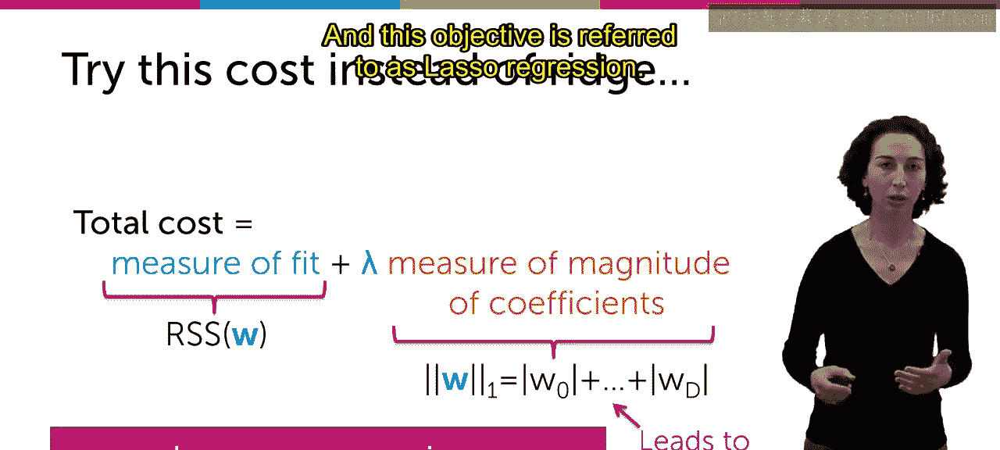
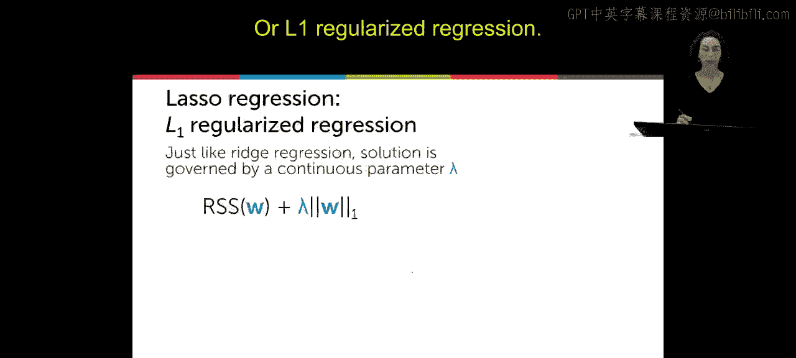
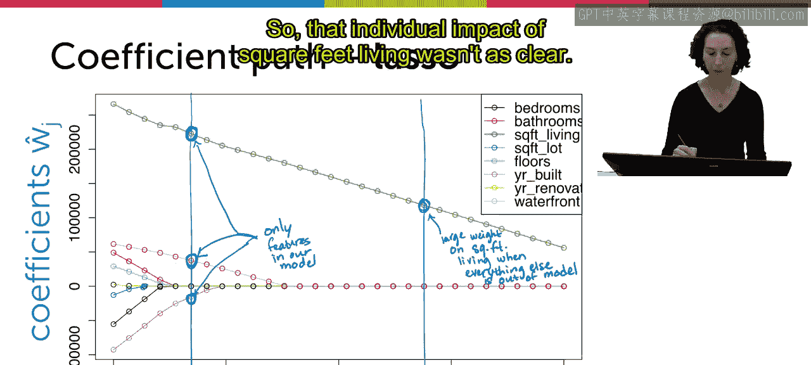

# 机器学习：第2课：Lasso目标及其系数路径 📊


在本节课中，我们将学习Lasso回归的目标函数，并理解其如何通过L1正则化产生稀疏解。我们将对比Lasso与之前介绍的岭回归，并通过系数路径图直观地展示其特性。

---



上一节我们介绍了岭回归及其L2正则化。本节中，我们来看看另一种正则化方法——Lasso回归。



如果我们将衡量系数大小的方式从岭回归的L2范数（平方和）替换为L1范数，即简单地对每个系数的绝对值求和，会发生什么？我们在上一个模块讨论岭回归时，曾将其描述为一种合理的系数大小度量方式。

这个修改的结果是，它会导向稀疏解。我们将在本模块的剩余部分探讨其原因。这个目标函数被称为**Lasso回归**或**L1正则化回归**。

其目标函数公式如下：
```
最小化 [ RSS(w) + λ * ||w||_1 ]
```
其中，`||w||_1 = |w_1| + |w_2| + ... + |w_D|` 是系数的L1范数。

---

与岭回归类似，Lasso也由一个调优参数λ控制。λ决定了我们在多大程度上倾向于解的稀疏性，而不是对训练数据的拟合程度。

需要明确的是，在进行特征选择任务时，我们是在一个连续的空间（λ值的空间）中进行搜索。λ控制着解的稀疏性。这与“所有子集”或“贪婪”方法形成对比，那些方法是在一组离散的可能解中搜索。因此，Lasso是一种根本不同的特征选择方法。

---

接下来，我们讨论当λ变化时，解会发生什么变化。再次强调，λ是一个平衡拟合度与稀疏性的调优参数。

以下是λ取不同值时的情况：

*   **λ = 0**：此时惩罚项完全消失，目标函数简化为最小化残差平方和（RSS），即我们之前的最小二乘目标。因此，Lasso的解 `ŵ_lasso` 将完全等于最小二乘解 `ŵ_least_squares`。这就是无正则化的解。
*   **λ = ∞**：此时我们完全倾向于系数大小的惩罚，完全忽略残差平方和的拟合。那么，什么值能使L1范数最小呢？与岭回归类似，当λ趋近于无穷大时，我们会得到 `ŵ_lasso` 等于零向量。
*   **0 < λ < ∞**：在这种情况下，Lasso解的L1范数将小于或等于最小二乘解的L1范数，并且大于等于零（标量零）。

---

到目前为止，尚不清楚为什么L1范数会导致稀疏性。我们稍后会解释。但首先让我们直观地探索一下。一种方法是观察系数路径。

我们先回顾一下岭回归的系数路径。我们看到，即使λ值很大，所有特征也仍然在模型中，只是系数值很小。对于大的λ值，所有 `ŵ_j` 都大于0，但都很小。

相比之下，观察Lasso的系数路径，我们会看到一个非常不同的模式。我们发现，在调优参数λ达到某些临界值时，某些特征会“跳出”模型。

例如，在下图中：
*   地块面积（square feet of the lot size）在此处从模型中消失。
*   卧室数量（number of bedrooms）几乎与楼层数（number of floors）和浴室数量（number of bathrooms）同时消失。
*   接着是房屋建造年份（year the house was built）。

对于像图中这个位置的λ值，我们模型中包含的是一个稀疏的特征集合。只有被圈出的特征是模型中包含的，所有其他特征的系数都已精确地降至零。

我们还观察到，当λ非常大时（如前一张图中所示的大值），模型中唯一剩下的特征是居住面积（square feet living）。请注意，即使其他特征都不在模型中，居住面积仍然具有非常大的权重。只有当λ值变得极大时，居住面积的系数最终才会被压缩至零。

回到岭回归的解，我们会发现居住面积的权重要小得多，因为权重被分配给了模型中的许多其他特征，因此居住面积的个体影响不那么明显。

---



本节课中，我们一起学习了Lasso回归的目标函数及其核心特性。我们了解到，Lasso通过引入系数的L1范数作为惩罚项，能够在优化过程中自动将某些不重要的特征系数精确地压缩为零，从而实现特征选择和稀疏解。通过系数路径图，我们直观地对比了Lasso与岭回归的差异：岭回归倾向于保留所有特征但缩小其系数，而Lasso则倾向于产生一个只包含部分特征的更简洁模型。