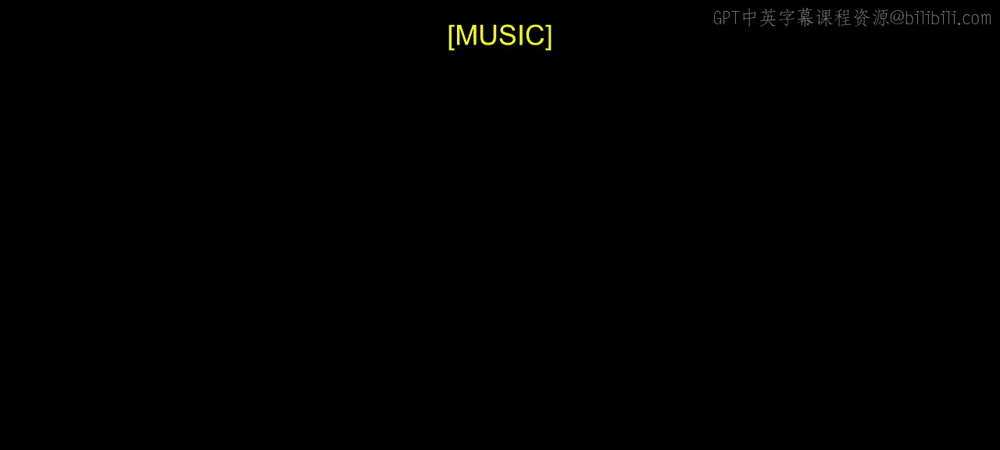
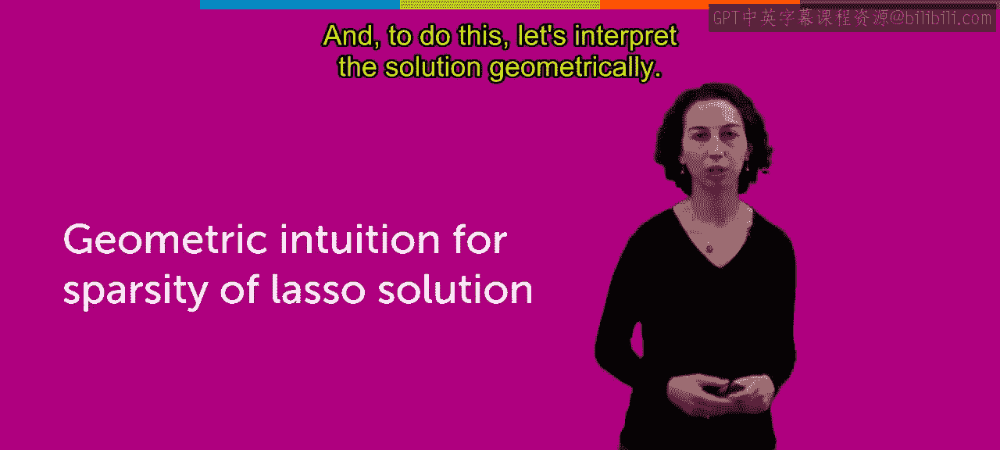
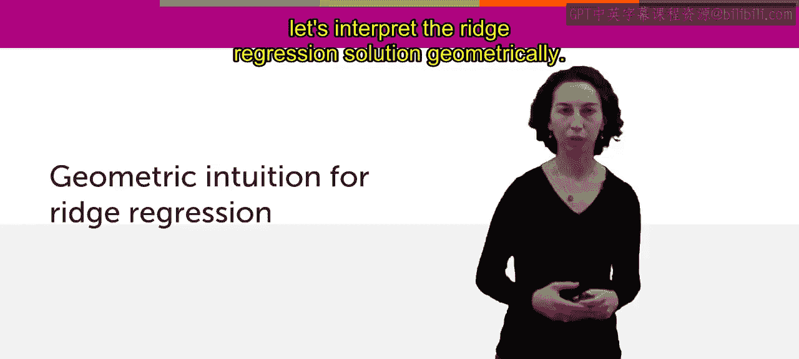
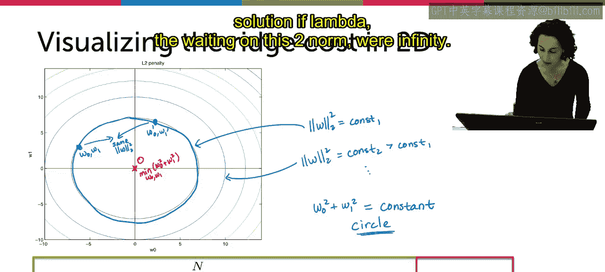
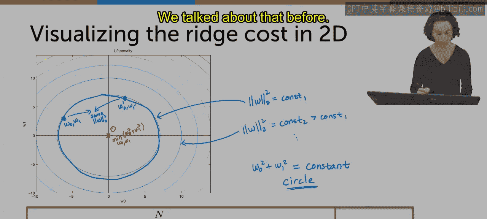

# 华盛顿大学《机器学习（回归，第2课⧸共4课）｜Machine Learning》中英字幕 p87 87_可视化岭回归成本.zh_en -BV11b421H7XL_p87-

。

Now let's see why we get sparsity in our LasO solutions and to do this let's interpret the solution geometrically。

 but first to set the stage， let's interpret the Rige regression solution geometrically and then we'll get to the Lasso well since visualizations are easier in 2D。

 let's just look at an example where we have two features。

H0 and H1。 so let me just write this two features。4。Visualization's sake。

And what I'm writing in this green box is my ridge objective simplified just for having two features。

 and in this pink box， I'm showing just the residual sum of squares term and what we're going to do to start with or we're going to make a contour plot for our residual sum of squares in these two dimensions W0 by W1。

And let's look at this residual summa squares term where。Inside the sum over n observations。

 we're going to get terms that look like why squared。Plus， W 0 squared。

 H0 squared plus W1 squared H1 squared plus。All the cross terms。

When I finish completing this square here。And if I think about this。

And if I sum over all my observations， these sums will pass in here。

So if I think of this as a function of W0 and W1。Well， what's this defining？

If this is equal to some constant。Which is what a contour plot is doing is' looking at an objective equal to different values。

 well this is an equation of an ellipse。Because I have my two parameters， W0 and W1 each squared。

 they're multiplied by some weighting， and then there's some other terms having to do with W0 and W1。

 no power greater than squared that are coming in here。

 setting it equal to constant that by definition is an ellipse。Okay， so what I see is that。

For my residual summer squares contour plot。I'm going to get a series of ellipses。

 so I'm highlighting here。One ellipse， and what this ellipse is is this is residual sum of squares of w0。

 w1。Equal to what I'll call constant one。And this next。Ploot and。Is residual sum of squares W 0。

 W1 equal to some constant 2， which is greater than constant 1。And so on。

 That's what all these curves are increasing residual summa squares。

 And when I walk around this curve， it's a level set。 It's a set of all things being。Equal value。

 So if I look at some w0， W1 pair and I look at some other point。W0， prime， W1 prime。Well。

 both of these points。Here and here， have the same。Residual sum of squares。

 which is what I called constant one before， so as I'm walking around this circle。

 every solution W0 W1 has exactly the same residual sum of squares。Okay。

 so hopefully what this plot is showing is now clear。

 and now let's talk about what if I just minimize residual sum of squares？Well。

 if I just minimize residual sum squares， every time I jump from one of these curves to the next curve to the next curve all the way in to the smallest curve。

 just this dot in the middle， this is going to smaller and smaller residual sum squares。

 So this X here marks the minimum。Over all possible W0 W1 of residual sum of squares， W0， W1。

And what is that， that's our least square solution， So this is W hat least squares。Okay， I'm gonna。

Because this is so important， I'm going to highlight it in red。 Okay， that's what this point is。

 actually， I don't want to draw a circle because a circle is。

Exactly what all these other ellipses look like here。

 so I'm going to put a little box around this and I'll highlight in red， this is W hat least squares。

Okay。So that would be my solution。If if I were just minimizing residual sum of squares。

 but when I'm looking at my ridge objective， there's also this L2 penalty。

 the sum of w0 squared plus w1 squared and what does that look like so I have。

W0 squared plus W1 squared and when I'm looking at my contour plot。

 I'm looking at setting this equal to some constant。

And changing the value of that constant to get these different contours。

 the different colors that I'm seeing here。Well， what shape is w0 squared plus w1 squared equal to a constant？

That is exactly the equation of a circle。So we see that the circle is centered about zero。And。

So each one of these curves here， just to be clear。Is。My two norm of W。Squared equal to let's say。

 constant one。 This next circle is the two norm of W。Squared equal to some constant2。

 which is greater than constant1。And so on。And again， if I look at any point。W0。

 W1 and some other point。W0， prime， W1 prime。These things have。The same。Norm。Of the W vector squared。

And that's true for all points around this circle。So let's say I'm just trying to minimize my two norm。

What's the solution to that？Well， I'm going to jump down these contours to my minimum and my minimum。

 let me do it directly in red this time。My minimum oops， that didn't switch colors。Directly in red。

 my minimum is setting w0 and W1 equal to zero。So this。Is。Min。😔，Over w0， W1。My。Two norm。

 which I'll write explicitly in this 2D case， is W0 squared plus W1 squared。And the solution is zero。

Okay， so this would be our Rige regression solution if lambda。

 the waitinging on this two norm were infinity， we talked about that before。

