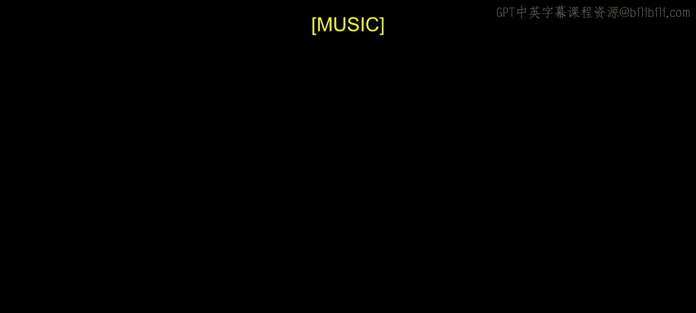
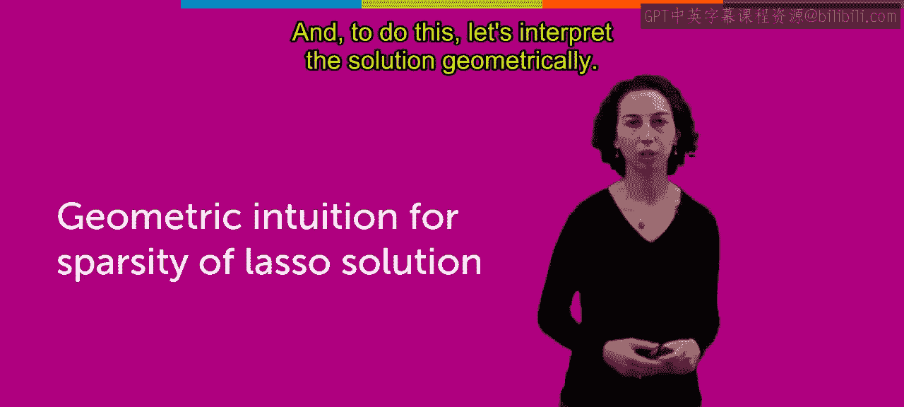
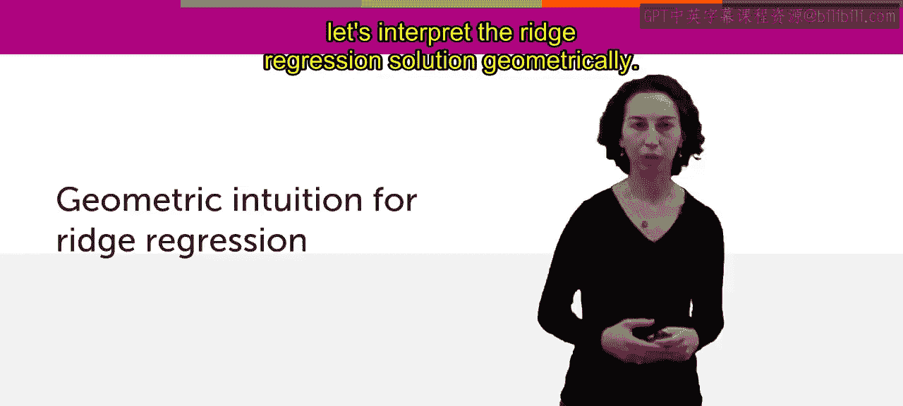
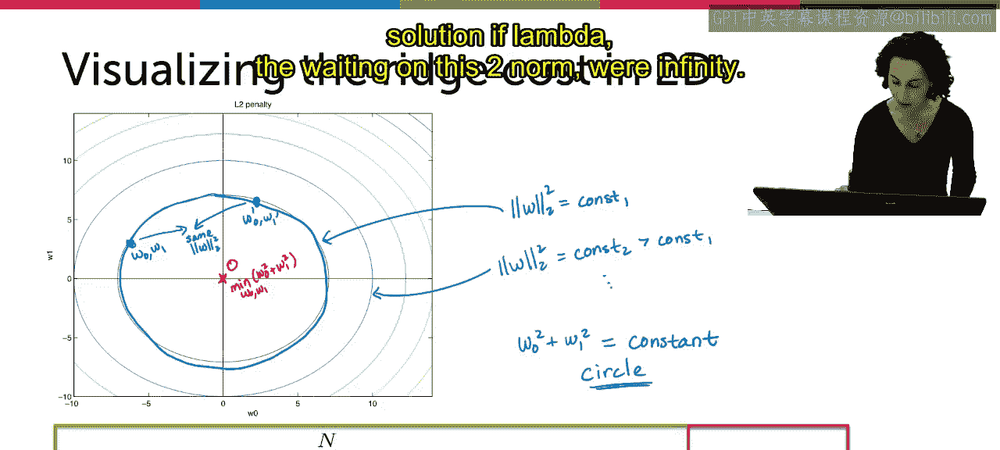
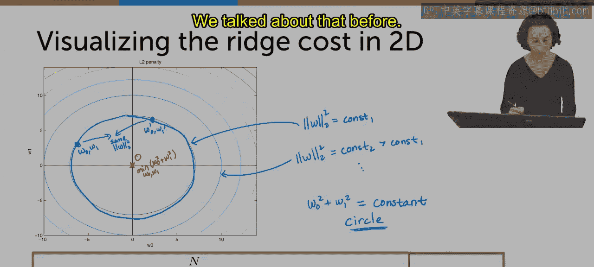

# 机器学习：第2课：可视化岭回归成本





在本节课中，我们将学习如何通过几何视角来理解岭回归的解。我们将从二维特征空间入手，通过绘制成本函数的等高线图，直观地展示岭回归如何平衡数据拟合（残差平方和）与模型复杂度（L2范数惩罚项）。理解这种几何解释，有助于我们为后续理解Lasso回归的稀疏性打下基础。



## 岭回归目标的几何解释

为了进行可视化，我们考虑一个简化的场景：模型只有两个特征，即 `w0` 和 `w1`。我们的目标是理解岭回归的解在参数空间中的位置。

岭回归的目标函数可以写为：
```
目标函数 = 残差平方和(RSS) + λ * (w0² + w1²)
```
其中，λ 是控制惩罚强度的超参数。

接下来，我们将分别分析这个目标函数中的两个组成部分。

## 残差平方和的等高线

首先，我们关注目标函数的第一部分：残差平方和（RSS）。在二维特征空间中，RSS作为 `w0` 和 `w1` 的函数，其等高线图具有特定的形状。

当我们固定RSS等于某个常数 `C` 时，方程 `RSS(w0, w1) = C` 定义了一个**椭圆**。这是因为方程中 `w0` 和 `w1` 都以平方项形式出现，并且包含它们的交叉项。

以下是RSS等高线图的关键点：
*   图中的每一个椭圆都代表一组 `(w0, w1)` 参数，它们都产生相同的RSS值。
*   越靠近中心的椭圆，其RSS值越小。
*   所有椭圆同心，并且中心点对应着RSS的全局最小值。

如果我们的目标仅仅是最小化RSS，那么最优解就是这个椭圆的中心点。这个点正是**最小二乘解**，我们将其标记为 `ŵ_least_squares`。

## L2惩罚项的等高线

现在，我们来看目标函数的第二部分：L2范数惩罚项 `w0² + w1²`。这个项的几何形状更为简单。

当我们固定惩罚项等于某个常数 `C` 时，方程 `w0² + w1² = C` 定义了一个**圆**。这个圆以坐标原点 `(0, 0)` 为圆心。

以下是L2惩罚项等高线图的关键点：
*   图中的每一个圆都代表一组 `(w0, w1)` 参数，它们具有相同的L2范数值。
*   越靠近原点的圆，其L2范数值越小。
*   如果我们的目标仅仅是最小化L2范数，那么最优解就是原点 `(0, 0)`。这对应着岭回归中惩罚强度λ趋于无穷大的极端情况。

## 岭回归解的平衡点

上一节我们分别查看了RSS和L2惩罚项的几何形状。在岭回归中，我们需要同时最小化这两者之和。最终的解将是这两个竞争目标之间的一个平衡点。

从几何上看，岭回归的最优解 `ŵ_ridge` 必须同时满足两个条件：
1.  它需要位于某个RSS的椭圆等高线上。
2.  它也需要位于某个L2惩罚项的圆形等高线上。

实际上，`ŵ_ridge` 就是使得RSS椭圆与L2圆**恰好相切**的那个点。随着惩罚强度λ的变化，这个切点的位置会沿着RSS椭圆的边界移动：
*   当 **λ = 0** 时，相当于没有惩罚，解就是最小二乘解 `ŵ_least_squares`。
*   当 **λ 增大**时，圆形等高线“收缩”，迫使解向原点 `(0, 0)` 移动，参数值被“压缩”得更小。
*   当 **λ → ∞** 时，解被压缩至原点 `(0, 0)`。

这种可视化清晰地展示了岭回归如何通过引入L2惩罚，将参数估计值从最小二乘解“拉向”原点，从而在偏差和方差之间取得平衡，提高模型的泛化能力。

## 总结





本节课中，我们一起学习了岭回归的几何解释。我们通过绘制残差平方和（椭圆）与L2惩罚项（圆）的等高线图，直观地看到了岭回归的解是如何作为这两个竞争目标之间的平衡点而出现的。解是RSS椭圆与L2圆的切点，其具体位置由惩罚系数λ控制。这种几何视角为我们理解正则化的作用机制提供了清晰的图像，并为下一课理解Lasso回归产生稀疏解的几何原因奠定了基础。