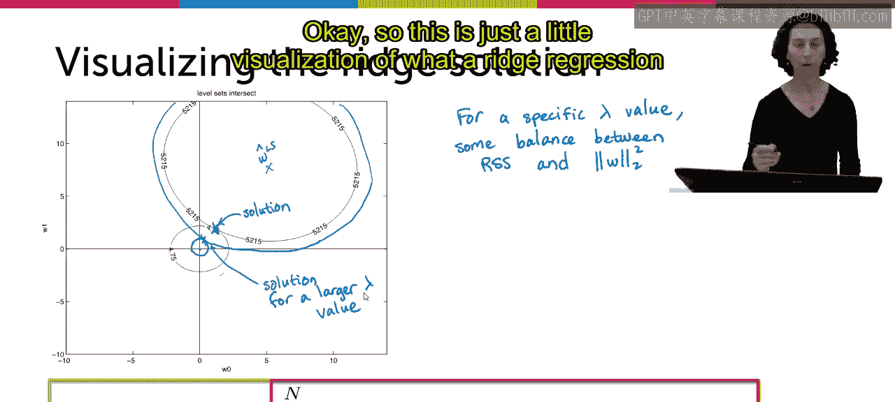

# 华盛顿大学《机器学习（回归，第2课⧸共4课）｜Machine Learning》中英字幕 p88 88_可视化岭回归解.zh_en -BV11b421H7XL_p88-

。

For any specific value of lambda。We get some balance between this residual sum squares and this two norm。

 And so what I'm going to do is in this movie， I'm going to add these two contour plots together。

 I'm going to add。So let me write this down。Add contour。Ploots。Together。

Where I'm getting residual sum of squares of w plus lambda2 norm of W。

Where here the residual Sma squares were these ellipses。

Centered about my least square solution and this two norm were these circles centered about zero and lambda is some waiting。

On how much I'm including that two norm penalty or the cost。

And what I'm going to do is I'm going to show a movie as a function of lambmbda。So movie。Fengsin。Of。

Increasing。Lambda where。I have my ellipses and I'm waiting more and more heavily these contours that are coming from this circle。

 these circle terms from this two norm penalty。Okay， so this is the movie right here。And。

My lovely assistant Carlos。Well， click the mouse to play the movie。

Since I don't know how to control it from the tablet， unfortunately。Thank you， Fna。U。

That reference was probably lost on most people and in doing so。

You didn't get me describing the movie， so let's watch it again。 But what we see， this X。

 let me be clear that the X is going to mark the optimal solution。For a specific。Lambda。

 and we're varying lambda。 So this x is going to move。 Okay， where's the x going to start。 Well。

 when lambda is equal to 0， we're starting out our least square solution。 And as lambda increases。

 we know that as lambda goes to infinity， the coefficients are going to shrink to 0。

 but let's visualize the path that it takes as we increase lambda。 Okay。

 so let's play this movie again。 and start at our least squared solution。

 And we see that the magnitude of our coefficients。

 W0 and w1 are shrinking smaller and smaller towards 0。

 So maybe we'll play that once more just to visualize this。And what we see， again。

 this was just the tail end of the movie， is this shrinking magnitude of the coefficients。

Carlos is very excited about this movie， so we're going to watch it one more time。 It's pretty cool。

 We've never actually seen somebody do this visualization。 We think it's really intuitive。 So again。

 as that lambmbda penalty is increasing， the magnitude of the coefficients are getting shrunk。😊，Okay。

 well now let's talk about what the solution looks like for a given value of lambmbda。Oops， sorry。

 let me。Depen on。For a specific。Lambda value。We have some balance between residual sum squares and the magnitude of our coefficients。

Lambda is automatically doing some trade off between the two。Some balance。Between。R S S， and。

Our two norm。And specifically in this plot， this is our solution。

So it has some RSS that happens to be 5215。 that's what the number on this contour is indicating。

 and it has some two norm which has value 4。75 and so this lambda has chosen this specific tradeoff and we see that our solution is somewhere here which is shrunk from where our least square solution was。

 let's remember our least square solution was somewhere around here and the optimal for lambda equals infinity was at  zero so it's somewhere in between these two values。

And if we had chosen a different value of lambda， let's say a larger value of lambmbda。

We would have had a different solution。And when I'm drawing all these contours。

 what I'm saying is let me just go back to the original one before this drawing。

What I'm saying is every other point along this circle has exactly the same residual sum squares。

 but larger L2 norm of W and everywhere along。This circle has exactly the same W2 norm。Sorry。

 L2 norm of W， but it has larger residual summa squares。

 so that's why this is the optimal trade off for this Lada。Then like I drew here， if I chose。

A larger lambda， I would get a solution that preferred a smaller two norm and a larger residual summa squares。

 so this would be solution。4。A larger。Lambda value。Okay。

 so this is just a little visualization of what our Rige regression solution looks like。

