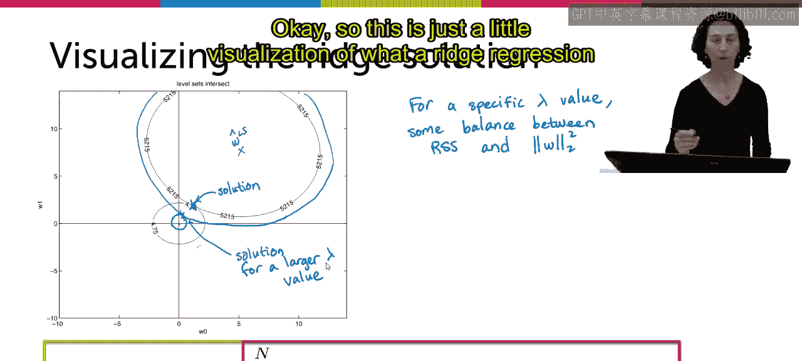

# 机器学习：第2课：可视化岭回归解

在本节课中，我们将学习如何通过可视化来理解岭回归的解。我们将看到，岭回归的解是如何在最小化残差平方和与最小化模型系数大小之间取得平衡的。

## 岭回归解的平衡

上一节我们介绍了岭回归的目标函数。本节中我们来看看这个解在几何上的直观表现。

对于任何一个特定的 lambda 值，我们都会在残差平方和与系数的 L2 范数之间取得某种平衡。

因此，我接下来要做的是，在这个演示中，将这两个等高线图叠加在一起。具体来说，我将叠加残差平方和 `RSS(w)` 与 `λ * ||w||₂²` 的等高线图。其中，残差平方和的等高线是围绕最小二乘解的一系列椭圆，而 L2 范数的等高线是围绕零点的一系列圆。λ 是一个权重参数，决定了惩罚项在总成本中的比重。

## 随 Lambda 变化的动态过程

以下是这个动态过程的核心：我将展示一个随着 lambda 值增加而变化的动画。

*   **动画内容**：随着 lambda 增加，观察解的变化。
*   **初始状态**：当 lambda 等于 0 时，我们的解就是最小二乘解。
*   **最终状态**：随着 lambda 趋近于无穷大，系数会收缩至 0。
*   **动画目的**：可视化系数收缩的路径。

让我们观看这个动画。动画中的 “X” 标记了对于特定 lambda 值的最优解。随着 lambda 变化，这个 “X” 会移动。

动画开始于最小二乘解。随着 lambda 增加，我们可以看到系数 w0 和 w1 的幅度越来越小，逐渐向零点收缩。这个过程直观地展示了岭回归的“收缩”效应。

## 特定 Lambda 值的解

现在，让我们讨论对于一个给定的 lambda 值，解的具体形态。

对于一个特定的 lambda 值，我们在残差平方和与系数幅度之间取得某种平衡。lambda 自动地在两者之间进行权衡。

具体到这张图中，这就是我们的解。它对应一个特定的残差平方和（图中等高线上的数字 5215 即表示此值），以及一个特定的 L2 范数值（4.75）。这个 lambda 值选择了这个特定的权衡点。我们可以看到，解的位置介于最小二乘解（大约在图中椭圆中心）和零点之间。

如果我们选择了一个不同的 lambda 值，例如一个更大的 lambda，我们将得到一个不同的解。在更大的 lambda 下，解会更倾向于更小的 L2 范数，但会接受更大的残差平方和。

## 理解最优性

当我绘制这些等高线时，我想表达的是：沿着这个椭圆上的任何其他点，都具有完全相同的残差平方和，但具有更大的系数 L2 范数；而沿着这个圆上的任何其他点，都具有完全相同的系数 L2 范数，但具有更大的残差平方和。因此，图中 “X” 标记的点，正是对于这个 lambda 值的最优权衡点。

本节课中我们一起学习了如何通过可视化等高线图来理解岭回归。我们看到了解如何随着正则化强度 lambda 的变化，在拟合数据（最小化残差）和约束模型复杂度（缩小系数）之间平滑地移动。这种几何视角有助于我们直观把握岭回归的工作原理。