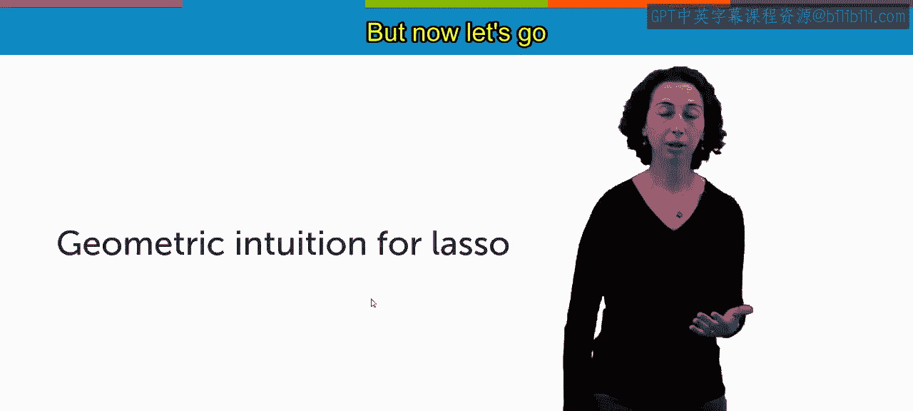
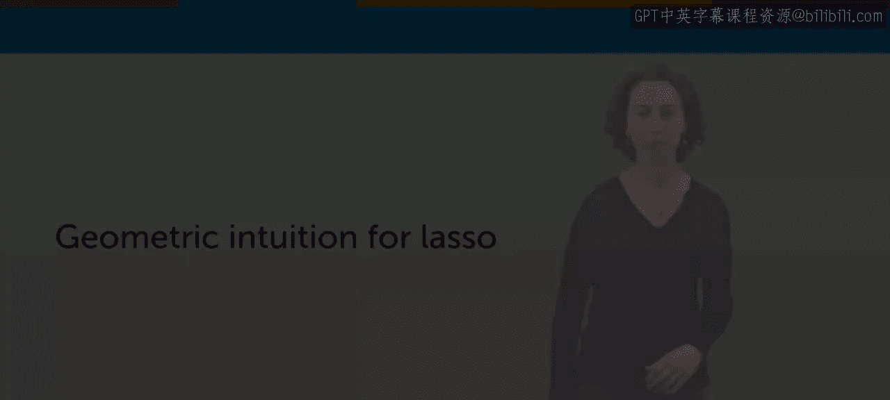
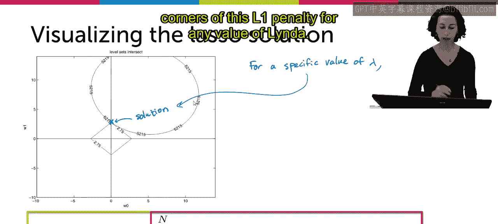

# 华盛顿大学《机器学习（回归，第2课⧸共4课）｜Machine Learning》中英字幕 p89 89_可视化Lasso成本和解.zh_en -BV11b421H7XL_p89-

。

But now let's go through exactly the same geometric interpretation for our Lasso objective。

And for our Lasso objective， we have our residual summa squares plus lambda times R L1 norm。Okay。

 so when we look at this first term。Which is in this pink or rather fusia box。

We have exactly the same residual summa squares that we talked about for Rige。

 So when we visualize the contours associated with residual sum squares in our Lasso objective。

 it's exactly the same。 so residual summa square。Contours。For。La so。2。Exactly。The same。As those。4。

Rge。Okay， so I don't need to explain this plot again。

 you remember what it is from our ridge visualization we just went through。

But now let's look at the term that's different and that's looking at an L1 penalty instead of an L2 penalty。

And here， if we think of looking at。The absolute value of w0 plus the absolute value of w1 equal to some constant。

Defining。One of our level sets in our contour plot， well， what does that look like？

That defines a diamond。Okay，As I'm walking along this diamond。Every point。Along。This surface here。

 this line that I'm drawing has exactly the same。L1 norm。

 so here I have my one norm is equal to some constant one。Here。I have the one norm。

Equal to some constant， two， greater than constant one。And so on。And again。

 just to be very explicit if I look at some W0。W1 pair。Can look at any two points and some W0 prime。

 W1 prime。These points。For any points along this surface， have the same。sorry， one norm。W1。Okay。

So if I'm just trying to minimize my L1 norm， what's the solution？Well， again， just like in Rige。

 the solution is to make the magnitude as small as possible， which is 0。 So this is min。Over w。

Of my one norm。Okay。So。This is a really important visualization for the one norm and we're going return to it in a couple slides。

 but first what I want to do is show exactly the same type of movie that we showed for our Ri objective but now for Laso so again this is a movie where we're adding the two contour plots。

 So adding。rss。Plus， lambmbda。W1， in this case， so we're adding ellipses。Plus。

 some waiting lambda of a set of diamonds。And then we're going to solve for the minimum。

 that's going to be x。 so x is again， our optimal。W hat for a specific lambmbda。

And we're going to look at how that solution changes as we increase the value of lambda and again。

 if we set lambda equal to0， we're going to be at our least square solution。

 so we're going to start at exactly the same point that we did in our Rige regression movie。

 but now as we're increasing lambda， the solution is going to look very different than what it did for Rige regression。

 we know that the final solution is going to go towards zero。

 but let's look at what the path looks like。Okay， Vanna。Carlos， you're up。Play the movie。Um。

So what we see is that the solution eventually gets to the point where w0 is exactly equal to zero。

So if we watch this movie again。We see that this x is moving along shrinking and then it hits the y axis and it moves along that y axis。

 so the first thing that happens is that w0 becomes exactly zero well the coefficient shrink and at some point it hits the point where w0 becomes exactly zero。

And then our W1 term， the weighting on this second feature。

 H1 is going to decrease and decrease and decrease as we continue to increase our penalty term lambda。

 So it's going to continue to。' going to continue to walk down this axis。

 so let's watch this one more time with this in mind。Our solution hits that。That zero point。

 that sparse solution where W0 hat is equal to zero。

And then it continues to shrink the coefficients to zero。

 and you see that our contours become more and more like the diamonds that are defined by that L1 norm as the weighting on that norm increases。

Now let's go ahead and visualize what the LaO solution looks like。

And this is where we're going to get our geometric intuition beyond what was just shown in the movie for why Laso solutions are sparse。

 so we already saw in the movie that for certain values of lambda。

 we're going to get coefficients exactly equal to zero。

 but now let's look at just one value of lambda。And here。Is our solution？

And what you see is that because of this diamond， So let me write， this is our solution。

Because of this diamond shape。Of our L1 objective or the penalty that we're adding。

We're going to have some probability of hitting those corners of this diamond。

 and at those corners we're going to get sparse solutions。So like Carlos likes to say。

 it's like a ninja star that's stabbing。Our。RSS contours。

 so maybe that's a little brutal of a description， but maybe you'll remember it。

So this is why Lasso leads to sparse solutions。And another thing I want to mention is this visualization is just in two dimensions。

 but as we get to higher dimensions instead of diamonds。

 they're called rhmbos and they're very pointy objects， so in high dimensions。

 we're very likely to hit one of those corners of this L1 penalty for any value of lambda。

