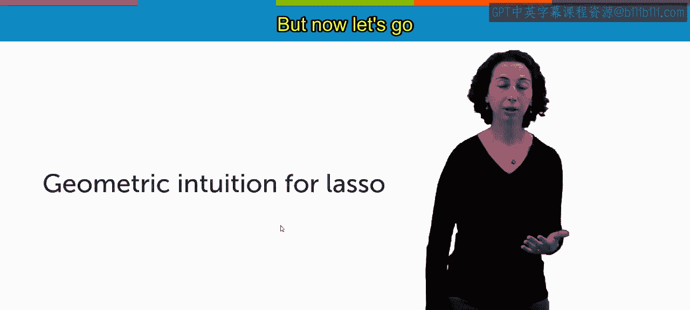
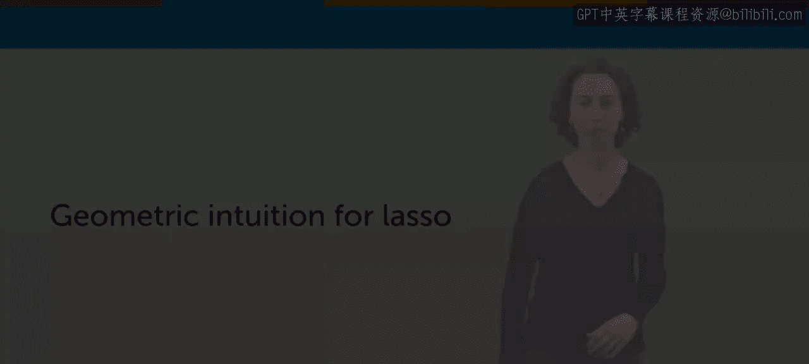
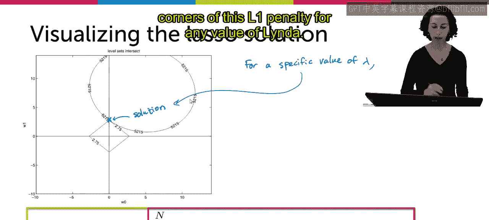

# 机器学习：回归：第2课：可视化Lasso成本函数与解 🎯

在本节课中，我们将学习Lasso回归的成本函数及其几何解释。我们将通过可视化方法，理解Lasso如何通过L1正则化产生稀疏解，即某些系数恰好为零的解。

---

上一节我们介绍了岭回归（Ridge）的几何解释，本节中我们来看看Lasso回归的目标函数。

Lasso的目标函数由两部分组成：残差平方和（RSS）加上一个L1正则化项。其公式如下：

**成本函数 = RSS + λ * ||w||₁**

其中，`||w||₁` 表示权重向量的L1范数，即各权重绝对值之和。

---

## 残差平方和（RSS）的等高线

首先，我们关注目标函数的第一项——残差平方和（RSS）。对于Lasso目标函数，RSS项与我们在岭回归中讨论的完全相同。

因此，在可视化Lasso目标函数中RSS的等高线时，它与岭回归中的形状完全一致。RSS的等高线是一组椭圆，其中心点是最小二乘解。

---

## L1正则化项的等高线

现在，让我们关注与岭回归不同的部分——L1正则化项。我们不再使用L2范数，而是使用L1范数。

如果我们考虑方程 `|w₀| + |w₁| = 常数`，这个方程定义了L1范数的一个等高线。这个形状看起来像什么？

它定义了一个**菱形**（或钻石形）。沿着这个菱形边界上的每一个点，都具有完全相同的L1范数值。

以下是不同L1范数常数对应的菱形：
*   当 `|w₀| + |w₁| = 常数1` 时，得到一个较小的菱形。
*   当 `|w₀| + |w₁| = 常数2`（大于常数1）时，得到一个较大的菱形。

如果我们的目标仅仅是最小化L1范数本身，那么最优解就是让所有权重趋近于零，即 `min over w of ||w||₁` 的解是 `w = 0`。

这个菱形的可视化对于理解Lasso至关重要，我们稍后会再次回到这个概念。

---

## 组合目标函数与解的路径

接下来，我们将展示一个动态过程，就像之前对岭回归所做的那样，但这次是针对Lasso。这个动态图展示了我们将两个等高线图相加的过程：**椭圆形的RSS等高线**加上**经过λ加权的菱形L1等高线**。

然后，我们求解这个组合函数的最小值，这个最小值点（标记为 `x`）就是对应特定λ值的最优解 `ŵ`。

我们将观察这个解如何随着λ值的增加而变化：
*   当 `λ = 0` 时，我们得到的就是普通最小二乘解，这与岭回归的起点相同。
*   随着λ逐渐增大，解的变化路径将与岭回归**非常不同**。虽然最终解都会趋向于零，但让我们看看具体路径是怎样的。

**播放动态图...**

我们观察到，解最终到达了 `w₀` 恰好等于零的点。让我们再看一遍这个过程：
1.  解 `x` 沿着路径移动并收缩。
2.  在某个时刻，它碰到了y轴（即 `w₀ = 0` 的轴）。
3.  此后，解沿着y轴向下移动。

这意味着，首先发生的是 `w₀` 系数**恰好变为零**。然后，第二个特征 `H₁` 的权重 `w₁` 会随着惩罚项λ的继续增加而不断减小，解将沿着y轴持续向下移动。

随着λ权重增大，组合后的等高线会变得越来越像定义L1范数的菱形。

---

## 为什么Lasso会产生稀疏解？

现在，让我们可视化Lasso在某个特定λ值下的解，这将为我们提供超越动态图的几何直觉，以理解**为什么Lasso解是稀疏的**。

动态图已经显示，对于某些λ值，我们会得到恰好为零的系数。现在，我们只看一个λ值下的情况。

**这里的 `x` 就是我们的解。**

关键点在于，由于我们添加的L1惩罚项具有**菱形**形状，解有很高的概率碰到这个菱形的**角**上。而在这些角上，我们就会得到稀疏解（即某些系数为零）。

可以这样形象地理解：菱形的角（在高维空间中是多面体的顶点）非常“尖”，它们会“刺中”RSS的椭圆等高线。这导致了最优解经常落在坐标轴上，使得某些系数为零。

需要提及的是，这个可视化仅仅是二维的。在更高维度中，L1范数的等高线形状被称为**菱面体**，它们同样是带有尖锐顶点的物体。因此，在高维空间中，对于任何λ值，解都更有可能落在L1惩罚项的某个顶点（角）上，从而产生稀疏性。

---

本节课中我们一起学习了Lasso回归成本函数的几何解释。我们看到了L1正则化项的菱形等高线如何与残差平方和的椭圆等高线相互作用，并理解了这种相互作用如何导致最优解经常位于坐标轴上，从而产生系数恰好为零的稀疏模型。这是Lasso回归用于特征选择的核心原理。