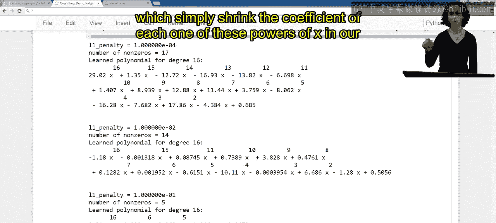

# 华盛顿大学《机器学习（回归，第2课⧸共4课）｜Machine Learning》中英字幕 p90 90_Lasso演示.zh_en -BV11b421H7XL_p90-

。

Well， let's see this sparsity in action and for this we're going to go back to our polynomial regression example。

 but instead of just doing least squares for increasing polynomial orders or looking at Rige regression。

 we're now going to look at our Lasso solution again for different values of our tuning parameter lambda。

Here we are back at our polynomial regression demo and for this Lasso regression example。

 all we have to do is take our polynomial regression function and modify it because we're using graphLb created just this dot linear regression remember there was this L2 penalty and L1 penalty well now we fully understand what these two penaltyalties are。

 and we know that for Ridge we were looking at the L2 penalty but for Lasso the L2 penalty is going to be set to zero and instead we're going to focus on this L1 penalty and in this demo we're going to explore different values of that L1 penalty and I also want to mention that here we're specifying a solver so FISA is one solver。

 we're going to look at other ways of optimizing the Lasso objective in this module but we can think of FISA as just a fancy version of gradient descent。

Okay， so this is our。Polynomial lassso regression function， and now we're just going to explore。

A set of L1 penalty values， so again these are our lambda values going from1 e to the minus4 all the way up to a value of 10 and like in our Rige regression demo we're starting with our 16th order polynomial。

 which was that really crazy fit in the least squares unregularized case。

 but now let's think about what is going to happen in this Laso scenario。嗯。

And so what we see is that when the penalty strength is really small。

 we don't get any sparsity at all， okay， so we have 16th order polynomial and what we're seeing is that all 17 coefficients because there's 16 orders of x plus this intercept terms。

 so in total 17 coefficients and all 17 of them are non-zero。

And that makes sense because as lambda becomes really， really small。

 remember we default back to our least square solution where we don't have any coefficients set exactly to zero。

 but as we increase this lambda value， we get more and more sparsity in our solution。

 so the number of non-zes here is 14， then we get five coefficients being non-zero。

 and by the time we have a penalty strength of 10， we only have two of our coefficients。

Being non zero， so you can see very explicitly from this how LasO is leading to sparse solutions。

 especially as you're increasing the strength of that L1 penalty term。

But now let's just look at the fits associated with these different estimated models。

 So this is for our very small。Penalty value。This function doesn't look as crazy as the least square solution。

 still fairly wiggly， but remember that in Lasso， just like in Ridge。

The coefficients are shrunk relative to the Rige regression solution。

 so even in this case where we don't have any sparsity。

 so none of the features have been knocked out of our model。

 we still have that the coefficients are a little bit shrunk relative to those of the least square solution。

 and that's providing enough regularization to lead to the smoother fit in this case。

But as we increase this lambda value， we see that we actually do get smoother and smoother fits。

 this starts to look like the fit that we had for our optimal setting of our ridge regression objective or the one that minimized our leave one out cross validation error。

But again， when we get to really large lambdas， just like in Rige regression。

 we start to have fits that are oversmthing things。

 so this was the case where we only had two non-zero coefficients and we see that's really just insufficient for describing what's going on in this case。

 so again， to choose our lambda value here we could do the same leave1 out cross validation we did in our ridd regression demo but the point that I wanted to show here is how we get these sparse solutions where we're knocking out in this case different powers of x in our polynomial regression fit。

And this is in contrast to Rige regression， which simply shrink the coefficients of each one of these powers of x in our degree 16 polynomial fit。

