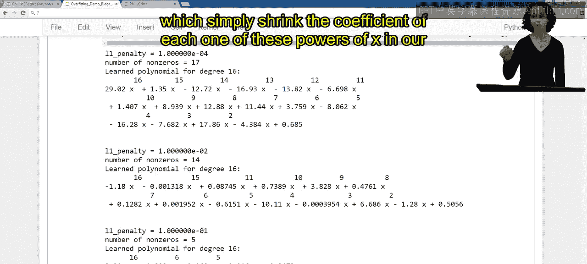

# 机器学习：第2课：Lasso回归演示 🎯


在本节课中，我们将通过一个多项式回归的示例，直观地展示Lasso回归如何通过L1惩罚项实现稀疏解。我们将观察随着正则化参数λ的变化，模型系数如何被压缩至零，以及这如何影响模型的拟合效果。

## 稀疏性实践

上一节我们介绍了Lasso回归的理论基础，本节中我们来看看它在实际数据上的表现。我们将回到多项式回归的示例，但这次我们将应用Lasso回归，并观察不同λ值下的结果。

以下是我们的演示设置：我们将使用一个16阶的多项式回归模型，并调整L1惩罚项的强度。


## 代码实现与参数探索

我们修改了多项式回归函数，以使用支持L1惩罚项的线性回归模型。在代码中，我们将L2惩罚项设置为零，并专注于调整L1惩罚项。我们使用FISTA求解器来优化Lasso目标函数。

```python
# 示例：多项式Lasso回归函数
def polynomial_lasso_regression(data, deg, l1_penalty):
    # 构建多项式特征
    # 应用带L1惩罚的线性回归
    # 返回模型和系数
```

现在，我们将探索一系列λ值，从 `1e-4` 到 `10`。我们从16阶多项式开始，这个模型在未正则化的最小二乘法中会产生非常复杂的拟合。

## 观察系数稀疏性

随着λ值的变化，我们可以观察到模型系数的变化。

以下是不同λ值下非零系数的数量变化：

*   **λ非常小（如1e-4）**：所有17个系数（16个特征加1个截距项）均为非零。此时模型近似于最小二乘解。
*   **λ增大（如0.01）**：非零系数数量减少至14个。
*   **λ继续增大（如0.1）**：非零系数数量进一步减少至5个。
*   **λ很大（如10）**：仅剩2个系数为非零。

这个结果清晰地展示了Lasso如何通过增加L1惩罚项的强度来产生稀疏解，即自动将不重要的特征系数精确地设为零。

## 对比模型拟合效果

接下来，我们看看这些不同稀疏度的模型对应的拟合曲线。

以下是不同λ值对应的拟合图像描述：

*   **λ值很小时**：拟合曲线虽然比未正则化的最小二乘解平滑一些，但仍然相当曲折。即使没有系数为零，Lasso的收缩效应也提供了一定的正则化。
*   **λ值适中时**：拟合曲线变得平滑，类似于我们在岭回归中找到的最优解。模型在保持关键特征的同时，避免了过拟合。
*   **λ值很大时**：拟合曲线过于平滑，由于大部分特征被剔除，模型变得过于简单，导致欠拟合。

与岭回归简单地收缩所有系数不同，Lasso通过将部分系数设为零，实现了特征选择，从而得到了一个更易于解释的模型。


## 总结



本节课中我们一起学习了Lasso回归在实际中的应用。我们通过一个多项式回归的演示，观察到L1惩罚项如何随着λ的增大，将越来越多的模型系数压缩至零，从而实现稀疏解和自动特征选择。与岭回归的系数收缩不同，Lasso能够产生更简洁、更具解释性的模型。为了选择最优的λ值，我们可以像在岭回归中一样，使用留一法交叉验证等技术。