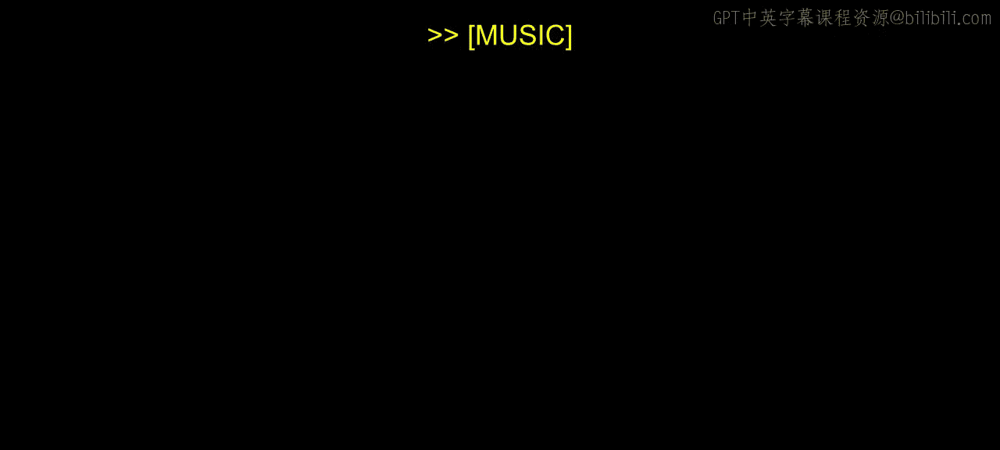
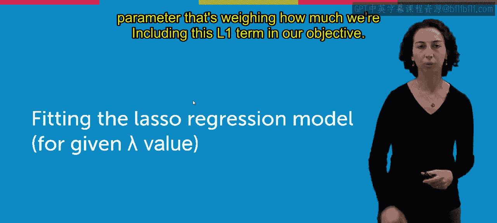
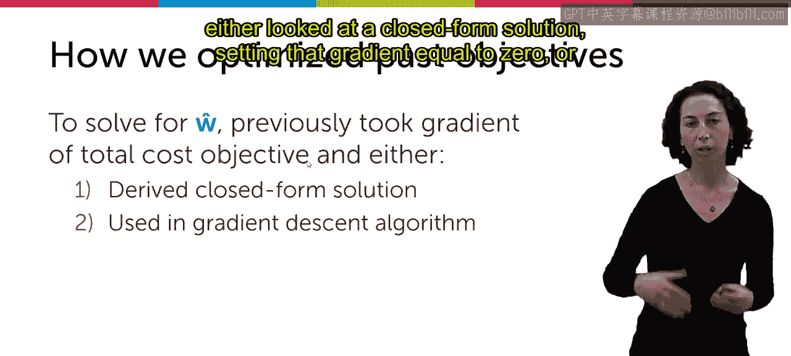
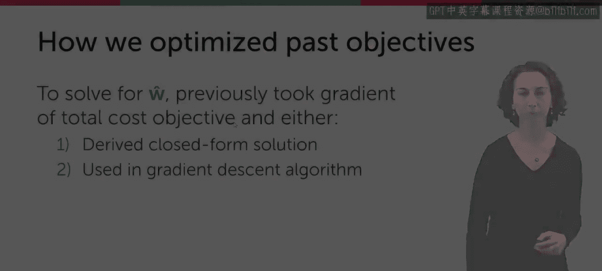
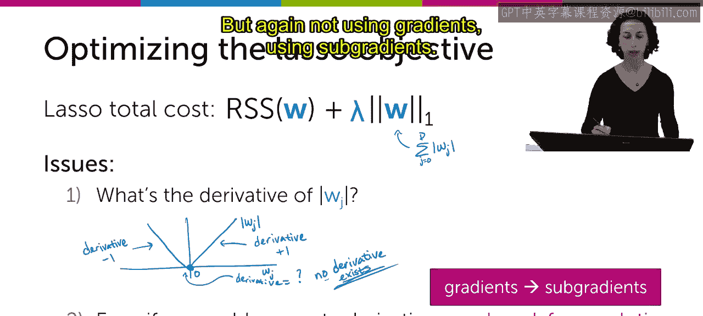
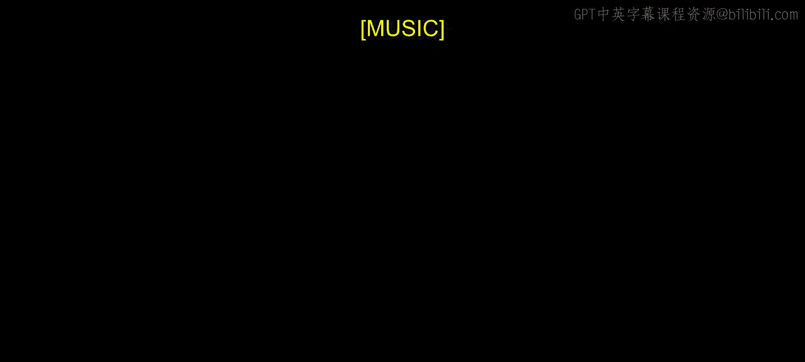

# 华盛顿大学《机器学习（回归，第2课⧸共4课）｜Machine Learning》中英字幕 p91 91_Lasso目标的独特之处.zh_en -BV11b421H7XL_p91-

。

Now that we've described our LASsO objective and we've given some intuition for why it leads to sparse solutions。

 now let's turn to how we're going to optimize our objective and actually solve for our LASsO solution for a specific value of Lambda。

 this tuning parameter that's weigh， how much were including this L1 term in our objective。

So in our machine learning workflow for regression， we're talking about this gray box here。

 our machine learning algorithm。And let's first remember what we've done for past objectives when we talked about least squares and Rige regression。

 what we did was we took the gradient of our total cost。

 and then we either looked at a closed form solution， setting that gradient equal to zero。

 or we used the gradient within an iterative procedure called gradient descent。

Well， here's our Lasso objective and let's think about taking the gradient。Well。

 we know how to take the gradient to the residual summa squares term。

 but then we get to this L1 objective。And we have some issues。In particular。

 what's the derivative of the absolute value because remember our L1 objective。

 this is the sum over j equals0 to D of the absolute value of WJ。

So we're going to have to take derivatives of this absolute value of WJ。

And when I think about this absolute value function。So this is WJ， absolute value of WJ。Well。

What's the derivative here？The derivative any point along this side is going to be minus1。

 the slope of this line is minus1。And the derivative anywhere on this half plane。

Is plus one because the slope is plus one， and then I get to this critical zero point。

And what's the derivative there？There's actually no derivative。That exists。At that point。

So instead of thinking about gradients defined by these derivatives。

 we can talk about something called subgrads。And we're going to discuss the concept of subgrads in a more advanced。

 optional video， but just know that they exist and they're crucial to the derivation of the algorithms we're going to talk about for the Laso objective and if you're interested in learning more。

 stay tuned for our optional advanced video。But even if you could compute this derivative that we're saying doesn't exist for this absolute value function。

There's still no closed form， solution for our Lasso objective。So we can't do the closed form option。

But we could do our gradient descent algorithm， but again， not using gradients using sub gradientds。

。

