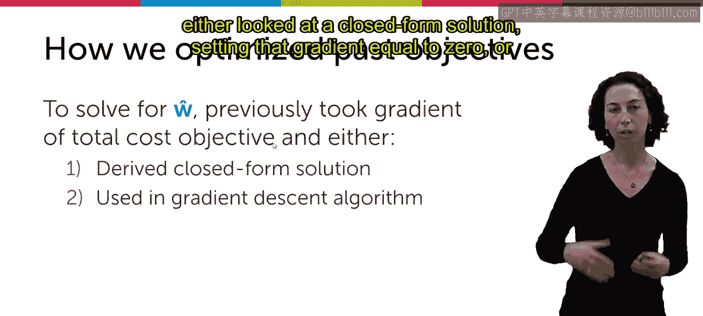
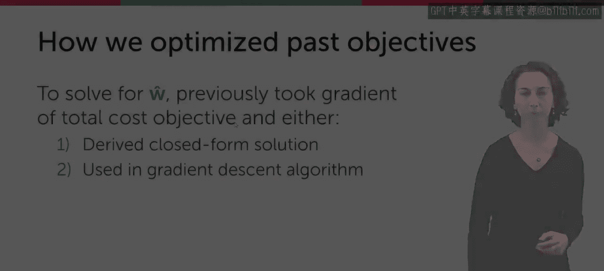
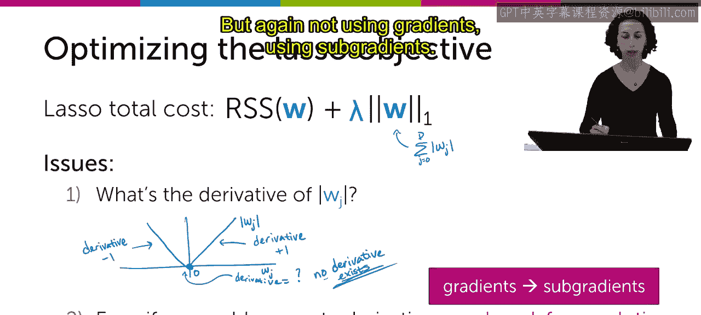

# 机器学习：回归：第2课：Lasso目标函数的独特性与优化 🎯

在本节课中，我们将学习Lasso回归目标函数的独特性，并探讨如何优化这个目标函数以找到特定λ值下的解。λ是一个调节参数，用于控制目标函数中L1惩罚项的权重。

## 从目标函数到优化方法

上一节我们介绍了Lasso目标函数及其导致稀疏解的直观原因。本节中，我们来看看如何优化这个目标函数，并实际求解特定λ值下的Lasso解。

在回归的机器学习工作流程中，我们目前关注的是代表机器学习算法的灰色方框。首先，让我们回顾一下之前处理最小二乘法和岭回归目标函数时的方法。我们计算了总成本的梯度，然后要么通过令梯度为零来寻找闭式解，要么在称为梯度下降的迭代过程中使用梯度。

## Lasso目标函数的梯度挑战

以下是我们的Lasso目标函数，让我们考虑计算其梯度。我们知道如何计算残差平方和项的梯度，但接下来会遇到这个L1目标项。这里存在一些问题。具体来说，绝对值的导数是什么？因为记住，我们的L1目标是W_j从j=0到D的绝对值之和。

因此，我们需要计算W_j绝对值的导数。当我思考这个绝对值函数时，即W_j的绝对值。那么，这里的导数是什么？在这条线的任何一点，导数都是-1，因为这条线的斜率是-1。而在这个半平面的任何地方，导数是+1，因为斜率是+1。然后我到达这个关键的零点，那里的导数是什么？实际上，该点不存在导数。

## 次梯度的引入

因此，与其考虑由这些导数定义的梯度，我们可以讨论一种称为**次梯度**的概念。我们将在更高级的可选视频中讨论次梯度的概念，但只需知道它们存在，并且对于推导我们将要讨论的Lasso目标函数算法至关重要。如果你有兴趣了解更多，请关注我们的可选高级视频。

但即使你能计算这个我们所说的绝对值函数不存在的导数，我们的Lasso目标函数仍然没有闭式解。因此，我们无法采用闭式解选项。不过，我们可以使用梯度下降算法，但再次强调，不是使用梯度，而是使用**次梯度**。

## 总结

本节课中，我们一起学习了Lasso回归目标函数在优化时面临的独特挑战。由于L1惩罚项包含绝对值函数，其在零点不可导，因此无法像最小二乘法或岭回归那样直接计算梯度并求闭式解。这引入了**次梯度**的概念，它是优化Lasso目标函数的关键工具。虽然我们无法获得闭式解，但可以通过基于次梯度的迭代算法（如次梯度下降）来求解Lasso问题。