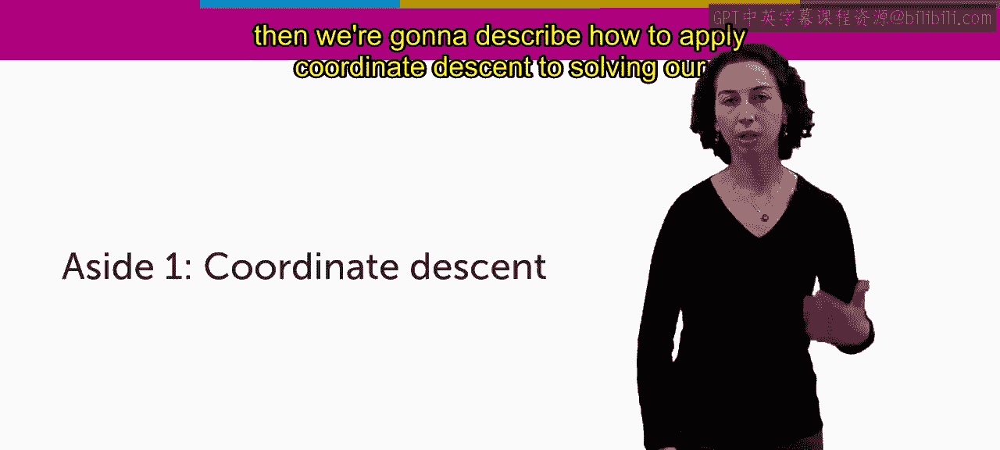
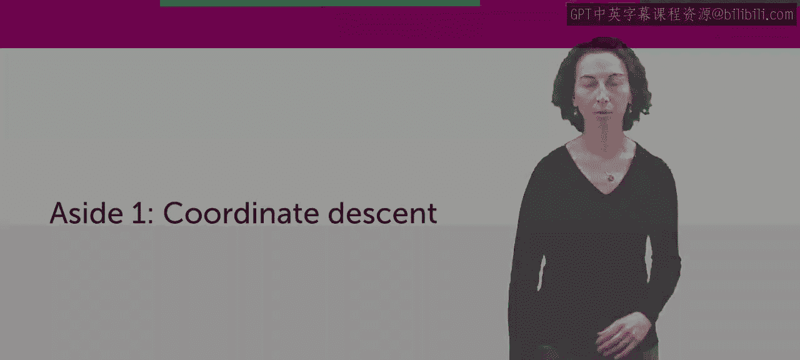
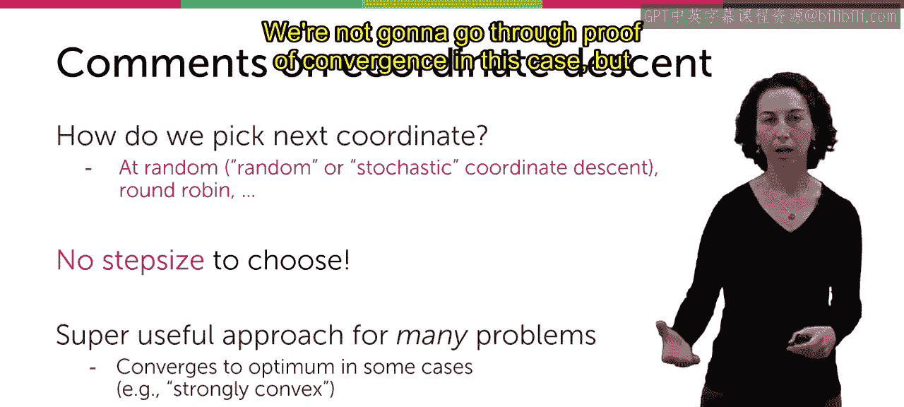
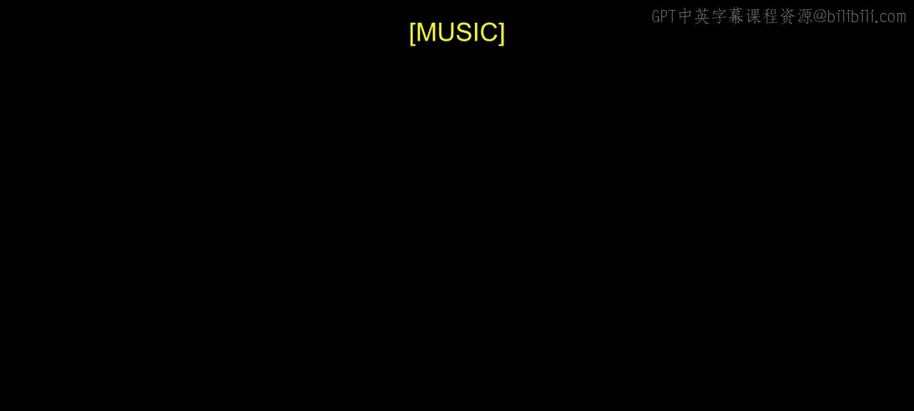

# 华盛顿大学《机器学习（回归，第2课⧸共4课）｜Machine Learning》中英字幕 p92 92_坐标下降法.zh_en -BV11b421H7XL_p92-

。

But instead of gradient descent or sub gradientient descent。

 let's take this as an opportunity to teach a really important alternative optimization procedure called coordinate descent。

 so let's just have a little aside on the coordinate descent algorithm and then we're going to describe how to apply coordinate descent to solving our Lasso objective。

So our goal here is to minimize some function G。 so this is the same objective we have。

 whether we're talking about our closed form solution。

 gradient descent or this coordinate descent algorithm。

 but let me just be very explicit where we're saying we want to minimize over all possible W。

 some G of W we're here。We're assuming G of w is a function of multiple variables， let's call it W0。

 W1， all the way up to W capital D。So this W I'm trying to write in some bold fonts here。

And often minimizing over a large set of variables can be a very challenging problem。

 but in contrast， often it's possible to think about optimizing just a single dimension。

 keeping all of the other dimensions fixed， so easy for each coordinate。Wen。Keeping。Others。Fixed。

Because that turns into just a 1D optimization problem。

And so that's the motivation behind coordinate descent。Where the coordinate descent algorithm。

 it's really intuitive， we're just going to start by initializing。Our W vector。

 which will denote W hat equal to0， or you could use some smarter initialization if you have it。

 and then while the algorithms not converged， we're just going to pick a coordinate out of 01 all the way to D and we're going to set W hat J。

Equal to the。To the W that minimizes， I'm going to write this as an omega。

 so I'm going to search over all possible values of omega that minimizes。G of W hat。Zero。

 dot dot dot all the way to W hat J minus1。Coma omega。Coma W。Hat J plus1 all the way up to W hat D。

We're here。These values。Everything with a hat on it are values from previous iterations of this coordinate toscent algorithm。

And our objective here is we're just minimizing over this Jith coordinate。Sorry。

 that these jas are pretty sloppy here。Okay， so whatever omega value minimizes。

This joint objective plugging omega in is going to be what we set W hatchj equal to at this iteration。

 and then we're going to keep cycling through until convergence so let's look at a little illustration of this just in two dimensions so here just be W0 W1。

And we're going to pick a dimension， so let's say we choose this optimizing the W1 dimension。

 keeping W0 fixed。So I'm just going to。Look at this slice and what's the minimum along this slice while the minimum occurs。

Here， if I look at the contours， this is the minimum along this dimension and then what I'm going to do is I'm。

In this case， just going to cycle through my corns， I'm next going to look at keeping。

W1 fixed and optimizing over W0。And here what's the minimum， I'm going to drop down to the minimum。

 which is here。Then， I'm gonna。Optimize over W1 holding W0 fixed to this value。

 and I'm going to keep taking these steps。 And if I look at the path of coordinate descent。

It's going to look like the following where I get these axis aligned moves。

So how are we going to pick which coordinate to optimize next well there are a couple choices one is to just choose coordinates randomly。

 this is called either random or stochastic coordinate descent。

 another option is round dropping where I just cycle through01，2。

3 all the way up to D and then cycle through again and there are other choices you can make as well。

And I want to make a few comments about coordinate descent the first is it's really important to note that there's no step size that we're using in this algorithm so that's in contrast to gradient descent where we had to choose our step size or step size schedule and hopefully in the practice that you've had you've seen the importance of carefully choosing that step size so it's nice not having to choose that parameter。

And this algorithm is really useful in many， many problems and you can show that this coordinate descent algorithm converges for certain objective functions。

 one example of this is if the objective is strongly convex and we talked about strongly convex functions before。

Another example is for LASO， which is very important。

 that's why we're talking about using coordinate descent for LaSO。

 we're not going to go through a proof of convergence in this case。

 but know that it does indeed converge。

