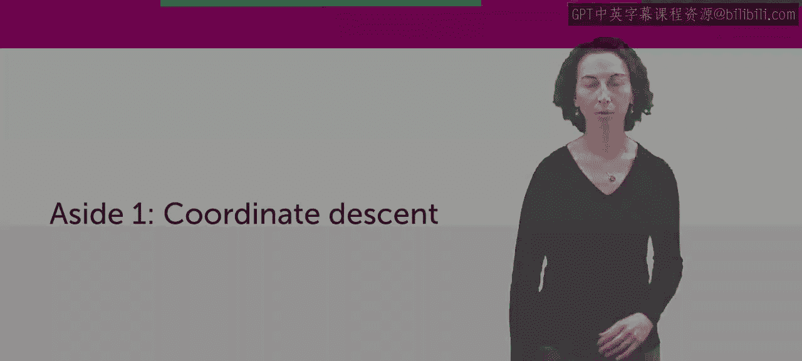
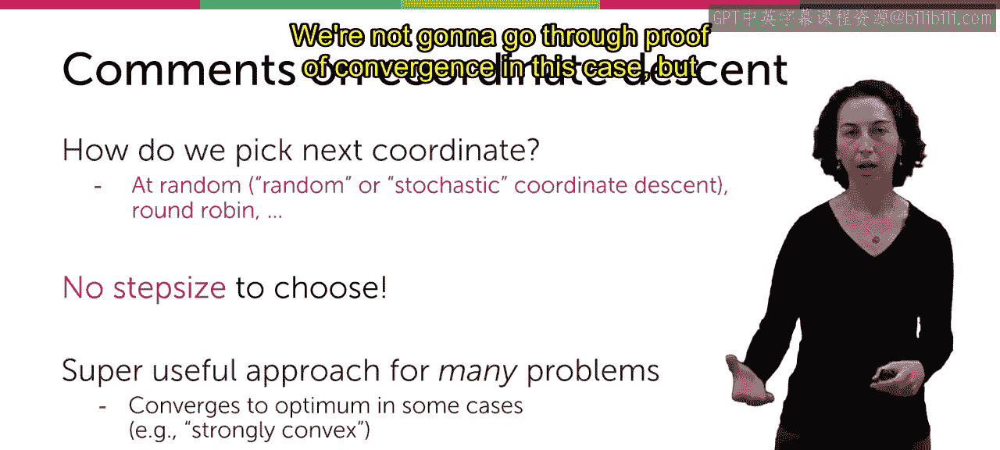
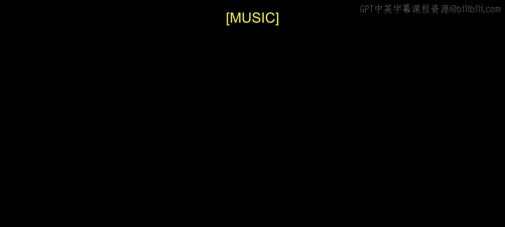

# 机器学习：第2课：坐标下降法


在本节课中，我们将学习一种重要的优化算法——坐标下降法。我们将首先介绍坐标下降法的基本概念和流程，然后详细说明如何将其应用于求解Lasso回归的目标函数。



## 概述

上一节我们讨论了梯度下降和次梯度下降。本节中，我们将介绍一种替代的优化方法：坐标下降法。这种方法的核心思想是，通过固定其他所有变量，每次只优化一个变量，从而将一个复杂的多变量优化问题转化为一系列简单的一维优化问题。

## 坐标下降法算法

我们的目标是最小化某个函数 **G(w)**，其中 **w** 是一个包含多个变量（**w₀, w₁, ..., w_D**）的向量。直接优化所有变量可能很困难，但固定其他变量，仅优化一个变量则相对简单。

以下是坐标下降法的基本步骤：

1.  **初始化**：初始化权重向量 **ŵ**，例如可以全部设为0，或采用其他更智能的初始化方法。
2.  **迭代优化**：当算法未收敛时，重复以下步骤：
    *   从所有坐标（0, 1, ..., D）中选择一个坐标 **j**。
    *   固定其他所有坐标的值（即使用前一次迭代得到的 **ŵ₀, ..., ŵ_{j-1}, ŵ_{j+1}, ..., ŵ_D**），仅针对第 **j** 个坐标进行优化。具体来说，我们寻找一个值 **ω**，使得函数 **G** 最小：
        ```
        ŵ_j = argmin_ω G(ŵ₀, ..., ŵ_{j-1}, ω, ŵ_{j+1}, ..., ŵ_D)
        ```
    *   将找到的最优 **ω** 值赋给 **ŵ_j**。
3.  **收敛判断**：持续循环，直到满足收敛条件。

## 算法图解

为了更直观地理解，我们以二维空间（**w₀, w₁**）为例：

*   首先，选择优化 **w₁** 坐标，同时固定 **w₀** 的值。这相当于在 **w₀** 固定的垂直线上寻找函数 **G** 的最小值点。
*   找到该点后，接下来选择优化 **w₀** 坐标，同时固定 **w₁** 为刚更新的值。这相当于在 **w₁** 固定的水平线上寻找最小值点。
*   如此交替进行，优化路径会呈现一系列沿坐标轴方向的移动，最终逼近全局最优点。

## 坐标选择策略

关于如何选择下一个要优化的坐标，有几种常见策略：

*   **循环坐标下降**：按固定顺序（如 0, 1, 2, ..., D）循环遍历所有坐标。
*   **随机坐标下降**：在每次迭代中随机选择一个坐标进行优化。

## 坐标下降法的特点

与梯度下降法相比，坐标下降法有几个重要的特点：

1.  **无需步长参数**：在坐标下降法中，我们直接求解每个一维子问题的最优解，因此不需要像梯度下降法那样手动设置或调整学习率（步长）。这简化了算法的使用。
2.  **收敛性保证**：对于某些类型的函数，可以证明坐标下降法能够收敛。例如，当目标函数是强凸函数时，算法保证收敛。更重要的是，对于我们将要应用的**Lasso回归**问题，坐标下降法也被证明是收敛的（尽管本课程不展开证明）。
3.  **广泛应用**：坐标下降法是一种非常实用的优化算法，适用于许多机器学习问题。

## 总结





本节课我们一起学习了坐标下降法。我们了解了其核心思想：通过**固定其他变量，轮流优化单个变量**，将复杂问题分解。我们介绍了算法的具体步骤，并通过二维示例图解了其工作原理。我们还讨论了坐标选择策略，并指出了坐标下降法**无需步长参数**以及对Lasso等问题具有**收敛保证**的优点。接下来，我们将具体探讨如何应用坐标下降法来求解Lasso回归的目标函数。