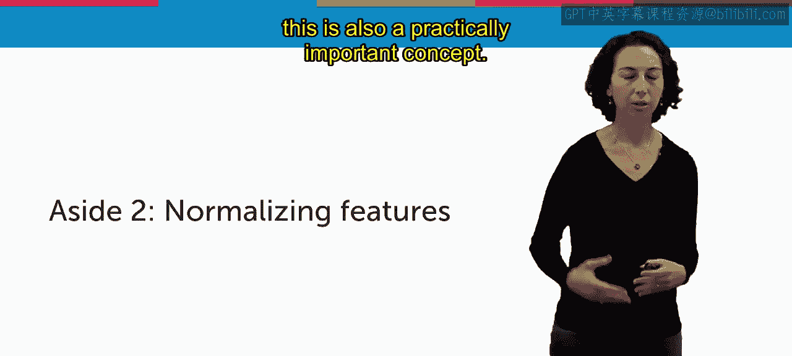
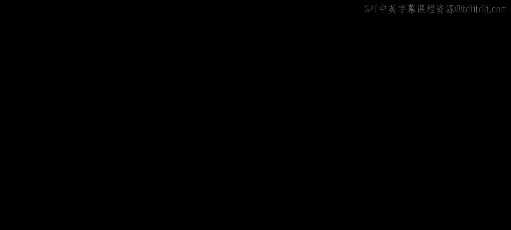
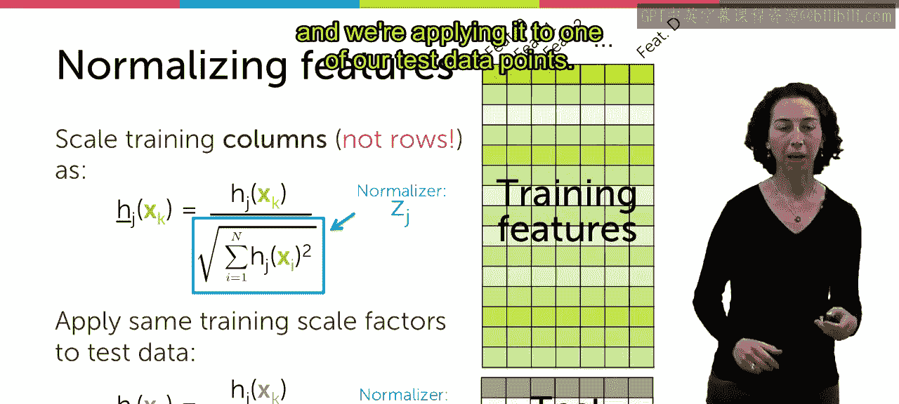

# 华盛顿大学《机器学习（回归，第2课⧸共4课）｜Machine Learning》中英字幕 p93 93_特征归一化.zh_en -BV11b421H7XL_p93-

。

Well， our presentation of coordinate asscent for Laso is really simplified if we think about normalizing our features。

 and this is also a practically important concept， so let's take a few minutes to discuss this idea of normalizing features。

Okay well when we talk about normalizing our features。

 what we're talking about is taking a column of our training data so very important that we take a column。

 not a row so I'll say it once more， we take a column。

 not a row because what does a column represent Well， for example。

 in our housing application right it might might represent all instances of the number of square feet of houses in our training data set So what we're going to do is we're going to do an operation on square feet that would be one column in contrast。

 if I took a row， we're going to be doing an operation for a specific observation and that operation would be different between different observations and then things would be all on different scales between our different observations and that wouldn't make any sense So please never do that please do this operation on columns of the training data and what's this operation we're going to do Well we're going to take our column our specific feature like square feet over our n different observations in our training set and we're going to normalize。

Each of these entries， each of these feature values by the following quantity。

 and doing this operation is going to place each one of our features into the same numeric range because the range of values we might see for square feet versus number of floors or number of bathrooms is dramatically different and after we do this transformation though everything will be in the same numeric range and so that's why it's a practically important transformation。

But I want to emphasize one thing that when you transform your features， when you normalize them。

In this way or any way that you choose to transform your features on your training data。

 you have to do exactly the same operation on your test dataset。

Otherwise you're going to be mixing up apples and oranges because if for example。

 you think about transforming your training data from measuring square feet to measuring square meters for every house。

 but then your test data is still in square feet when I learn a model on my training data which is now in square meters and I go to test it on my test data which is square feet。

 it's going to give me bogus answers okay so make sure you do the same operation on both training and test。

And so if we're going to call this normalizer， which we'll use this notation later， Zj。

We're going to divide by exactly the same quantity for each column。Of our test set。

 So this same ZJ appears here， where just emphasize we're summing over all of our training data points and doing。

This operation here， and we're applying it to one of our test data points。

🎼。