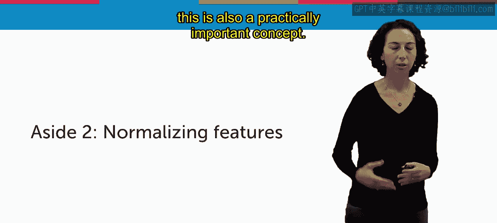
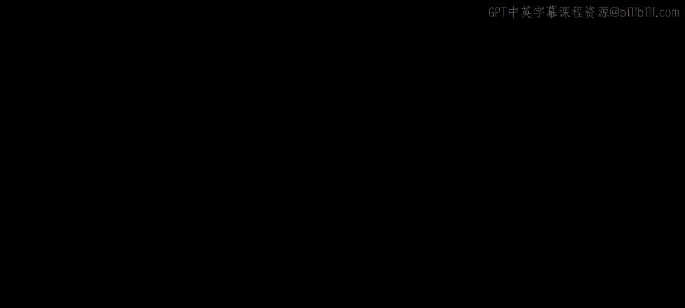
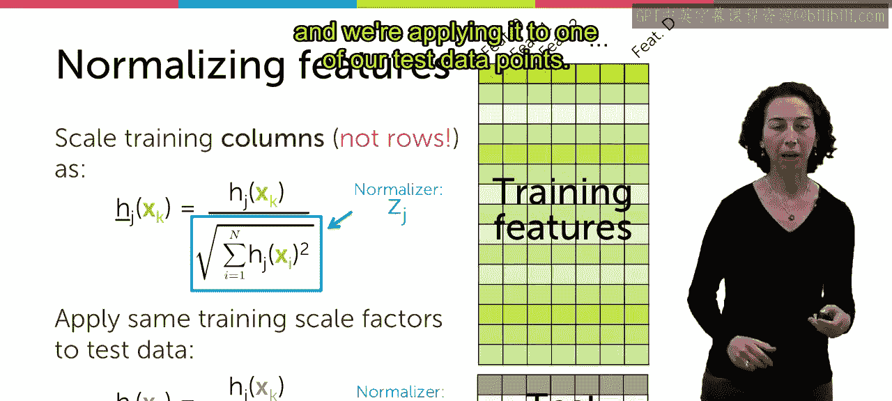

# 机器学习：第2课：特征归一化


在本节课中，我们将要学习一个在机器学习中非常实用且重要的概念——特征归一化。它不仅能简化某些算法（如Lasso回归的坐标上升法）的推导和实现，还能提升模型性能，确保不同尺度的特征能被公平对待。





## 概述：什么是特征归一化？

上一节我们介绍了Lasso回归等模型。本节中我们来看看如何通过特征归一化来简化问题并提升实践效果。

特征归一化指的是对数据集的**列**（即特征）进行缩放处理，使其落入一个相近的数值范围。例如，在房价预测中，“房屋面积”的数值可能高达数千，而“卧室数量”通常只是个位数。这种量级差异会影响许多机器学习算法的表现。

**核心操作是：我们必须对训练数据的每一列（特征）进行归一化，并且将完全相同的缩放操作应用到测试数据上。**

## 如何对特征进行归一化？

以下是特征归一化的标准步骤。其核心思想是计算每个特征的“尺度”或“范数”，然后用该特征的所有值除以这个尺度。

1.  **计算归一化因子（尺度）**：对于训练数据集中的第 `j` 个特征（即第 `j` 列），我们计算其归一化因子 `Z_j`。一个常见的方法是计算该特征所有值的平方和的平方根（即L2范数）。

    **公式**：
    ```
    Z_j = sqrt( sum_{i=1}^{n} (x_{i,j})^2 )
    ```
    其中，`x_{i,j}` 表示第 `i` 个训练样本的第 `j` 个特征值，`n` 是训练样本的总数。

2.  **归一化训练数据**：用训练数据中该特征的每一个值除以计算得到的 `Z_j`。

    **公式**：
    ```
    x_{i,j}^{(normalized)} = x_{i,j} / Z_j
    ```
    对所有训练样本 `i` 和特征 `j` 执行此操作。

3.  **归一化测试数据（关键步骤）**：当需要对新的测试数据进行预测时，必须使用**从训练数据计算得到的同一个 `Z_j`** 来对测试数据的相应特征进行归一化。

    **公式**：
    ```
    x_{test, j}^{(normalized)} = x_{test, j} / Z_j
    ```
    这里使用的 `Z_j` 与步骤1中计算出的值完全相同。

## 为什么必须对训练集和测试集使用相同的归一化因子？

这是一个至关重要的实践要点。如果我们用一套标准（例如，将面积从平方英尺转换为平方米）处理了训练数据，但测试数据却仍保持原始单位（平方英尺），那么模型在测试集上的预测将完全错误。模型从归一化后的数据中学到的规律，无法直接应用到未以同样方式处理的测试数据上。

**简而言之：必须保证训练阶段和测试/预测阶段的数据预处理管道完全一致。**

## 归一化带来的好处

*   **算法简化**：如课程开头所述，特征归一化后，Lasso回归的坐标上升法等算法的数学表达和实现会变得更加简洁清晰。
*   **公平比较**：将所有特征缩放到相近的范围，可以防止某些数值大的特征仅仅因为其尺度大而在模型中占据主导地位。
*   **提升性能**：对于依赖距离计算（如K近邻、支持向量机）或梯度下降的算法，归一化能显著加快收敛速度并提高模型精度。

## 总结



本节课中我们一起学习了特征归一化。我们明确了其定义：对数据特征的列进行缩放处理。我们掌握了其方法：基于训练集计算归一化因子，并统一应用于训练集和测试集。我们理解了其重要性：确保数据尺度一致，避免模型偏差，并简化算法实现。记住，在将任何预处理技术应用于测试数据时，都必须严格复用从训练数据中得出的参数，这是构建可靠机器学习工作流的基本原则。