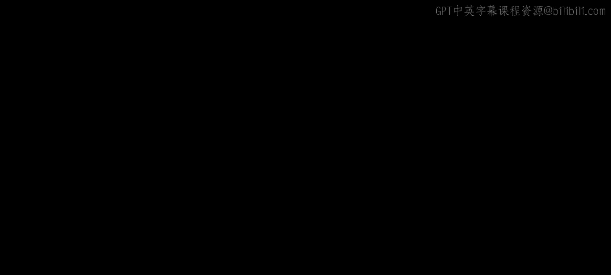
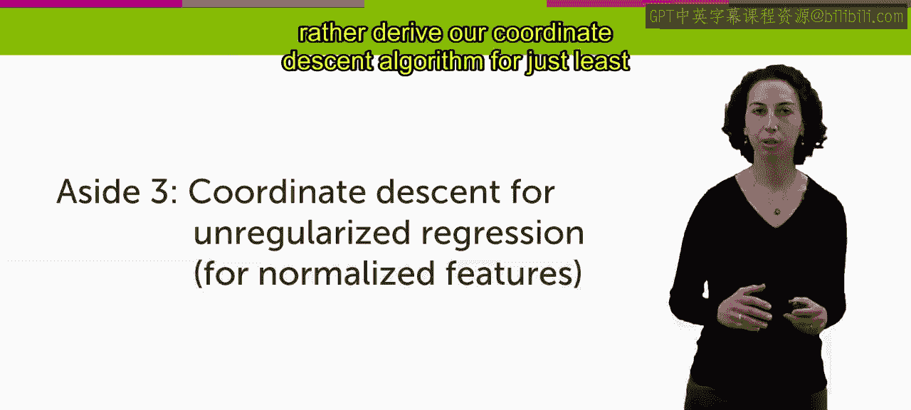
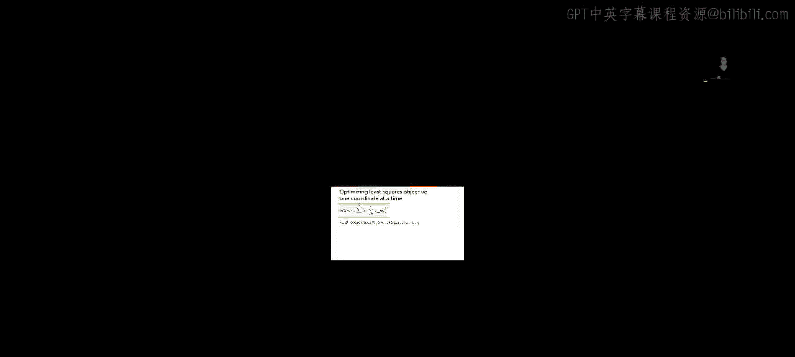
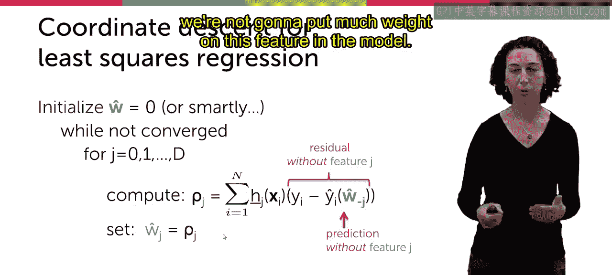

# 华盛顿大学《机器学习（回归，第2课⧸共4课）｜Machine Learning》中英字幕 p94 94_最小二乘回归的坐标下降法（归一化特征）.zh_en -BV11b421H7XL_p94-

。

As a last aside， before we get to our coordinate descent algorithm for Laso。

 let's first describe or rather derive our coordinate descent algorithm for just least squares regression using these normalized features that we just described。

So here's our least squares objective， which is just minimizing our residual sum of squares and when we derive our coordinatescent algorithm。

 remember that we're going to look at a specific variable Wj。

 we're going to hold all other variables fixed and we're going to optimize just with respect to WJ so what we're going to do is we're going to take the partial with respect to WJ and then think about setting that equal to0 to find the optimal value for Wj fixing everything else。

 So this is our statement of just our 1D optimization。Coordinate by coordinate。Okay。

 so let's write our partial with respect to WJ of our residual sumquas。

 and we've derived this in various forms multiple times in this course。

 so I'm not going to reeriveve it again。But I'm just writing it here and then we're going to manipulate this into the form that we need in this specific case。

 and I want to highlight though first before I move on that this underbar notation。

 it was actually introduced when we're talking about our normalized features。

 so these are our normalized features。That's what the underbar represents。

And so everything I'm doing here is in the context of normalized features。Okay。

 so we can rewrite this objective What I want do is I specifically want to pull out this WJ term。

 that's the term I'm solving for。 Everything else is assumed fixed。

 So when I'm thinking about my coordinate descent algorithm， I know the values of all the。Other WJs。

 I guess I should mention what this notation means like means this minus。J means。All WK for。

K not equal to J， so that's my shorthand saying I'm just taking my W vector and subtracting off。

 just removing from that that set， that that J element， WJ。Okay。

 I'll remove the circle so that I don't。Cover it up too much。Okay， so I'm assuming that W minus J。

 those numbers are known。 Those values are known at any given iteration of my algorithm。

 so I want to separate out Wj， which is my variable and solve for everything in terms of these other quantities。

 So let's do that。 So I have minus2 sum I equals 1 to n。H bar J of X I。

 and I'm just going to rewrite this as Y I。Minus sum over。K not equal to J。Of WK。H bar K of X I。

So that's everything except for WJ。 And I'm going to write the WJ term。

 the specific J that I'm looking at here separately。 So H bar J of X I。

And then I'm just going to multiply through。And so what I'm going to get is I'm going to get minus2 some i equals 1 to n。

H bar J X I。Times Y I minus sum K not equal to J W， K， H bar K X I。 So that's the first term。

 And then this minus sign and this minus sign are going to turn into a plus2。

 And then this sum over I。 Well， W J doesn't depend on I。 So that's going to come out。

 And then I'm going to have a sum I equals1 to n。And I have two HJs。

 I have Hj here multiplying this Hj here， so H bar J squared of X I。

Or just to match the notation we did before， I'll say hj of X I squared。

And my features are normalized。 So let me just switch to another color here。 Let's do purple。

What is the sum of the squared values of my normalized features？Well， by definition of normalization。

 this is equal to one。Fatures。This is equal to one。So。

 and the other thing I'm going to do is I'm going to define。This term here。Im just going。

Use this notation triangle equal， meaning I'm defining this notation， I'm going to call this rh J。

And the last thing I want to mention is this here。What is this term here？

I'm looking at this sum over all features not equal to J。Of WK times my feature K。Well。

 that's my predicted value of the Ithe observation if I excluded the Jth feature from the model。

So this is my predicted value without including this JF feature。Okay。

 well let's just rewrite what we've done。 so the result is we get minus2 rh J。Plus2 W J times 1。

 okay？So this is my partial with respect to WJ of my residual summit squares。

And what I'm going to do， like I said， is I'm going to set this partial equal to0。

 and I'm going to solve for W J。 so we get， remember when we set it equal to 0。

 we're going to start calling things W hat。 So these twos cancel out and very straightforwardly。

 I get W hat J equals row。Ze。Okay。So now I've derived my coordinate tocent algorithm。

And I'm showing this coordinate to send algorithm here so what we see is we just initialize our w hat to0 well not converge。

 we're just going to cycle through， we're doing round dropping here。

 cycling through each one of our coordinates， we're going to compute this row J term for given coordinatenet J。

And then we're simply going to set WHj equal to rh J。

So let's discuss this row J term and give a little intuition behind why we're setting W hatt J equal to row J。

Well what Ro J is doing is it's a measure of the correlation between our feature J and this residual between the predicted value。

 where remember that prediction was formed excluding that J feature from the model and the true observation。

 so we're looking at our prediction， the difference relative to the truth when J is not included in the model。

And then we're saying how correlated is that with the Jith feature and if that correlation is really high。

 so if they tend to agree。Then what that means is that Jith feature is important for the model and it can be added into the model and reduce the residuals。

So equivalently improve our predictions， so what this is going to mean is if these things tend to agree。

 row J is going to be really large high correlation， and we're going to set Wha J large。

 we're going to put a weight strongly on this feature being in the model。

 but in contrast if they're uncorrelated， if they don't tend to agree across observations or if the residuals themselves are already very small。

Because the predictions are already very good， then what it's saying is that W sorry ro J is going to be small and as a result。

 we're not going to put much weight on this feature in the model。

