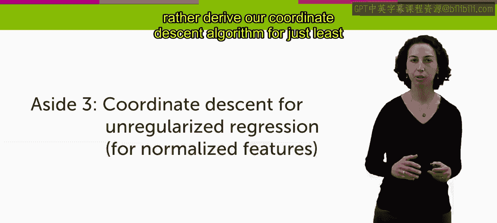
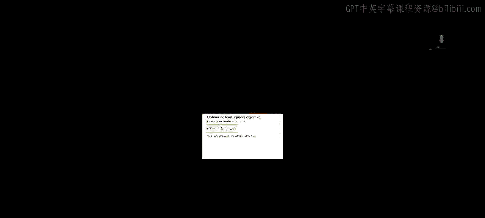
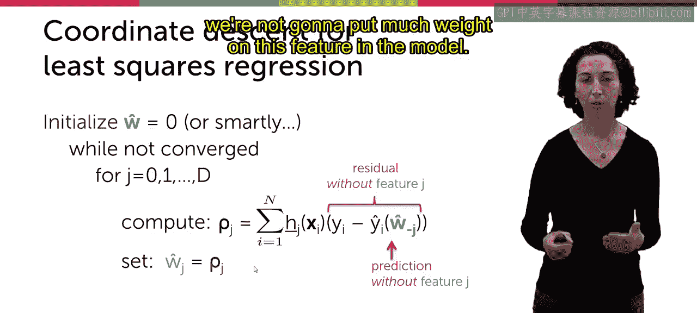

# 机器学习：第2课：最小二乘回归的坐标下降法（归一化特征）📊






在本节课中，我们将要学习一种用于最小二乘回归的优化算法——坐标下降法。我们将从归一化特征这一重要概念出发，逐步推导出算法的核心更新公式，并解释其背后的直观含义。

## 概述

上一节我们介绍了归一化特征的概念。本节中，我们来看看如何利用归一化特征，为最小二乘回归问题推导出坐标下降算法。坐标下降法的核心思想是：在优化多变量目标函数时，每次只优化一个变量，而固定其他所有变量，并循环迭代这一过程。

## 坐标下降法推导

我们的目标是最小化残差平方和（RSS）。在坐标下降法中，当我们针对特定变量 **Wj** 进行优化时，会固定所有其他变量 **W_{-j}**（即除 **Wj** 外的所有权重），然后求解使目标函数最小的 **Wj** 值。这本质上是一个一维优化问题。

以下是我们的最小二乘目标函数：
```
最小化：RSS(W) = Σ_{i=1}^{n} (y_i - Σ_{k=1}^{p} w_k * \bar{h}_k(x_i))^2
```
其中，**\bar{h}_k(x_i)** 表示第 **k** 个归一化特征。

为了求解最优的 **Wj**，我们对 **RSS** 关于 **Wj** 求偏导数，并令其等于零。

**RSS** 关于 **Wj** 的偏导数推导如下（注意，所有特征均已归一化）：
```
∂RSS/∂w_j = -2 * Σ_{i=1}^{n} \bar{h}_j(x_i) * [ y_i - Σ_{k≠j} w_k * \bar{h}_k(x_i) ] + 2 * w_j * Σ_{i=1}^{n} \bar{h}_j(x_i)^2
```

现在，我们定义两个关键量来简化这个表达式。

首先，根据归一化特征的定义，每个归一化特征的平方和等于1：
```
Σ_{i=1}^{n} \bar{h}_j(x_i)^2 = 1
```

其次，我们定义 **ρ_j**，它衡量了第 **j** 个特征与当前模型残差（在排除第 **j** 个特征的情况下计算）之间的相关性：
```
ρ_j = Σ_{i=1}^{n} \bar{h}_j(x_i) * [ y_i - Σ_{k≠j} w_k * \bar{h}_k(x_i) ]
```
其中，**Σ_{k≠j} w_k * \bar{h}_k(x_i)** 是在模型中排除第 **j** 个特征时对第 **i** 个观测值的预测值。

将这两个定义代入偏导数公式，我们得到：
```
∂RSS/∂w_j = -2 * ρ_j + 2 * w_j
```

令偏导数等于零以求解最优的 **w_j**（记作 **ŵ_j**）：
```
-2 * ρ_j + 2 * ŵ_j = 0
```

由此，我们得到坐标下降法的核心更新规则：
```
ŵ_j = ρ_j
```

## 算法步骤与直观理解

基于上述推导，我们可以总结出最小二乘回归的坐标下降算法。

以下是算法的主要步骤：
1.  **初始化权重**：将所有回归权重 **w** 初始化为0（或其他初始值）。
2.  **循环迭代**：重复以下步骤直至收敛。
3.  **遍历特征**：对于每一个特征 **j = 1, 2, ..., p**，执行以下操作：
    *   根据当前所有权重（**w_{-j}**）计算残差，即 **y_i - Σ_{k≠j} w_k * \bar{h}_k(x_i)**。
    *   计算相关性度量 **ρ_j**，即第 **j** 个归一化特征与上述残差的点积。
    *   将权重 **w_j** 更新为 **ρ_j**。

现在，我们来理解 **ρ_j** 的直观含义。**ρ_j** 度量了第 **j** 个特征与当前模型残差（在排除该特征时计算）的相关性。

*   如果 **ρ_j** 的绝对值很大（正或负），意味着该特征与当前模型未能解释的误差高度相关。因此，将该特征以相应的权重（**ŵ_j = ρ_j**）加入模型，可以有效地减少这些残差，从而显著改进预测。
*   如果 **ρ_j** 接近于零，则意味着该特征与当前残差不相关，或者当前模型的预测已经很好（残差本身很小）。因此，在模型中加入该特征不会带来多大改善，其权重也会被设得很小。

## 总结



本节课中我们一起学习了针对归一化特征的最小二乘回归坐标下降法。我们首先回顾了归一化特征，然后通过固定其他变量、对单一变量求导并令其为零的方法，推导出了核心更新公式 **ŵ_j = ρ_j**。最后，我们解释了 **ρ_j** 作为特征与残差相关性的直观意义，并概述了算法的迭代步骤。这个简单而有效的算法为理解后续更复杂的正则化回归（如Lasso）的坐标下降法奠定了重要基础。