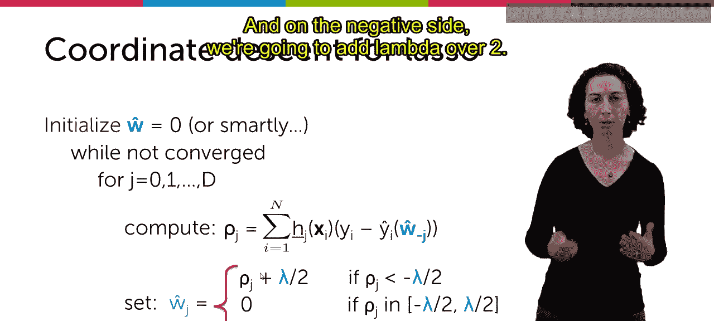
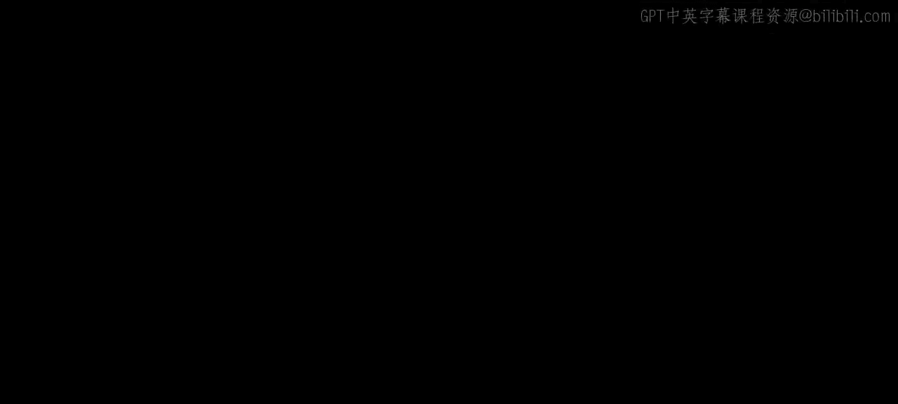
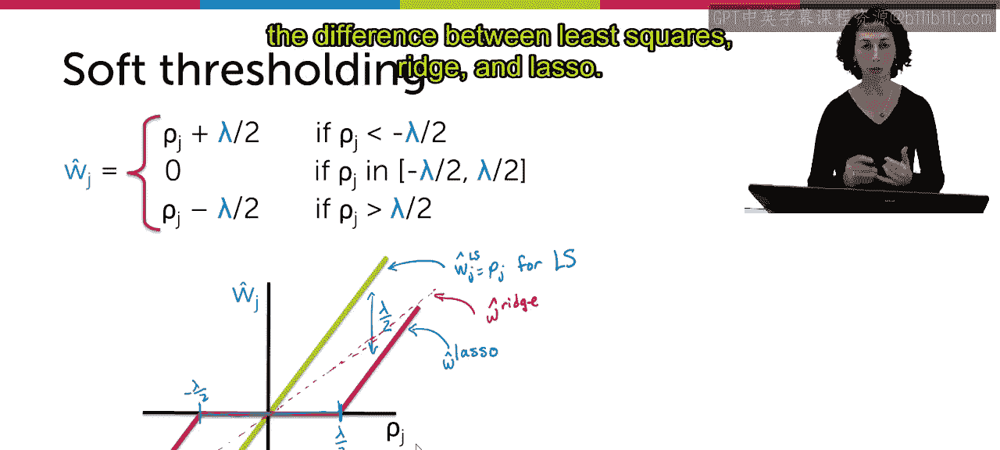
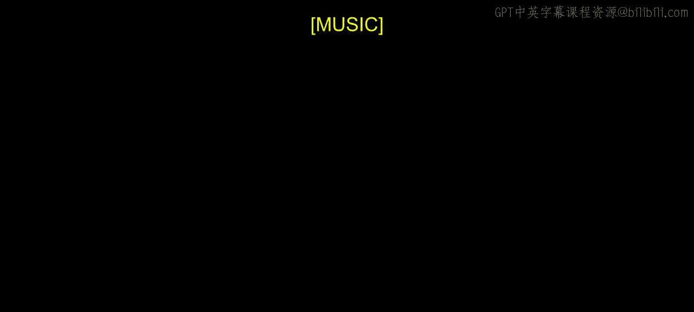

# 华盛顿大学《机器学习（回归，第2课⧸共4课）｜Machine Learning》中英字幕 p95 95_Lasso的坐标下降法（归一化特征）.zh_en -BV11b421H7XL_p95-

。

So now we're going to describe what the variant of this coordinate descent algorithm looks like in the case of Lasso。

 again we're going to be looking at these normalized features。And just remember。

 this is where we left off with our coordinate descent algorithm for just least squares unregularized regression。

 and remember the key point was that we set W hatch J equal to row J。

 this correlation between our features and the residuals from a prediction leaving J out of the model。

Well， in the case of Lasso， what we're going to do is how we set WHj is going to depend on the value of our tuning parameter lambmbda。

And how that relates to this roj correlation term。 So in particular， if roj is small。

 if it's in this minus lambda over2 to lambda over2 range， where again。

 what small means is determined by lambda。What we're going to do is we're going to set that W hadj exactly equal to zero。

And here we see the sparsity of our solutions coming out directly here。But in contrast。

 if roj is really large or on the flip side very small。

 what that means is that the correlation is either very positive or very negative。

 then we're going to include that feature in the model。

 just like we did in our least square solution， but relative to our least square solution。

 we're going to decrease the weight， so。In the positive case， if we have a strong correlation row J。

 instead of putting Whaj equal to rh J， we're going to set it equal to row J minus lambda over 2 and on the negative side we're going to add lambda over2 so let's look at this function of how we're setting Whaj visually。

Okay， well this operation that we're performing here in these Lasso updates is something that's called soft Thrholding。

 and so let's just visualize this and to do this， we're going to make a plot of ro J that correlation we've been talking about versus W Hat J are coefficient that we're setting。

And remember。In the least square solution， we set W hat J equal to row J。

For least squares and we can see that just setting lambda equal to0。

 remember lambda equals0 returns us to our least square solution。

 so I'll specifically write least squares there。So that's why we get this line， y equals x。

 this green line appearing here， so this represents。As a function of row J。

 how we would set WHj for least squares。And in contrast， this。

Fusion line here we're showing is for Lasso。And what we see is that in the range， lambda over two。

Or minus lambda over 2 to lambda over2。If this correlation is within this range。

Meaning that there's not much of a relationship between our feature and the residuals。

From predictions without feature J in our model， we're just going to completely eliminate that feature。

 we're going to set its weight exactly equal to zero。But if we're outside that range。

 we're still going to include the feature in the model。But we're going to shrink。

The weight on that feature relative to the least square solution， by an amount lambda over2。

So this is why it's called soft Thring and we're shrinking the solution everywhere。

And but we're strictly driving it to zero from minus lambda over  two to lambda over  two。

And I just want to mention to contrast with。Let me choose a color that we don't have here。

It red will work， I want to contrast with the Rige regression solution。Where you can show。

Which we're not going to do。Here， but you can show that the Rige regression solution。

Shrinks the coefficients。Everywhere， but never strictly to 0。 So this is the line。W hat Ridge。And。

Let me just write that this is W hat Lasso。Okay。So here we get a very clear visualization of the difference between least squares。

 Rige， and Lasso。

