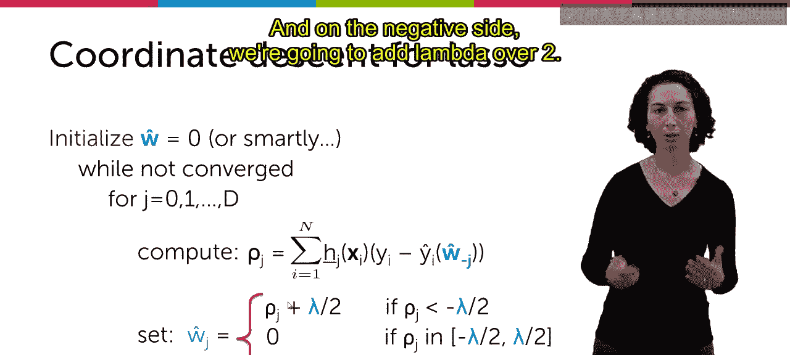
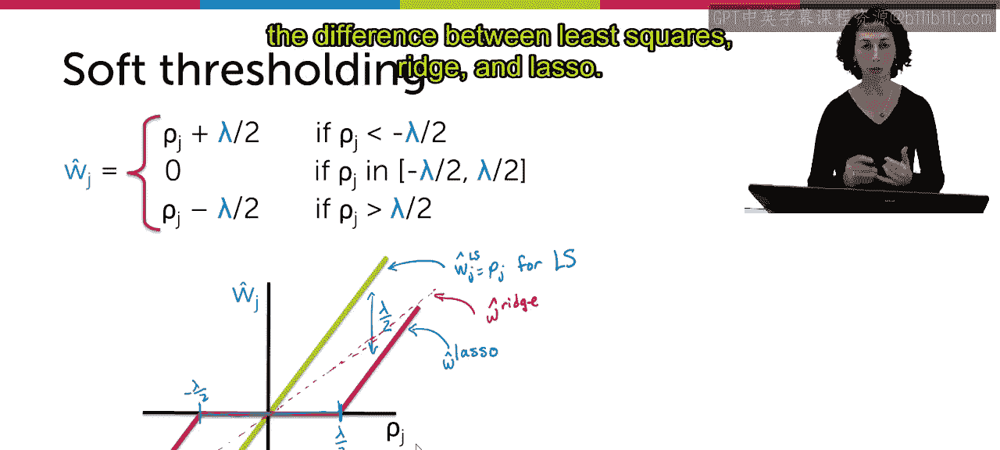

# 机器学习：第2课：Lasso的坐标下降法（归一化特征）📉

在本节课中，我们将学习Lasso回归的坐标下降算法，特别是当特征经过归一化处理时的情况。我们将看到Lasso如何通过一个称为“软阈值”的操作，在优化过程中自动进行特征选择，从而产生稀疏的模型解。

---

上一节我们介绍了普通最小二乘回归的坐标下降算法。本节中，我们来看看在Lasso回归中，这个算法是如何变化的。

我们继续讨论归一化特征的情况。回顾一下，在无正则化的最小二乘回归的坐标下降算法中，关键步骤是将权重系数 `W_hat_j` 设置为 `ρ_j`，即特征 `j` 与排除该特征后模型预测残差之间的相关性。

在Lasso的情况下，我们如何设置 `W_hat_j` 将取决于我们的调优参数 `λ` 以及它与相关性项 `ρ_j` 的关系。具体来说：

以下是Lasso坐标下降法中更新权重 `W_hat_j` 的规则：

*   **情况一：相关性较弱**
    如果 `ρ_j` 的值较小，即处于 `[-λ/2, λ/2]` 这个区间内（“小”的程度由 `λ` 决定），那么我们将直接把 `W_hat_j` 设置为零。
    公式表示为：`if |ρ_j| <= λ/2: W_hat_j = 0`
    这里我们直接看到了Lasso解稀疏性的体现。

*   **情况二：相关性较强（正相关）**
    如果 `ρ_j` 非常大（正相关很强），我们将把这个特征包含在模型中。但与最小二乘解相比，我们会减小其权重。
    公式表示为：`if ρ_j > λ/2: W_hat_j = ρ_j - λ/2`

*   **情况三：相关性较强（负相关）**
    如果 `ρ_j` 非常小（负相关很强），我们同样会包含该特征，并调整其权重。
    公式表示为：`if ρ_j < -λ/2: W_hat_j = ρ_j + λ/2`

让我们通过可视化来理解我们如何设置 `W_hat_j` 的这个函数。

---

这个在Lasso更新中执行的操作被称为**软阈值**。为了可视化它，我们绘制 `ρ_j`（我们讨论的相关性）与 `W_hat_j`（我们设置的系数）的关系图。

在最小二乘解中，我们设 `W_hat_j = ρ_j`。对于最小二乘法（可以看作是令 `λ = 0` 的Lasso特例），我们得到一条 `y = x` 的绿色直线。这条线代表了作为 `ρ_j` 的函数，我们如何为最小二乘法设置 `W_hat_j`。

相比之下，图中显示的这条蓝色折线是针对Lasso的。我们看到，在 `[-λ/2, λ/2]` 这个区间内，如果相关性在这个范围内，意味着特征 `j` 与残差之间没有太强的关系，我们将完全剔除该特征，将其权重精确设置为零。但是，如果相关性在这个范围之外，我们仍然会在模型中包含该特征，但相对于最小二乘解，我们会将该特征的权重收缩 `λ/2` 的量。

这就是它被称为“软阈值”的原因：我们在所有地方收缩解，但在 `[-λ/2, λ/2]` 区间内严格将其驱动为零。

我想用红色对比一下岭回归的解。可以证明（此处不展开），岭回归的解会收缩系数，但永远不会严格收缩到零。这是 `W_hat_Ridge` 的线。而蓝色的是 `W_hat_Lasso` 的线。

这样，我们就得到了最小二乘法、岭回归和Lasso之间差异的清晰可视化。

---

本节课中，我们一起学习了Lasso回归的坐标下降算法。核心在于，通过引入 `λ` 参数和软阈值操作，算法能够根据特征与残差的相关性 `ρ_j` 自动决定是否将特征权重设为零。当 `|ρ_j| <= λ/2` 时，权重归零，实现特征选择；当相关性较强时，权重被收缩为 `ρ_j ± λ/2`。这与始终收缩但永不置零的岭回归，以及完全不收缩的最小二乘法形成了鲜明对比，直观地展示了Lasso能产生稀疏模型的原因。