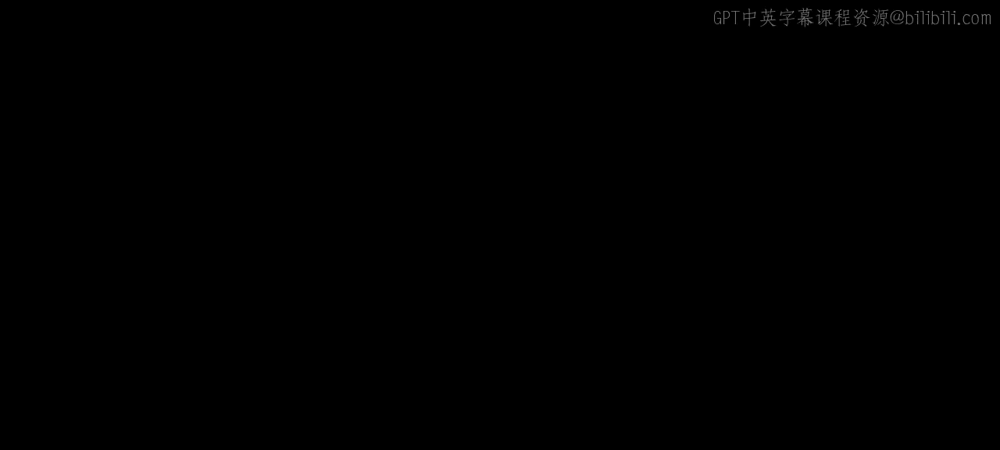
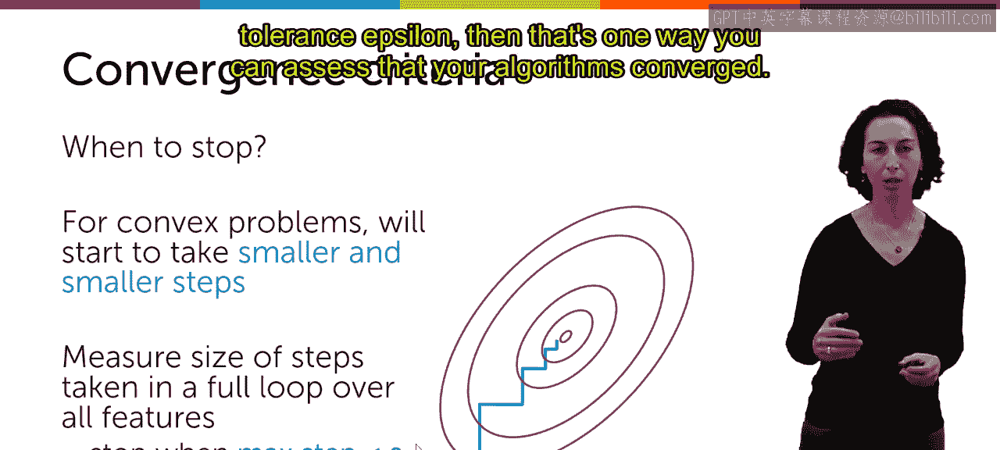
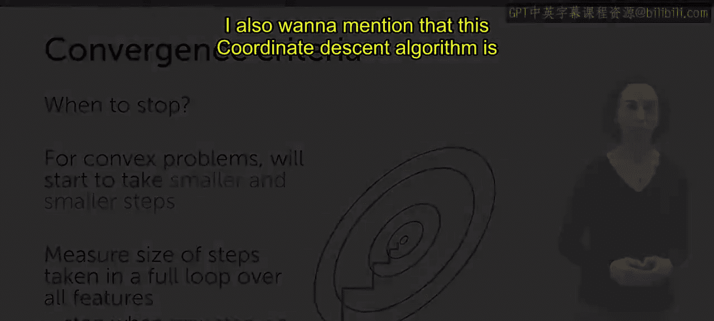
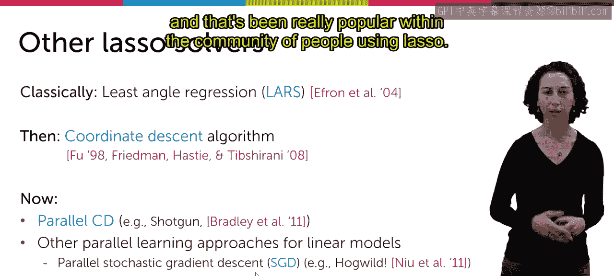

# 华盛顿大学《机器学习（回归，第2课⧸共4课）｜Machine Learning》中英字幕 p96 96_评估收敛性和其他Lasso求解器.zh_en -BV11b421H7XL_p96-

。

Well， in our coordinate descent algorithm for LaSO。

 and actually all of our coordinate descent algorithms that we've presented。

 we have this line that says while not converged， and a question is how are we assessing convergence？

Well， when should I stop in coordinate descent， ingredient descent。

 remember we're looking at the magnitude of that gradient vector and stopping when the magnitude of the vector was below some tolerance epsilon。

Well， here we don't have these gradient we're computing， so we have to do something else。

One thing we know though， is that for convex objectives。Our step size or not step size。

 the steps that we're taking as we're going through this algorithm are going to become smaller and smaller and smaller as we're moving towards our optimum。

 well at least in strongly convex functions we know that we're converging to our optimal solution。

And so one thing that we can do is we can measure the size of these steps that we're taking through a full cycle of our different coordinates。

 because I want to emphasize we have to cycle through all of our coordinates zero to D before judging whether to stop。

 because it's possible that one coordinate or a few coordinates might have small steps。

 but then you get to another coordinate and you still take a large step。

 but if over an entire sweep of all coordinates if the maximum step that you take。

In that entire cycle is less than your tolerance epsilon。

 then that's one way you can assess that your algorithms converged。

I also want to mention that this coordinate descent algorithm is just one of many possible ways of solving this LasO objective。

 so classically Lasso was solved using what's called Lars， lease angle regression and shrinkage。

And that was popular up until roughly 2008 when an older algorithm was kind of rediscovered and popularized。

 which is doing this coordinate descent approach for Lasso。

 but more recently there's been a lot a lot of activity in the area of coming up with efficient parallelized and distributed implementations of Lasso solvers。

 these include a parallel version of coordinate descent。

 other parallel learning approaches like parallel stochastic gradient descent or thinking about this kind of distributed and average approach that's fairly popular as well。

 and one of the most popular approaches specifically for Lasso is something called alternating direction method of multipliers or ADMM。

 and that's been really popular within the community of people using LaSO。

